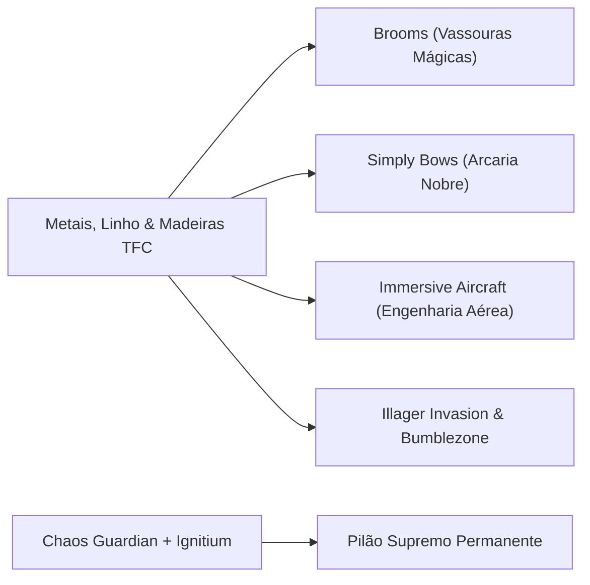

# 22 — Expansão v1.3.0: Aviação, Vassouras, Arcaria & Invasões

> **TerraFirmaCraft: Arcanum & Empires (NeoForge 1.21.1 — v1.3.0)**  
> **Script KubeJS:** `kubejs/server_scripts/22_expansion_v130_recipes_and_events.js`  
> **Total de Receitas Adicionadas:** 58  
> **Mecânicas Principais:** Aviação Dieselpunk do Create/TFC, Mobilidade Arcana com Vassouras, Arcaria Especializada, Invasões Rústicas e Pilão Permanente.

---

## 📑 Visão Geral da Expansão v1.3.0
A atualização **v1.3.0 ("A Fratura Dimensional & Fronteiras Cósmicas")** unifica os ecossistemas de transporte aéreo, combate à distância e magia aos metais, madeiras e fibras do TerraFirmaCraft.

---

## 1. 🧹 Mobilidade Arcana: Vassouras Mágicas (*Magic Brooms*)

As vassouras mágicas são veículos aéreos leves movidos pelo fluxo de mana do Ars Nouveau e integrados à carpintaria do TFC.

### 1.1 Bancadas e Suportes de Manutenção
* **Suporte de Vassouras (`brooms:broom_rack`):**  
  `3x Tábuas TFC (#tfc:lumber) + 1x Vara de Madeira (#c:rods/wooden) + 2x Tábuas laterais`.
* **Bancada de Modificação (`brooms:broom_workbench`):**  
  `3x Chapas de Ferro Forjado TFC (#c:sheets/wrought_iron) + 2x Tábuas TFC + 1x Bancada de Trabalho TFC (#tfc:workbenches)`.
* **Mesa de Pergaminhos (`brooms:scroll_table`):**  
  `3x Tábuas TFC + 1x Livro + 2x Linhas de Costura TFC (#tfc:sewing_threads)`.

### 1.2 Vassoura Mágica Básica
* **Vassoura Mágica (`brooms:broom_magic`):**  
  `2x Tábuas TFC + 1x Linha de Costura TFC + 1x Palha TFC (tfc:straw) + 1x Fonte de Gemas (ars_nouveau:source_gem)`.

### 1.3 Linhagens Elementais & Upgrades
As vassouras elementais utilizam a essência elemental do Ars Nouveau combinada à vassoura mágica básica:
- 🔥 **Vassoura Ígnea (`brooms:broom_fire`):** `1x Vassoura Básica + 1x Essência de Fogo (ars_nouveau:fire_essence)`.
- ❄️ **Vassoura de Gelo (`brooms:broom_ice`):** `1x Vassoura Básica + 1x Essência de Água (ars_nouveau:water_essence)`.
- ⚡ **Vassoura dos Raios (`brooms:broom_lightning`):** `1x Vassoura Básica + 1x Essência de Ar (ars_nouveau:air_essence)`.
- 🌊 **Vassoura das Marés (`brooms:broom_tide`):** `1x Vassoura Básica + 1x Essência de Manipulação (ars_nouveau:manipulation_essence)`.
- 🌿 **Vassoura do Bosque (`brooms:broom_grove`):** `1x Vassoura Básica + 1x Essência da Terra (ars_nouveau:earth_essence)`.
- 🌌 **Vassoura do Vazio / Ender (`brooms:broom_ender`):** `1x Vassoura Básica + 1x Pérola do End (minecraft:ender_pearl)`.
- 👑 **Variantes Aprimoradas (`_upgraded`):** Transmutação da vassoura elemental com `1x Chapa de Ouro TFC (#c:sheets/gold) + 1x Essência Arcana de Nível Superior`, elevando velocidade terminal e aceleração vertical.

---

## 2. 🏹 Arcaria Especializada (*Simply Bows*)

Para superar o combate padrão sem perder a fidelidade rústica, os arcos do *Simply Bows* foram recalibrados com peças estruturais do TFC:

### 2.1 Componentes de Armaria
* **Armação Reforçada (`simplybows:reinforced_bow_frame`):**  
  `1x Tora TFC (#tfc:firepit_logs) + 2x Chapas de Bronze TFC (#c:sheets/bronze) + 2x Varas de Madeira`.
* **Corda Encantada (`simplybows:enchanted_bow_string`):**  
  `3x Fios de Seda / Linho TFC (#tfc:sewing_threads) + 2x Fragmentos de Ametista + 2x Pó de Redstone`.
* **Molde de Arco Longo (`simplybows:bow_large_template`):**  
  `3x Tábuas TFC (#tfc:lumber) + 2x Fibras Rústicas (#tfc:corals_or_fibers)`.

### 2.2 Arcos Elementais & Nobres
| Arco | Insumos Principais na Bancada | Efeito & Especialidade |
| :--- | :--- | :--- |
| 🐝 **Bee Bow** | Armação + Corda + Favos e Ferrão do *Bumblezone* | Dispara flechas tóxicas e atordoa alvos |
| 🌸 **Blossom Bow** | Armação + Corda + Flores Silvestres TFC | Regeneração de aliados em área ao acertar |
| 🫧 **Bubble Bow** | Armação + Corda + Sacos de Tinta Brilhante | Confinamento de alvos em bolhas aquáticas |
| 🧊 **Ice Bow** | Armação + Corda + Gelo Compacto TFC / Essência de Gelo | Congelamento severo e lentidão extrema |
| 🪨 **Earth Bow** | Armação + Corda + Rocha Negra TFC / Basalto | Dano perfurante massivo com tremor de terra |
| 🌿 **Vine Bow** | Armação + Corda + Vinhas TFC | Enraíza inimigos e impede esquiva do Better Combat |
| 🦇 **Echo Bow** | Armação + Corda + Fragmento de Eco (Deep Dark TFC) | Perfura armaduras e paredes com pulso sônico |
| 🌌 **Cosmic Bow** | Armação + Corda + Lingote de Aço Negro TFC + Celestina | Disparo hipersônico de precisão cirúrgica |

---

## 3. ✈️ Engenharia Mecânica & Aviação (*Immersive Aircraft*)

A aviação do modpack é tratada como ápice da engenharia mecânica da Era do Aço TFC em conjunto com o *Create*.

### 3.1 Motores e Propulsão
* **Caldeira Industrial (`immersive_aircraft:boiler`):**  
  `Chapas de Bronze TFC (#c:sheets/bronze) + Barril TFC (#tfc:barrels) + Fornalha/Boca de Fogo TFC`.
* **Caldeira de Alta Pressão (`immersive_aircraft:steel_boiler`):**  
  `Chapas de Aço TFC (#c:sheets/steel) + Caldeira Básica + Tubos de Cobre Create`.
* **Motor a Vapor Clássico (`immersive_aircraft:engine`):**  
  `Chapas de Ferro Forjado + Engrenagens Grandes do Create + Caldeira`.
* **Motor Ecológico / Eólico (`immersive_aircraft:eco_engine`):**  
  `Chapas de Latão (Brass) + Motor + Algas Secas TFC + Carcaça Mecânica Create`.
* **Motor do Nether (`immersive_aircraft:nether_engine`):**  
  `Motor a Vapor + Tijolos do Nether + Obsidiana TFC + Pó de Blaze`.

### 3.2 Cascos e Componentes
* **Casco de Madeira Rústica (`immersive_aircraft:hull`):**  
  Construído com 6x Tábuas TFC e 1x Lingote de Ferro Forjado.
* **Reforço de Casco (`immersive_aircraft:hull_reinforcement`):**  
  2x Chapas de Aço TFC + 2x Chapas de Bronze TFC.
* **Vela Reforçada (`immersive_aircraft:sail`):**  
  3x Tecidos de Juta ou Linho TFC (#tfc:sewing_threads / tecidos).
* **Hélices Simples e Aprimoradas:**  
  Moldadas com Chapas de Ferro Forjado ou Aço TFC batidas na bigorna.
* **Aviônica (Giroscópio, Telêmetro e HUD):**  
  Integrados com Tubos de Latão Create, Bússola e Vidro Soprado TFC.

### 3.3 Aeronaves Montadas
1. 🛩️ **Biplano (`immersive_aircraft:biplane`):** Casco de madeira, 2x asas de linho TFC, motor a vapor e trem de pouso reforçado.
2. 🎈 **Dirigível (*Airship*):** Grande balão de tecido impermeabilizado com resina vegetal TFC, motor e gôndola.
3. 🚢 **Dirigível de Carga (*Cargo Airship*):** Casco reforçado com aço TFC, 4x baús de carga e motor de alta cilindrada.
4. 🚁 **Girodino (*Gyrodyne*):** Fuselagem compacta para exploração geológica rápida de relevos montanhosos.
5. 🛸 **Quadricóptero (*Quadrocopter*):** 4 rotores de latão Create para voo pairado em minerações e escavações.
6. ⚔️ **Navio de Guerra (*Warship*):** Casco de Aço Negro TFC equipado com baia de bombas (`bomb_bay`), canhão rotativo (`rotary_cannon`) e balestra pesada (`heavy_crossbow`).

---

## 4. 📯 Invasões, Alianças & Bumblezone

* **Chifre da Visão (`illagerinvasion:horn_of_sight`):**  
  Forjado com `1x Chifre de Cabra + 2x Chapas de Ouro TFC + 2x Essências Arcanas`. Alerta a aproximação de frotas de saqueadores.
* **Mesa de Imbuimento (`illagerinvasion:imbuing_table`):**  
  `3x Tábuas TFC + 2x Chapas de Ferro Forjado TFC + 1x Livro Encantado`. Permite canalizar maldições e poções em armas brancas.
* **Lança de Ferrão (`the_bumblezone:stinger_spear`):**  
  `2x Ferrões de Abelha Rainha + 1x Vara de Madeira TFC`. Penetra escudos e aplica lentidão química.

---

## 5. 👑 Pilão Supremo Permanente (*Endgame*)

O **Pilão de Infusão Supremo (`pylons:infusion_pylon`)** foi revisado na v1.3.0 para fomentar a economia e comércio entre vilas e jogadores:
* **Receita Especial:**  
  `2x Estilhaços do Caos (Chaos Shard) + 1x Coração do Dragão (Dragon Heart) + 2x Lingotes de Ignitium + 4x Blocos de Aço Negro TFC`.
* **Propriedade Permanente (`.keepIngredient`):**  
  Ao forjar o Pilão Supremo, **o Coração do Dragão NÃO É CONSUMIDO**, retornando imediatamente ao inventário do ferreiro.
* **Impacto no Multijogador:**  
  O jogador ou guilda que abate o Dragão pode atuar como ferreiro central do reino, cobrando tributos ou contratos mercenários do Millénaire para forjar Pilões para vilas vizinhas sem perder seu troféu primordial.
