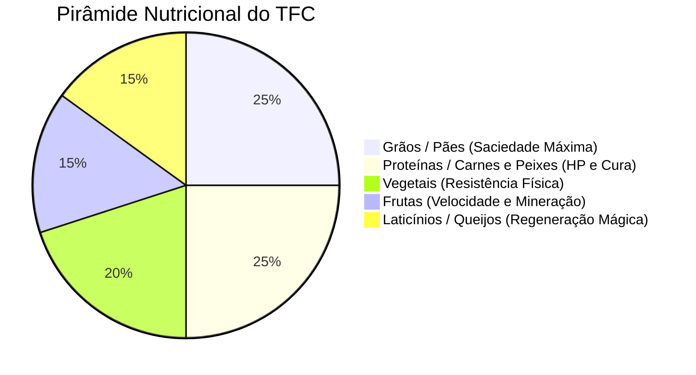

# 🍳 Guia Mestre: Cozinha, Gastronomia & Culinária TFC

> *Sobreviver no TFC: Arcanum & Empires não é apenas comer para não morrer de fome. O modpack integra a **nutrição profunda de 5 grupos alimentares do TerraFirmaCraft**, a culinária do **Farmer's Delight** adaptada aos metais da forja, as infusões de ervas medicinais do **HerbalBrews** e a conservação com sal marinho.*

---

## 🥗 Os 5 Grupos Nutricionais do TerraFirmaCraft

Manter uma dieta variada e equilibrada aumenta a sua **Vida Máxima (de 1000 para até 3000 HP)**, acelera a cura e concede bônus permanentes de resistência física e mágica:



| Grupo Nutricional | Fontes Comuns no Mundo | Bônus ao Manter a Barra Alta |
|---|---|---|
| 🌾 **Grãos (Grains)** | Trigo, Cevada, Centeio, Arroz, Milho e Aveia | Aumenta a saciedade total e retarda a fome |
| 🥩 **Proteínas (Proteins)** | Carne bovina, suína, carneiro, frango, caça (*Venison*) e peixes | **Aumenta a vida máxima (HP)** e acelera a regeneração de feridas |
| 🥕 **Vegetais (Vegetables)** | Cenouras, batatas, repolho, cebola, alho, abóbora e pimentão | Concede resistência física contra ataques cortantes e concussão |
| 🍎 **Frutas (Fruit)** | Maçãs, bagas silvestres, pêssegos, laranjas, bananas e ameixas | Aumenta a velocidade de movimento e pressa ao minerar (*Haste*) |
| 🧀 **Laticínios (Dairy)** | Leite fresco ordenhado, queijos curados em barril | Aumenta a resistência mágica e acelera a regeneração de Mana |

---

## 🍳 Utensílios de Cozinha & Fontes de Calor Integradas

### 1. Panela de Cozimento (Cooking Pot — Farmer's Delight Adaptada)
*A panela foi totalmente convertida para exigir forjamento em metalúrgica do TFC:*

- **Receitas de Forjamento:**
  - Versão Ferro Forjado: `farmersdelight:cooking_pot` feita com Tijolos de Argila e Lingotes de Ferro Forjado (`tfc:metal/ingot/wrought_iron`).
  - Versão Ferro Fundido: Feita com Lingotes de Ferro Fundido (*Cast Iron*).
- **Fontes de Calor Compatíveis no TFC:** A panela pode ser posicionada sobre:
  - Fogueira TFC (`tfc:firepit`), Fogueira com grelha (`tfc:campfire`), Braseiro de Forja a Carvão (`tfc:charcoal_forge`), Bloomery e Cadinhos incandescentes.
- **Pratos Notáveis:** Ensopados densos, Arroz carreteiro com legumes, Massas artesanais e Caldos nutritivos que combinam múltiplos grupos em uma só tigela.

---

### 2. Tábua de Corte (Cutting Board) & Filetagem
- **Receita TFC:** Criada na bancada combinando 2× Gravetos e 2× Tábuas de Madeira TFC (`#tfc:lumber`).
- **Uso com Facas do TFC:** Qualquer faca de pedra, bronze ou ferro do TFC (`#c:tools/knife`) funciona diretamente sobre a tábua de corte.
- **Processos de Corte:**
  - **Filetagem de Peixes:** Robalo (*Bass*), Bagre (*Catfish*), Peixe-pescador e Carpas Koi cortados rendem 2× Filés de Peixe Cru.
  - **Cortes de Açougue:** Carne Bovina vira Carne Moída; Carne Suína vira tiras de Bacon; Frango vira Cortes de Frango desossados.

---

### 3. Frigideira (Skillet) & Salteados
- **Receita TFC:** Forjada com 3× Lingotes de Ferro Forjado TFC e um cabo de graveto.
- **Uso:** Cozinha carnes e ovos em alta velocidade. Segurar o botão direito empunhando a frigideira permite preparar refeições em acampamentos ao lado de qualquer fogueira rápida.

---

### 4. Chaleira de Cobre (HerbalBrews: Copper Tea Kettle)
- **Receita TFC:** Forjada na bigorna com **Chapas de Cobre (*Copper Sheets*)** e gravetos.
- **Infusões & Cafés:** Ferva água potável com folhas de chá ou grãos tostados para criar chás medicinais que removem lentidão, concedem foco mental e aumentam a velocidade de corrida.

---

## 🧂 Métodos de Preservação de Alimentos contra Apodrecimento (*Decay*)

No TFC, todos os alimentos orgânicos apodrecem com o passar dos dias. A carne fresca dura pouco tempo no calor do verão. Utilize estas técnicas para criar estoques eternos:

### 1. Salga com Sal Marinho (*Salt Curing*)
- **Como Obter Sal:** Encha um **Pote Cerâmico (*Ceramic Pot*)** com água salgada do mar e ferva-o sobre a fogueira até a água evaporar completamente. O resíduo no fundo é o puro **Pó de Sal (*Powder/Salt*)** do TFC.
- **Salga Imediata:** Combine Carne Crua ou Filé de Peixe Cru com Sal na bancada. A carne curada salgada tem sua vida útil aumentada em **mais de 4×**.

### 2. Potes Cerâmicos Selados (Sealed Ceramic Vessels)
- Crie um vaso cerâmico grande e queime-o no Pit Kiln.
- Guarde até 4 pilhas de comida no interior e sele o pote com cera ou tampa hermética.
- **Efeito:** Reduz a taxa de decaimento microbiano em **90%**, permitindo guardar grãos e queijos por anos inteiros in-game sem estragar.

### 3. Adegas Frias & Casas de Gelo (*Ice Houses*)
- Construa uma câmara subterrânea sem janelas, revestida com paredes duplas de madeira e chão de terra batida.
- Posicione blocos de gelo compacto colhidos nos picos nevados do *Frostmaw*.
- A temperatura interna cairá para perto de 0 °C, mantendo carnes e frutas frescas durante todo o verão escaldante.

---

## 🥪 A Arte dos Sanduíches & Saladas Nutritivas

A refeição suprema do explorador no TFC é o **Sanduíche Composto**:

```
Como Montar o Sanduíche Perfeito:
[ Pão Assado TFC ] + [ Carne Grelhada ] + [ Vegetal 1 (Tomate) ] + [ Vegetal 2 (Cebola) ] + [ Queijo Curado ]
           ➔ Rende 1x Sanduíche Lendário que preenche os 5 Grupos Nutricionais!
```

- **Vantagem de Peso & Inventário:** Um único sanduíche pesa pouco na mochila e recupera nutrientes de grãos, carnes, vegetais e laticínios simultaneamente, poupando espaço de inventário em expedições às Cidades Ancestrais e masmorras do End!
