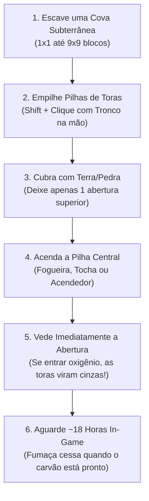

# 🏗️ Guia Mestre: Estruturas Multiblocos do Ecossistema TFC

> *No TerraFirmaCraft: Arcanum & Empires, a era dos blocos mágicos de uma única peça acabou. Para fundir metais avançados, produzir carvão vegetal em escala industrial, viajar entre dimensões e defender reinos, o jogador precisa erguer **estruturas físicas tridimensionais (Multiblocos)**.*

---

## 🗺️ Índice de Estruturas Multibloco

| Multibloco | Era / Tier | Dimensões | Função Principal |
|---|---|---|---|
| **Charcoal Pit** | Idade da Pedra | 1×1×1 até 9×9×9 | Carbonização em massa de toras em Carvão Vegetal |
| **Bloomery** | Idade do Bronze | 2×2 na base, altura de 3 a 5 | Queima de minério de ferro em Esponja de Ferro (*Raw Bloom*) |
| **Blast Furnace (Alto-Forno)** | Idade do Ferro / Aço | Coluna vertical 3×3 | Fusão de Ferro Gusa (*Pig Iron*) e Aço a >1500 °C |
| **Ward Pylons (Pilões de Defesa)** | Era Arcana | 3×3 com pilar central | Supressão de monstros, cura e safezone de aldeias |
| **Portal do Undergarden** | Ato III — Submundo | Moldura vertical 4×5 | Acesso à dimensão do The Undergarden com tijolos TFC |
| **Portal do End de Aço Negro** | Ato VI — Fim dos Tempos | Círculo ritual 5×5 | Ativação do The End com molduras de Aço Negro |
| **Trip Hammer & Moagem Mecânica** | Era Mecânica (Powered TFC) | Eixo rotacional 3×2×4 | Forjamento automático e desfibramento com energia hídrica |

---

## 1. Charcoal Pit (O Carbonizador Subterrâneo em Massa)
*A espinha dorsal de combustível para a forja e metalurgia do TFC.*

### Especificações & Dicas:
- **Alimentação:** Cada bloco de *Log Pile* comporta até **16 toras de madeira**.
- **Regra do Vácuo:** Se qualquer bloco de ar tiver contato com o fogo, a estrutura queima até virar fumaça e você obtém apenas cinzas inúteis (*Wood Ash*).
- **Rendimento:** Cada tora rende entre **1 a 2 Carvões Vegetais TFC** (`tfc:wood/charcoal`).

---

## 2. Bloomery (O Alto-Forno Primitivo de Ferro Esponja)
*A transição da Idade do Bronze para a Idade do Ferro Forjado.*

### Como Construir a Estrutura:
1. **Base da Câmara:** Crie uma base quadrada de **2×2 blocos** utilizando Tijolos de Pedra (*Stone Bricks*) ou Blocos Refratários.
2. **Chaminé Vertical:** Eleve as paredes por mais **2 a 3 blocos de altura**, formando uma coluna oca com interior de 2×2.
3. **Instalação do Tuyere & Fole:**
   - Instale um **Tuyere de Cerâmica ou Bronze** na base lateral da chaminé.
   - Posicione o **Fole (Bellows)** apontado diretamente para a traseira do Tuyere.
4. **Porta de Extração:** A parte frontal da base deve ser fechada com blocos temporários de terra ou tijolos soltos.

### Operação & Combustão:
- **Carga (Proporção 1:1):** Alterne camadas de **8 Minérios de Ferro** (Hematita, Magnetita ou Limonita) e **8 Carvões Vegetais**. A capacidade máxima varia de 24 a 32 minérios por fornada.
- **Ignição:** Jogue uma tocha acesa ou use o acendedor pelo topo da chaminé.
- **Bombeamento:** Acione o fole ritmicamente para manter a temperatura acima de **1200 °C**.
- **Produto Obtido:** O minério não se funde em líquido! Ele se aglomera na forma de uma **Esponja de Ferro Crua (*Raw Iron Bloom*)**.
- **Processamento:** Quebre a porta frontal, retire a esponja com pinças e leve-a **imediatamente para a Bigorna** enquanto estiver com calor *Bright Red* para bater com o martelo e transformá-la em lingotes de Ferro Forjado.

---

## 3. Blast Furnace (O Alto-Forno Industrial TFC para Aço)
*A mais avançada obra de engenharia térmica do TFC: atinge temperaturas superiores a 1500 °C para a produção de Ferro Gusa e Aço.*

### Componentes Exigidos:
- **Tijolos Refratários (*Firebricks*):** Produzidos com argila refratária cozida no Pit Kiln.
- **Chapas de Ferro Forjado (*Wrought Iron Sheets*):** Revestem externamente o forno para suportar a pressão interna.
- **Cadinho de Grafite (*Crucible*):** Posicionado na base inferior para coletar o metal líquido.
- **Tuyere de Ferro & Fole Mecânico:** Garante o fluxo contínuo de ar sob alta pressão.

### Procedimento para Obtenção de Aço (*Steel*):
1. **Adição de Fluxo:** Adicione **Pó de Fluxo (*Flux*)** (mármore ou calcário moído no Quern) na proporção de 1 fluxo para cada 4 minérios.
2. **Fundição em Ferro Gusa (*Pig Iron*):** O minério derrete completamente e escorre para o cadinho na forma de Ferro Gusa líquido com alto teor de carbono.
3. **Refino em Aço:** O Ferro Gusa líquido é vertido em moldes de lingote e depois reaquecido na Charcoal Forge na presença de fluxo de soldagem e batido na bigorna para expulsar o excesso de carbono, gerando o verdadeiro **Aço TFC**.

---

## 4. Ward Pylons (Pilões Arcanos de Proteção Territorial)
*Monólitos sagrados erguidos nos arredores de aldeias do Millénaire e bases fortificadas para repelir as trevas.*

- **Estrutura Básica:** Base de 3×3 blocos de Pirita ou Basalto Talhado, sustentando um pilar vertical de 3 blocos de altura com o **Catalisador Arcano** no ápice.
- **Efeito de Supressão Noturna:** Em um raio de **64 blocos**, monstros noturnos agressivos (Zumbis do Caos, Dread Hounds e Esqueletos Decrépitos) são repelidos ou desintegrados ao entrar no perímetro.
- **Imunidade contra a Lua de Sangue:** Cidades protegidas por Pilões de Grau 3 não sofrem invasões de hordas durante o eclipse lunar.

---

## 5. Portais Dimensionais Multibloco

### Portal do The Undergarden (O Submundo Fúngico)
- **Construção:** Uma moldura vertical de **4×5 blocos** (com vão livre de 2×3) feita exclusivamente com **Tijolos de Pedra do TFC** (*TFC Stone Bricks*).
- **Ativação:** Utilize o **Undergarden Catalyst** no vão inferior da moldura.

### Portal do The End de Aço Negro (O Vazio Profundo)
- **Construção:** Círculo ritual de **12 molduras especiais** forjadas em bigorna com **Chapas de Aço Negro**, **Receptáculo de Almas da Tombstone** e **Olhos Ancestrais Infundidos**.
- **Selo Primordial:** Conecta o mundo físico diretamente às coordenadas celestes do *Ender Dragon* e do *Chaos Guardian*.
