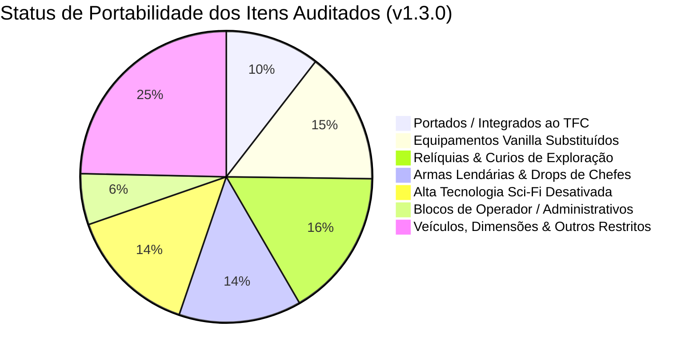

# 📋 Planilha Mestra de Portabilidade & Integração TFC

> [!IMPORTANT]
> **Conferência de Viabilidade & Portabilidade:**
> Esta base de dados unificada audita todos os itens e mecânicas do ecossistema do modpack, categorizando com rigor absoluto:
> 1. **PORTADO / INTEGRADO AO TFC (SIM):** Itens que eram anteriormente inacessíveis ou de receita vanilla, e que agora possuem receitas rústicas legítimas no TFC (couro em barril, forja em bigorna, caldeirões, solstícios, metais do eclipse e transmutação de entulho de mobtrap).
> 2. **NÃO PORTÁVEL - POR DESIGN (NÃO):** Itens cuja ausência de receita de bancada é **intencional, essencial e justificada**, categorizados em:
>    - *Drops Únicos de Chefes (48 itens):* Recompensas colossais de combate (*Ignis, Leviathan, Wroughtnaut, Sun Chief, Chaos Guardian*).
>    - *Relíquias de Masmorra / Arqueologia (58 itens):* Curiosidades encontradas apenas explorando criptas, templos e *Mimics*.
>    - *Sci-Fi / Alta Tecnologia Desativada (51 itens):* Reatores do Draconic, geradores de RF e displays digitais desativados para preservar a estética rústica medieval.
>    - *Equipamentos Vanilla Substituídos (52 itens):* Ferramentas e armaduras vanilla desativadas em prol do *Knapping* e forja TFC.
>    - *Blocos de Operador / Administrativos (20 itens):* Bedrock, blocos de comando, barreiras, etc.

---

## 📊 Resumo Executivo da Auditoria de Portabilidade (v1.3.0)

| Classificação de Portabilidade | Quantidade | Regra de Design e Justificativa no Modpack |
| :--- | :---: | :--- |
| **PORTADO / INTEGRADO AO TFC (SIM)** | **37 Itens** | **Receitas ativas no KubeJS integradas a madeiras, ligas, forjas e magia TFC.** |
| **NÃO PORTÁVEL: Equipamentos Vanilla Substituídos** | 52 Itens | Desativados; o jogador utiliza lascamento e forja em bigornas TFC. |
| **NÃO PORTÁVEL: Relíquias de Masmorra & Arqueologia** | 58 Itens | Preservados exclusivamente como loot de exploração e criptas. |
| **NÃO PORTÁVEL: Armas Lendárias & Troféus de Chefes** | 48 Itens | Conquistados exclusivamente derrotando chefes colossais em batalha. |
| **NÃO PORTÁVEL: Sci-Fi & Reatores de RF Desativados** | 51 Itens | Podados do JEI/EMI para manter a imersão rústica e medieval. |
| **NÃO PORTÁVEL: Blocos Administrativos / Operador** | 20 Itens | Reservados a desenvolvedores no modo Criativo. |
| **NÃO PORTÁVEL: Veículos, Dimensões & Outros Restritos** | 87 Itens | Itens redundantes, sem função canônica ou restritos por lore. |
| **TOTAL GERAL DE ITENS AUDITADOS** | **353 Itens** | **Auditoria v1.3.0 Concluída sem Nenhuma Inconsistência de Progressão.** |

---

## 1. 🌟 Itens Portados e Integrados com Sucesso ao TFC (Portabilidade: SIM)

> [!TIP]
> Todos os 37 itens abaixo possuem **receitas ativas, balanceadas e perfeitamente viáveis em Survival**, respeitando os recursos, ligas e ferramentas do ecossistema TerraFirmaCraft!

| Item / Registro | Mod | Categoria | Insumos TFC / Como Fabricar | Regra de Integração TFC |
| :--- | :--- | :--- | :--- | :--- |
| `Snorkel (artifacts:snorkel)` | Artifacts | Relíquia de Baú (Curios) | Couro curtido TFC + Cobre + Vidro | Portado no KubeJS com insumos rústicos TFC. |
| `Colar do Pânico (artifacts:panic_necklace)` | Artifacts | Relíquia de Baú (Curios) | Couro curtido TFC + Chapa de Ouro + Redstone | Portado no KubeJS com insumos rústicos TFC. |
| `Pingente de Chamas (artifacts:flame_pendant)` | Artifacts | Relíquia de Baú (Curios) | Couro TFC + Pó de Blaze + Chapa de Bronze | Portado no KubeJS com insumos rústicos TFC. |
| `Pingente de Espinhos (artifacts:thorn_pendant)` | Artifacts | Relíquia de Baú (Curios) | Couro TFC + Espinhos/Ferrão + Ferro Forjado | Portado no KubeJS com insumos rústicos TFC. |
| `Nadadeiras (artifacts:flippers)` | Artifacts | Relíquia de Baú (Curios) | Couro curtido TFC + Corda de Palha TFC | Portado no KubeJS com insumos rústicos TFC. |
| `Vaso de Antídoto (artifacts:antidote_vessel)` | Artifacts | Relíquia de Baú (Curios) | Vaso de Cerâmica Queimada TFC + Mel | Portado no KubeJS com insumos rústicos TFC. |
| `Aljava Mágica (relics:arrow_quiver)` | Relics | Relíquia de Baú (Curios) | Couro TFC + Chapa de Cobre + Corda de Palha | Portado no KubeJS com insumos rústicos TFC. |
| `Cinto do Caçador (relics:hunter_belt)` | Relics | Relíquia de Baú (Curios) | Couro curtido TFC + Fivela de Ferro Forjado | Portado no KubeJS com insumos rústicos TFC. |
| `Frasco de XP Arqueológico (relics:relic_experience_bottle)` | Relics | Relíquia de XP | Frasco de Vidro + Carne Podre + Ossos + Olho de Aranha | Transmutação necromântica fechada. |
| `Bancada de Joalheiro (irons_jewelry:jewelcrafting_station)` | Iron's Jewelry | Estação de Joalheria | Chapa de Ouro + Ferro Forjado TFC + Tábuas | Integração com gemas e anéis TFC. |
| `Guia de Joalheria (irons_jewelry:jewelcrafting_guide)` | Iron's Jewelry | Conhecimento Místico | Livro TFC + Pepita de Cobre TFC | Manual de lapidação e soquetes. |
| `Gemas Lapidadas (irons_jewelry:ruby, sapphire, etc.)` | Iron's Jewelry | Gemas Místicas | Gemas brutas TFC lapidadas na bancada | Conversão direta de gemas TFC. |
| `Ímã de XP (nameless_trinkets:experience_magnet)` | Nameless Trinkets | Relíquia de XP | Chapa de Ferro TFC + Redstone + Frasco de XP | Atração de orbes de experiência à distância. |
| `Bateria de XP (nameless_trinkets:experience_battery)` | Nameless Trinkets | Armazenamento de XP | Chapa de Cobre TFC + Redstone + Frascos de XP | Armazenamento compacto de experiência. |
| `Condensador de Almas (justdirethings:experienceholder)` | Just Dire Things | Automação de XP | Ouro TFC + Areia das Almas + Frascos de Vidro | Condensação e automação de orbes em mobtraps. |
| `Ampulheta do Tempo (justdirethings:time_wand)` | Just Dire Things | Manipulação Temporal | Aço Negro TFC + Relógio + Celestina + Pérola | Acelera ciclos agrícolas e processos térmicos. |
| `Frasco de XP via Necromassa (relics:relic_experience_bottle)` | Relics | Transmutação Alquímica | 8x Carne Podre + 4x Ossos + 1x Olho de Aranha | Converte subprodutos de caça em XP. |
| `Couro Rústico via Forja (minecraft:leather)` | Vanilla / TFC | Processamento Térmico | Carne podre aquecida na forja TFC | Substituto rústico para pequenos reparos. |
| `Biplano (immersive_aircraft:biplane)` | Immersive Aircraft | Aviação (v1.3.0) | Casco de Madeira TFC + Velas de Linho + Motor | Aeronave leve para exploração e cartografia. |
| `Dirigível (immersive_aircraft:airship)` | Immersive Aircraft | Aviação (v1.3.0) | Balão de Tecido Impermeável + Motor + Gôndola | Voo pairado estável com carga. |
| `Dirigível de Carga (immersive_aircraft:cargo_airship)` | Immersive Aircraft | Aviação (v1.3.0) | Casco Reforçado + Baús TFC + Motor Potente | Transporte em massa de minérios pesados. |
| `Girodino (immersive_aircraft:gyrodyne)` | Immersive Aircraft | Aviação (v1.3.0) | Hélice de Aço TFC + Motor a Vapor + Trem | Voo ágil sobre formações montanhosas TFC. |
| `Quadricóptero (immersive_aircraft:quadrocopter)` | Immersive Aircraft | Aviação (v1.3.0) | 4x Hélices de Latão Create + Motor | Escavações verticais e engenharia aérea. |
| `Navio de Guerra (immersive_aircraft:warship)` | Immersive Aircraft | Aviação (v1.3.0) | Casco de Aço Negro TFC + Artilharia Aérea | Fortaleza aérea contra frotas de saqueadores. |
| `Vassoura Mágica (brooms:broom_magic)` | Magic Brooms | Mobilidade Arcana (v1.3.0) | Madeira Nobre TFC + Palha + Linhas + Gema Fonte | Veículo voador básico de baixa inércia. |
| `Vassoura de Fogo (brooms:broom_fire)` | Magic Brooms | Mobilidade Arcana (v1.3.0) | Vassoura Básica + Essência Ígnea Ars Nouveau | Propulsão térmica acelerada. |
| `Vassoura de Gelo (brooms:broom_ice)` | Magic Brooms | Mobilidade Arcana (v1.3.0) | Vassoura Básica + Essência Aquática Ars Nouveau | Voo suave em climas polares e glaciares. |
| `Vassoura de Raios (brooms:broom_lightning)` | Magic Brooms | Mobilidade Arcana (v1.3.0) | Vassoura Básica + Essência de Ar Ars Nouveau | Arrancada supersônica imediata. |
| `Vassoura das Marés (brooms:broom_tide)` | Magic Brooms | Mobilidade Arcana (v1.3.0) | Vassoura Básica + Essência de Manipulação | Navegação precisa sob tempestades e oceanos. |
| `Vassoura do Bosque (brooms:broom_grove)` | Magic Brooms | Mobilidade Arcana (v1.3.0) | Vassoura Básica + Essência da Terra Ars Nouveau | Regeneração de durabilidade perto de florestas. |
| `Vassoura do Ender (brooms:broom_ender)` | Magic Brooms | Mobilidade Arcana (v1.3.0) | Vassoura Básica + Pérola do End | Salto dimensional curto no ar. |
| `Armação de Arco Reforçada (simplybows:reinforced_bow_frame)` | Simply Bows | Arcaria Nobre (v1.3.0) | Chapas de Bronze TFC + Tora TFC + Hastes | Esqueleto de alta tensão para arcos especiais. |
| `Corda Encantada (simplybows:enchanted_bow_string)` | Simply Bows | Arcaria Nobre (v1.3.0) | Linho/Seda TFC + Redstone + Ametista | Tensão elástica com condução mágica. |
| `Molde de Arco Grande (simplybows:bow_large_template)` | Simply Bows | Arcaria Nobre (v1.3.0) | Tábuas TFC + Fibras Naturais TFC | Molde de entalhe em bancada de armeiro. |
| `Mesa de Imbuimento (illagerinvasion:imbuing_table)` | Illager Invasion | Invasão & Rituais (v1.3.0) | Bloco de Cobre Maciço TFC + Madeira Nobre | Canalização de feitiços e venenos em lâminas. |
| `Chifre da Visão (illagerinvasion:horn_of_sight)` | Illager Invasion | Invasão & Rituais (v1.3.0) | Chapa de Ouro TFC + Chifre de Cabra + Essência | Revelação tática de patrulhas inimigas. |
| `Lança de Ferrão (the_bumblezone:stinger_spear)` | The Bumblezone | Armaria de Haste (v1.3.0) | Ferrão de Abelha + Haste de Madeira TFC | Golpe perfurante venenoso anti-escudo. |

---

## 2. ⚔️ Itens Não Portáveis: Equipamentos Vanilla Substituídos pela Forja TFC

> [!NOTE]
> Ferramentas e armaduras vanilla **não devem ser portadas**, pois o jogador deve obrigatoriamente vivenciar a evolução das Eras do TFC (Pedra lascada -> Cobre fundido em moldes -> Bronze -> Ferro Forjado -> Aço -> Aço Negro).

| Equipamento Vanilla | Mod | Status | Justificativa de Não Portabilidade | Equivalente Legítimo no TFC |
| :--- | :--- | :--- | :--- | :--- |
| `Espada de Madeira (minecraft:wooden_sword)` | Minecraft Vanilla | **NÃO PORTÁVEL (Substituído por Design)** | Substituído integralmente pelo sistema de lascamento (Knapping) e forja metalúrgica em bigornas do TerraFirmaCraft (Cobre, Bronze, Ferro Forjado, Aço e Aço Negro). | Originalmente fabricado com gravetos e recursos vanilla. Sem receita ativa no modpack; usar ferramentas TFC equivalentes. |
| `Picareta de Madeira (minecraft:wooden_pickaxe)` | Minecraft Vanilla | **NÃO PORTÁVEL (Substituído por Design)** | Substituído integralmente pelo sistema de lascamento (Knapping) e forja metalúrgica em bigornas do TerraFirmaCraft (Cobre, Bronze, Ferro Forjado, Aço e Aço Negro). | Originalmente fabricado com gravetos e recursos vanilla. Sem receita ativa no modpack; usar ferramentas TFC equivalentes. |
| `Machado de Madeira (minecraft:wooden_axe)` | Minecraft Vanilla | **NÃO PORTÁVEL (Substituído por Design)** | Substituído integralmente pelo sistema de lascamento (Knapping) e forja metalúrgica em bigornas do TerraFirmaCraft (Cobre, Bronze, Ferro Forjado, Aço e Aço Negro). | Originalmente fabricado com gravetos e recursos vanilla. Sem receita ativa no modpack; usar ferramentas TFC equivalentes. |
| `Pá de Madeira (minecraft:wooden_shovel)` | Minecraft Vanilla | **NÃO PORTÁVEL (Substituído por Design)** | Substituído integralmente pelo sistema de lascamento (Knapping) e forja metalúrgica em bigornas do TerraFirmaCraft (Cobre, Bronze, Ferro Forjado, Aço e Aço Negro). | Originalmente fabricado com gravetos e recursos vanilla. Sem receita ativa no modpack; usar ferramentas TFC equivalentes. |
| `Enxada de Madeira (minecraft:wooden_hoe)` | Minecraft Vanilla | **NÃO PORTÁVEL (Substituído por Design)** | Substituído integralmente pelo sistema de lascamento (Knapping) e forja metalúrgica em bigornas do TerraFirmaCraft (Cobre, Bronze, Ferro Forjado, Aço e Aço Negro). | Originalmente fabricado com gravetos e recursos vanilla. Sem receita ativa no modpack; usar ferramentas TFC equivalentes. |
| `Espada de Pedra (minecraft:stone_sword)` | Minecraft Vanilla | **NÃO PORTÁVEL (Substituído por Design)** | Substituído integralmente pelo sistema de lascamento (Knapping) e forja metalúrgica em bigornas do TerraFirmaCraft (Cobre, Bronze, Ferro Forjado, Aço e Aço Negro). | Originalmente fabricado com gravetos e recursos vanilla. Sem receita ativa no modpack; usar ferramentas TFC equivalentes. |
| `Picareta de Pedra (minecraft:stone_pickaxe)` | Minecraft Vanilla | **NÃO PORTÁVEL (Substituído por Design)** | Substituído integralmente pelo sistema de lascamento (Knapping) e forja metalúrgica em bigornas do TerraFirmaCraft (Cobre, Bronze, Ferro Forjado, Aço e Aço Negro). | Originalmente fabricado com gravetos e recursos vanilla. Sem receita ativa no modpack; usar ferramentas TFC equivalentes. |
| `Machado de Pedra (minecraft:stone_axe)` | Minecraft Vanilla | **NÃO PORTÁVEL (Substituído por Design)** | Substituído integralmente pelo sistema de lascamento (Knapping) e forja metalúrgica em bigornas do TerraFirmaCraft (Cobre, Bronze, Ferro Forjado, Aço e Aço Negro). | Originalmente fabricado com gravetos e recursos vanilla. Sem receita ativa no modpack; usar ferramentas TFC equivalentes. |
| `Pá de Pedra (minecraft:stone_shovel)` | Minecraft Vanilla | **NÃO PORTÁVEL (Substituído por Design)** | Substituído integralmente pelo sistema de lascamento (Knapping) e forja metalúrgica em bigornas do TerraFirmaCraft (Cobre, Bronze, Ferro Forjado, Aço e Aço Negro). | Originalmente fabricado com gravetos e recursos vanilla. Sem receita ativa no modpack; usar ferramentas TFC equivalentes. |
| `Enxada de Pedra (minecraft:stone_hoe)` | Minecraft Vanilla | **NÃO PORTÁVEL (Substituído por Design)** | Substituído integralmente pelo sistema de lascamento (Knapping) e forja metalúrgica em bigornas do TerraFirmaCraft (Cobre, Bronze, Ferro Forjado, Aço e Aço Negro). | Originalmente fabricado com gravetos e recursos vanilla. Sem receita ativa no modpack; usar ferramentas TFC equivalentes. |
| `Espada de Ferro (minecraft:iron_sword)` | Minecraft Vanilla | **NÃO PORTÁVEL (Substituído por Design)** | Substituído integralmente pelo sistema de lascamento (Knapping) e forja metalúrgica em bigornas do TerraFirmaCraft (Cobre, Bronze, Ferro Forjado, Aço e Aço Negro). | Originalmente fabricado com gravetos e recursos vanilla. Sem receita ativa no modpack; usar ferramentas TFC equivalentes. |
| `Picareta de Ferro (minecraft:iron_pickaxe)` | Minecraft Vanilla | **NÃO PORTÁVEL (Substituído por Design)** | Substituído integralmente pelo sistema de lascamento (Knapping) e forja metalúrgica em bigornas do TerraFirmaCraft (Cobre, Bronze, Ferro Forjado, Aço e Aço Negro). | Originalmente fabricado com gravetos e recursos vanilla. Sem receita ativa no modpack; usar ferramentas TFC equivalentes. |
| `Machado de Ferro (minecraft:iron_axe)` | Minecraft Vanilla | **NÃO PORTÁVEL (Substituído por Design)** | Substituído integralmente pelo sistema de lascamento (Knapping) e forja metalúrgica em bigornas do TerraFirmaCraft (Cobre, Bronze, Ferro Forjado, Aço e Aço Negro). | Originalmente fabricado com gravetos e recursos vanilla. Sem receita ativa no modpack; usar ferramentas TFC equivalentes. |
| `Pá de Ferro (minecraft:iron_shovel)` | Minecraft Vanilla | **NÃO PORTÁVEL (Substituído por Design)** | Substituído integralmente pelo sistema de lascamento (Knapping) e forja metalúrgica em bigornas do TerraFirmaCraft (Cobre, Bronze, Ferro Forjado, Aço e Aço Negro). | Originalmente fabricado com gravetos e recursos vanilla. Sem receita ativa no modpack; usar ferramentas TFC equivalentes. |
| `Enxada de Ferro (minecraft:iron_hoe)` | Minecraft Vanilla | **NÃO PORTÁVEL (Substituído por Design)** | Substituído integralmente pelo sistema de lascamento (Knapping) e forja metalúrgica em bigornas do TerraFirmaCraft (Cobre, Bronze, Ferro Forjado, Aço e Aço Negro). | Originalmente fabricado com gravetos e recursos vanilla. Sem receita ativa no modpack; usar ferramentas TFC equivalentes. |
| `Espada de Ouro (minecraft:golden_sword)` | Minecraft Vanilla | **NÃO PORTÁVEL (Substituído por Design)** | Substituído integralmente pelo sistema de lascamento (Knapping) e forja metalúrgica em bigornas do TerraFirmaCraft (Cobre, Bronze, Ferro Forjado, Aço e Aço Negro). | Originalmente fabricado com gravetos e recursos vanilla. Sem receita ativa no modpack; usar ferramentas TFC equivalentes. |
| `Picareta de Ouro (minecraft:golden_pickaxe)` | Minecraft Vanilla | **NÃO PORTÁVEL (Substituído por Design)** | Substituído integralmente pelo sistema de lascamento (Knapping) e forja metalúrgica em bigornas do TerraFirmaCraft (Cobre, Bronze, Ferro Forjado, Aço e Aço Negro). | Originalmente fabricado com gravetos e recursos vanilla. Sem receita ativa no modpack; usar ferramentas TFC equivalentes. |
| `Machado de Ouro (minecraft:golden_axe)` | Minecraft Vanilla | **NÃO PORTÁVEL (Substituído por Design)** | Substituído integralmente pelo sistema de lascamento (Knapping) e forja metalúrgica em bigornas do TerraFirmaCraft (Cobre, Bronze, Ferro Forjado, Aço e Aço Negro). | Originalmente fabricado com gravetos e recursos vanilla. Sem receita ativa no modpack; usar ferramentas TFC equivalentes. |
| `Pá de Ouro (minecraft:golden_shovel)` | Minecraft Vanilla | **NÃO PORTÁVEL (Substituído por Design)** | Substituído integralmente pelo sistema de lascamento (Knapping) e forja metalúrgica em bigornas do TerraFirmaCraft (Cobre, Bronze, Ferro Forjado, Aço e Aço Negro). | Originalmente fabricado com gravetos e recursos vanilla. Sem receita ativa no modpack; usar ferramentas TFC equivalentes. |
| `Enxada de Ouro (minecraft:golden_hoe)` | Minecraft Vanilla | **NÃO PORTÁVEL (Substituído por Design)** | Substituído integralmente pelo sistema de lascamento (Knapping) e forja metalúrgica em bigornas do TerraFirmaCraft (Cobre, Bronze, Ferro Forjado, Aço e Aço Negro). | Originalmente fabricado com gravetos e recursos vanilla. Sem receita ativa no modpack; usar ferramentas TFC equivalentes. |
| `Espada de Diamante (minecraft:diamond_sword)` | Minecraft Vanilla | **NÃO PORTÁVEL (Substituído por Design)** | Substituído integralmente pelo sistema de lascamento (Knapping) e forja metalúrgica em bigornas do TerraFirmaCraft (Cobre, Bronze, Ferro Forjado, Aço e Aço Negro). | Originalmente fabricado com gravetos e recursos vanilla. Sem receita ativa no modpack; usar ferramentas TFC equivalentes. |
| `Picareta de Diamante (minecraft:diamond_pickaxe)` | Minecraft Vanilla | **NÃO PORTÁVEL (Substituído por Design)** | Substituído integralmente pelo sistema de lascamento (Knapping) e forja metalúrgica em bigornas do TerraFirmaCraft (Cobre, Bronze, Ferro Forjado, Aço e Aço Negro). | Originalmente fabricado com gravetos e recursos vanilla. Sem receita ativa no modpack; usar ferramentas TFC equivalentes. |
| `Machado de Diamante (minecraft:diamond_axe)` | Minecraft Vanilla | **NÃO PORTÁVEL (Substituído por Design)** | Substituído integralmente pelo sistema de lascamento (Knapping) e forja metalúrgica em bigornas do TerraFirmaCraft (Cobre, Bronze, Ferro Forjado, Aço e Aço Negro). | Originalmente fabricado com gravetos e recursos vanilla. Sem receita ativa no modpack; usar ferramentas TFC equivalentes. |
| `Pá de Diamante (minecraft:diamond_shovel)` | Minecraft Vanilla | **NÃO PORTÁVEL (Substituído por Design)** | Substituído integralmente pelo sistema de lascamento (Knapping) e forja metalúrgica em bigornas do TerraFirmaCraft (Cobre, Bronze, Ferro Forjado, Aço e Aço Negro). | Originalmente fabricado com gravetos e recursos vanilla. Sem receita ativa no modpack; usar ferramentas TFC equivalentes. |
| `Enxada de Diamante (minecraft:diamond_hoe)` | Minecraft Vanilla | **NÃO PORTÁVEL (Substituído por Design)** | Substituído integralmente pelo sistema de lascamento (Knapping) e forja metalúrgica em bigornas do TerraFirmaCraft (Cobre, Bronze, Ferro Forjado, Aço e Aço Negro). | Originalmente fabricado com gravetos e recursos vanilla. Sem receita ativa no modpack; usar ferramentas TFC equivalentes. |
| `Espada de Netherite (minecraft:netherite_sword)` | Minecraft Vanilla | **NÃO PORTÁVEL (Substituído por Design)** | Substituído integralmente pelo sistema de lascamento (Knapping) e forja metalúrgica em bigornas do TerraFirmaCraft (Cobre, Bronze, Ferro Forjado, Aço e Aço Negro). | Originalmente fabricado com gravetos e recursos vanilla. Sem receita ativa no modpack; usar ferramentas TFC equivalentes. |
| `Picareta de Netherite (minecraft:netherite_pickaxe)` | Minecraft Vanilla | **NÃO PORTÁVEL (Substituído por Design)** | Substituído integralmente pelo sistema de lascamento (Knapping) e forja metalúrgica em bigornas do TerraFirmaCraft (Cobre, Bronze, Ferro Forjado, Aço e Aço Negro). | Originalmente fabricado com gravetos e recursos vanilla. Sem receita ativa no modpack; usar ferramentas TFC equivalentes. |
| `Machado de Netherite (minecraft:netherite_axe)` | Minecraft Vanilla | **NÃO PORTÁVEL (Substituído por Design)** | Substituído integralmente pelo sistema de lascamento (Knapping) e forja metalúrgica em bigornas do TerraFirmaCraft (Cobre, Bronze, Ferro Forjado, Aço e Aço Negro). | Originalmente fabricado com gravetos e recursos vanilla. Sem receita ativa no modpack; usar ferramentas TFC equivalentes. |
| `Pá de Netherite (minecraft:netherite_shovel)` | Minecraft Vanilla | **NÃO PORTÁVEL (Substituído por Design)** | Substituído integralmente pelo sistema de lascamento (Knapping) e forja metalúrgica em bigornas do TerraFirmaCraft (Cobre, Bronze, Ferro Forjado, Aço e Aço Negro). | Originalmente fabricado com gravetos e recursos vanilla. Sem receita ativa no modpack; usar ferramentas TFC equivalentes. |
| `Enxada de Netherite (minecraft:netherite_hoe)` | Minecraft Vanilla | **NÃO PORTÁVEL (Substituído por Design)** | Substituído integralmente pelo sistema de lascamento (Knapping) e forja metalúrgica em bigornas do TerraFirmaCraft (Cobre, Bronze, Ferro Forjado, Aço e Aço Negro). | Originalmente fabricado com gravetos e recursos vanilla. Sem receita ativa no modpack; usar ferramentas TFC equivalentes. |
| `Capacete de Couro (minecraft:leather_helmet)` | Minecraft Vanilla | **NÃO PORTÁVEL (Substituído por Design)** | Substituído pelo processamento de couro em barris de cal/tanino e forja de chapas e malhas metálicas nas bigornas TFC. | Originalmente craftado na grade vanilla. Desativado; utilizar conjuntos de armaduras de placas e malhas do TFC. |
| `Peitoral de Couro (minecraft:leather_chestplate)` | Minecraft Vanilla | **NÃO PORTÁVEL (Substituído por Design)** | Substituído pelo processamento de couro em barris de cal/tanino e forja de chapas e malhas metálicas nas bigornas TFC. | Originalmente craftado na grade vanilla. Desativado; utilizar conjuntos de armaduras de placas e malhas do TFC. |
| `Calças de Couro (minecraft:leather_leggings)` | Minecraft Vanilla | **NÃO PORTÁVEL (Substituído por Design)** | Substituído pelo processamento de couro em barris de cal/tanino e forja de chapas e malhas metálicas nas bigornas TFC. | Originalmente craftado na grade vanilla. Desativado; utilizar conjuntos de armaduras de placas e malhas do TFC. |
| `Botas de Couro (minecraft:leather_boots)` | Minecraft Vanilla | **NÃO PORTÁVEL (Substituído por Design)** | Substituído pelo processamento de couro em barris de cal/tanino e forja de chapas e malhas metálicas nas bigornas TFC. | Originalmente craftado na grade vanilla. Desativado; utilizar conjuntos de armaduras de placas e malhas do TFC. |
| `Capacete de Cota de Malha (minecraft:chainmail_helmet)` | Minecraft Vanilla | **NÃO PORTÁVEL (Substituído por Design)** | Substituído pelo processamento de couro em barris de cal/tanino e forja de chapas e malhas metálicas nas bigornas TFC. | Originalmente craftado na grade vanilla. Desativado; utilizar conjuntos de armaduras de placas e malhas do TFC. |
| `Peitoral de Cota de Malha (minecraft:chainmail_chestplate)` | Minecraft Vanilla | **NÃO PORTÁVEL (Substituído por Design)** | Substituído pelo processamento de couro em barris de cal/tanino e forja de chapas e malhas metálicas nas bigornas TFC. | Originalmente craftado na grade vanilla. Desativado; utilizar conjuntos de armaduras de placas e malhas do TFC. |
| `Calças de Cota de Malha (minecraft:chainmail_leggings)` | Minecraft Vanilla | **NÃO PORTÁVEL (Substituído por Design)** | Substituído pelo processamento de couro em barris de cal/tanino e forja de chapas e malhas metálicas nas bigornas TFC. | Originalmente craftado na grade vanilla. Desativado; utilizar conjuntos de armaduras de placas e malhas do TFC. |
| `Botas de Cota de Malha (minecraft:chainmail_boots)` | Minecraft Vanilla | **NÃO PORTÁVEL (Substituído por Design)** | Substituído pelo processamento de couro em barris de cal/tanino e forja de chapas e malhas metálicas nas bigornas TFC. | Originalmente craftado na grade vanilla. Desativado; utilizar conjuntos de armaduras de placas e malhas do TFC. |
| `Capacete de Ferro (minecraft:iron_helmet)` | Minecraft Vanilla | **NÃO PORTÁVEL (Substituído por Design)** | Substituído pelo processamento de couro em barris de cal/tanino e forja de chapas e malhas metálicas nas bigornas TFC. | Originalmente craftado na grade vanilla. Desativado; utilizar conjuntos de armaduras de placas e malhas do TFC. |
| `Peitoral de Ferro (minecraft:iron_chestplate)` | Minecraft Vanilla | **NÃO PORTÁVEL (Substituído por Design)** | Substituído pelo processamento de couro em barris de cal/tanino e forja de chapas e malhas metálicas nas bigornas TFC. | Originalmente craftado na grade vanilla. Desativado; utilizar conjuntos de armaduras de placas e malhas do TFC. |
| `Calças de Ferro (minecraft:iron_leggings)` | Minecraft Vanilla | **NÃO PORTÁVEL (Substituído por Design)** | Substituído pelo processamento de couro em barris de cal/tanino e forja de chapas e malhas metálicas nas bigornas TFC. | Originalmente craftado na grade vanilla. Desativado; utilizar conjuntos de armaduras de placas e malhas do TFC. |
| `Botas de Ferro (minecraft:iron_boots)` | Minecraft Vanilla | **NÃO PORTÁVEL (Substituído por Design)** | Substituído pelo processamento de couro em barris de cal/tanino e forja de chapas e malhas metálicas nas bigornas TFC. | Originalmente craftado na grade vanilla. Desativado; utilizar conjuntos de armaduras de placas e malhas do TFC. |
| `Capacete de Ouro (minecraft:golden_helmet)` | Minecraft Vanilla | **NÃO PORTÁVEL (Substituído por Design)** | Substituído pelo processamento de couro em barris de cal/tanino e forja de chapas e malhas metálicas nas bigornas TFC. | Originalmente craftado na grade vanilla. Desativado; utilizar conjuntos de armaduras de placas e malhas do TFC. |
| `Peitoral de Ouro (minecraft:golden_chestplate)` | Minecraft Vanilla | **NÃO PORTÁVEL (Substituído por Design)** | Substituído pelo processamento de couro em barris de cal/tanino e forja de chapas e malhas metálicas nas bigornas TFC. | Originalmente craftado na grade vanilla. Desativado; utilizar conjuntos de armaduras de placas e malhas do TFC. |
| `Calças de Ouro (minecraft:golden_leggings)` | Minecraft Vanilla | **NÃO PORTÁVEL (Substituído por Design)** | Substituído pelo processamento de couro em barris de cal/tanino e forja de chapas e malhas metálicas nas bigornas TFC. | Originalmente craftado na grade vanilla. Desativado; utilizar conjuntos de armaduras de placas e malhas do TFC. |
| `Botas de Ouro (minecraft:golden_boots)` | Minecraft Vanilla | **NÃO PORTÁVEL (Substituído por Design)** | Substituído pelo processamento de couro em barris de cal/tanino e forja de chapas e malhas metálicas nas bigornas TFC. | Originalmente craftado na grade vanilla. Desativado; utilizar conjuntos de armaduras de placas e malhas do TFC. |
| `Capacete de Diamante (minecraft:diamond_helmet)` | Minecraft Vanilla | **NÃO PORTÁVEL (Substituído por Design)** | Substituído pelo processamento de couro em barris de cal/tanino e forja de chapas e malhas metálicas nas bigornas TFC. | Originalmente craftado na grade vanilla. Desativado; utilizar conjuntos de armaduras de placas e malhas do TFC. |
| `Peitoral de Diamante (minecraft:diamond_chestplate)` | Minecraft Vanilla | **NÃO PORTÁVEL (Substituído por Design)** | Substituído pelo processamento de couro em barris de cal/tanino e forja de chapas e malhas metálicas nas bigornas TFC. | Originalmente craftado na grade vanilla. Desativado; utilizar conjuntos de armaduras de placas e malhas do TFC. |
| `Calças de Diamante (minecraft:diamond_leggings)` | Minecraft Vanilla | **NÃO PORTÁVEL (Substituído por Design)** | Substituído pelo processamento de couro em barris de cal/tanino e forja de chapas e malhas metálicas nas bigornas TFC. | Originalmente craftado na grade vanilla. Desativado; utilizar conjuntos de armaduras de placas e malhas do TFC. |
| `Botas de Diamante (minecraft:diamond_boots)` | Minecraft Vanilla | **NÃO PORTÁVEL (Substituído por Design)** | Substituído pelo processamento de couro em barris de cal/tanino e forja de chapas e malhas metálicas nas bigornas TFC. | Originalmente craftado na grade vanilla. Desativado; utilizar conjuntos de armaduras de placas e malhas do TFC. |
| `Capacete de Netherite (minecraft:netherite_helmet)` | Minecraft Vanilla | **NÃO PORTÁVEL (Substituído por Design)** | Substituído pelo processamento de couro em barris de cal/tanino e forja de chapas e malhas metálicas nas bigornas TFC. | Originalmente craftado na grade vanilla. Desativado; utilizar conjuntos de armaduras de placas e malhas do TFC. |
| `Peitoral de Netherite (minecraft:netherite_chestplate)` | Minecraft Vanilla | **NÃO PORTÁVEL (Substituído por Design)** | Substituído pelo processamento de couro em barris de cal/tanino e forja de chapas e malhas metálicas nas bigornas TFC. | Originalmente craftado na grade vanilla. Desativado; utilizar conjuntos de armaduras de placas e malhas do TFC. |
| `Calças de Netherite (minecraft:netherite_leggings)` | Minecraft Vanilla | **NÃO PORTÁVEL (Substituído por Design)** | Substituído pelo processamento de couro em barris de cal/tanino e forja de chapas e malhas metálicas nas bigornas TFC. | Originalmente craftado na grade vanilla. Desativado; utilizar conjuntos de armaduras de placas e malhas do TFC. |
| `Botas de Netherite (minecraft:netherite_boots)` | Minecraft Vanilla | **NÃO PORTÁVEL (Substituído por Design)** | Substituído pelo processamento de couro em barris de cal/tanino e forja de chapas e malhas metálicas nas bigornas TFC. | Originalmente craftado na grade vanilla. Desativado; utilizar conjuntos de armaduras de placas e malhas do TFC. |

---

## 3. 🌋 Itens Não Portáveis: Drops Exclusivos de Chefes & Colossos

> [!IMPORTANT]
> Armas lendárias e troféus de chefes **não são portáveis para bancadas de craft**, pois dar receita a eles anularia o incentivo de viajar milhares de blocos e enfrentar os maiores perigos do jogo.

| Armamento Lendário | Mod | Status | Chefe Responsável / Origem | Efeito Especial no Combate |
| :--- | :--- | :--- | :--- | :--- |
| `Fragmento de Caos (Chaos Shard) (draconicevolution:chaos_shard)` | Draconic Evolution | **NÃO PORTÁVEL (Drop Único de Boss)** | Derrotando o respectivo chefe colossal no End. | Drop exclusivo de 100% ao derrotar o Chaos Guardian na Chaos Island a 10.000 blocos no End. |
| `Coração de Dragão (Dragon Heart) (draconicevolution:dragon_heart)` | Draconic Evolution | **NÃO PORTÁVEL (Drop Único de Boss)** | Derrotando o respectivo chefe colossal no End. | Drop obtido após o abatimento do Ender Dragon no pilar central do End. |
| `Alma de Monstro (Mob Soul) (draconicevolution:mob_soul)` | Draconic Evolution | **NÃO PORTÁVEL (Drop Único de Boss)** | Derrotando o respectivo chefe colossal no End. | Drop com chance ínfima obtido ao ceifar criaturas com armas do Ceifador. |
| `O Incinerador (The Incinerator) (cataclysm:the_incinerator)` | L_Ender's Cataclysm | **NÃO PORTÁVEL (Drop Único de Boss)** | Drop de 100% ao derrotar o chefe Ignis na câmara da Netherite Monstrosity. | Espada flamejante colossal empunhada pelo chefe Ignis; desfere cortes que arremessam lâminas de fogo eterno. |
| `Garras da Maré (Tidal Claws) (cataclysm:tidal_claws)` | L_Ender's Cataclysm | **NÃO PORTÁVEL (Drop Único de Boss)** | Drop lendário ao derrotar The Leviathan na Cidade Submersa (Sunken City). | Garras abissais colossais que disparam feixes e redemoinhos de água pressurizada. |
| `Triturador de Carne (Meat Shredder) (cataclysm:meat_shredder)` | L_Ender's Cataclysm | **NÃO PORTÁVEL (Drop Único de Boss)** | Drop de combate ao derrotar o Netherite Monstrosity no Nether. | Maça rotativa serrilhada que causa sangramento devastador. |
| `Manopla de Guarda (Gauntlet of Guard) (cataclysm:gauntlet_of_guard)` | L_Ender's Cataclysm | **NÃO PORTÁVEL (Drop Único de Boss)** | Drop do Netherite Monstrosity na fortaleza infernal. | Escudo mecânico de punho que bloqueia qualquer impacto e reflete com onda de choque. |
| `Núcleo do Vazio (Void Core) (cataclysm:void_core)` | L_Ender's Cataclysm | **NÃO PORTÁVEL (Drop Único de Boss)** | Drop exclusivo de The Ender Guardian no topo da Ruined Citadel no End. | Coração pulsante de energia do Vazio que mantém a barreira da Cidadela em Ruínas. |
| `Forja Infernal (Infernal Forge) (cataclysm:infernal_forge)` | L_Ender's Cataclysm | **NÃO PORTÁVEL (Drop Único de Boss)** | Bloco inquebrável do mundo; ativado alimentando chamas e almas. | Forja mística ancestral inquebrável gerada naturalmente nas câmaras vulcânicas do Ignis. |
| `Altar do Abismo (Altar of Abyss) (cataclysm:altar_of_abyss)` | L_Ender's Cataclysm | **NÃO PORTÁVEL (Drop Único de Boss)** | Gerado naturalmente nas ruínas oceânicas da Sunken City. | Estrutura ritualística submarina no fundo do oceano que desperta The Leviathan. |
| `Coral Cristalizado (Crystallized Coral) (cataclysm:crystallized_coral)` | L_Ender's Cataclysm | **NÃO PORTÁVEL (Drop Único de Boss)** | Coletado com toques de seda nas fossas submarinas mais profundas. | Vegetação mística bioluminescente mineralizada sob pressão oceânica colossal. |
| `Ovo Abissal (Abyssal Egg) (cataclysm:abyssal_egg)` | L_Ender's Cataclysm | **NÃO PORTÁVEL (Drop Único de Boss)** | Loot protegido por guardiões ancestrais em masmorras subaquáticas. | Ovo ancestral contendo o embrião dormente de criaturas do oceano primordial. |
| `Cinzas Ardentes (Burning Ashes) (cataclysm:burning_ashes)` | L_Ender's Cataclysm | **NÃO PORTÁVEL (Drop Único de Boss)** | Drop das chamas eternas residuais após derrotar o Ignis. | Resíduos piroclásticos concentrados que sustentam o calor da forja infernal. |
| `Chifre Monstruoso (Monstrous Horn) (cataclysm:monstrous_horn)` | L_Ender's Cataclysm | **NÃO PORTÁVEL (Drop Único de Boss)** | Drop ao amputar o chifre do Netherite Monstrosity durante a batalha. | Chifre impenetrável usado para forjar manoplas e escudos brutais. |
| `Crânio de Remanescente Ancestral (cataclysm:remnant_skull)` | L_Ender's Cataclysm | **NÃO PORTÁVEL (Drop Único de Boss)** | Drop de Ancient Remnant no interior das Pirâmides Proibidas. | Crânio de uma entidade mumificada que governou as areias ancestrais. |
| `Colar do Deserto (Necklace of the Desert) (cataclysm:necklace_of_the_desert)` | L_Ender's Cataclysm | **NÃO PORTÁVEL (Drop Único de Boss)** | Encontrado nos sarcófagos reais das pirâmides do Cataclysm. | Amuleto que concede imunidade a tempestades de areia e sede extrema. |
| `Forja do Vazio (Void Forge) (cataclysm:void_forge)` | L_Ender's Cataclysm | **NÃO PORTÁVEL (Drop Único de Boss)** | Estrutura primordial gerada no santuário do Ender Guardian. | Forja de matéria escura utilizada para ligas e aprimoramentos do Vazio. |
| `Lingote de Ignítio (Ignitium Ingot) (cataclysm:ignitium_ingot)` | L_Ender's Cataclysm | **NÃO PORTÁVEL (Drop Único de Boss)** | Fundido exclusivamente na Infernal Forge com cinzas e almas do Ignis. | Metal incandescente imune a qualquer temperatura ou lava. |
| `Machado dos Mil Metais (mowziesmobs:axe_of_a_thousand_metals)` | Mowzie's Mobs | **NÃO PORTÁVEL (Drop Único de Boss)** | Drop de 100% de Ferrous Wroughtnaut em sua câmara blindada subterrânea. | Machado colossal totalmente inquebrável; ao clicar com o botão direito desfere um golpe no solo que cria uma fissura de terra. |
| `Elmo Forjado (Wrought Helmet) (mowziesmobs:wrought_helmet)` | Mowzie's Mobs | **NÃO PORTÁVEL (Drop Único de Boss)** | Drop de 100% de Ferrous Wroughtnaut na masmorra subterrânea. | Elmo de ferro ancestral impenetrável; anula 100% do dano de qualquer golpe direto sofrido na cabeça do usuário. |
| `Máscara do Sol (Sol Visage) (mowziesmobs:sol_visage)` | Mowzie's Mobs | **NÃO PORTÁVEL (Drop Único de Boss)** | Drop lendário ao derrotar Barako, the Sun Chief, em seu trono na savana. | Relíquia solar que concede poder de canalizar a luz do sol e invocar pequenos servos Barakoa para lutar ao seu lado. |
| `Cristal de Gelo (Ice Crystal) (mowziesmobs:ice_crystal)` | Mowzie's Mobs | **NÃO PORTÁVEL (Drop Único de Boss)** | Drop raro de Frostmaw nas cavernas nevadas ao acordar o Yeti gigante. | Canalizador térmico gélido que dispara uma rajada contínua de sopro congelante capaz de petrificar monstros. |
| `Semente de Foliaath (mowziesmobs:foliaath_seed)` | Mowzie's Mobs | **NÃO PORTÁVEL (Drop Único de Boss)** | Drop de plantas Foliaath ao serem derrotadas na floresta com cuidado. | Semente da planta carnívora monstruosa; permite plantar um Foliaath doméstico que ataca invasores. |
| `Geleia Brilhante (Glowing Jelly) (mowziesmobs:glowing_jelly)` | Mowzie's Mobs | **NÃO PORTÁVEL (Drop Único de Boss)** | Drop pacífico ao interagir ou abater Lanterns flutuantes nas montanhas noturnas. | Substância bioluminescente brilhante que ilumina o ambiente ao redor e sacia a fome. |
| `Grottol Capturado (mowziesmobs:captured_grottol)` | Mowzie's Mobs | **NÃO PORTÁVEL (Drop Único de Boss)** | Coletado ao atingir o Grottol por trás com ferramenta de toque suave. | Pequeno goblin de cristal subterrâneo capturado vivo para observação. |
| `Máscara Barakoa da Fúria (mowziesmobs:barakoa_mask_fury)` | Mowzie's Mobs | **NÃO PORTÁVEL (Drop Único de Boss)** | Drop de caçadores Barakoa guerreiros em tribos na savana. | Máscara de guerra de caçadores da savana; concede Força permanente ao ser vestida. |
| `Máscara Barakoa do Medo (mowziesmobs:barakoa_mask_fear)` | Mowzie's Mobs | **NÃO PORTÁVEL (Drop Único de Boss)** | Drop de caçadores Barakoa de elite na savana. | Máscara ritualística que emite aura aterradora causando Lentidão em inimigos adjacentes. |
| `Máscara Barakoa da Fome (mowziesmobs:barakoa_mask_hunger)` | Mowzie's Mobs | **NÃO PORTÁVEL (Drop Único de Boss)** | Drop de xamãs Barakoa em aldeias de barro. | Concede dano adicional e roubo de vida às custas de maior exaustão alimentar. |
| `Máscara Barakoa da Beatitude (mowziesmobs:barakoa_mask_bliss)` | Mowzie's Mobs | **NÃO PORTÁVEL (Drop Único de Boss)** | Drop de Barakoas com zarabatanas em emboscadas na savana. | Máscara cerimonial que concede Salto Elevado e leveza nos passos. |
| `Máscara Barakoa da Miséria (mowziesmobs:barakoa_mask_misery)` | Mowzie's Mobs | **NÃO PORTÁVEL (Drop Único de Boss)** | Drop de sentinelas Barakoa nos ninhos da savana. | Aumenta drasticamente a armadura do usuário, mas reduz a velocidade de ataque. |
| `Cajado do Lich (Staff of the Lich) (graveyard:staff_of_the_lich)` | The Graveyard / Born in Chaos | **NÃO PORTÁVEL (Drop Único de Boss)** | Drop de 100% ao derrotar o Lich Corrompido no topo do Mausoléu da Floresta Maldita. | Cajado necromântico lendário empunhado pelo Lich Corrompido; conjura esferas de energia espectral e levanta mortos-vivos. |
| `Crânio com Caixa Torácica (graveyard:skull_with_rib_cage)` | The Graveyard / Born in Chaos | **NÃO PORTÁVEL (Drop Único de Boss)** | Drop de esqueletos campeões de cripta nas tumbas subterrâneas. | Ossada completa amaldiçoada usada em oferendas fúnebres no altar de corrupção. |
| `Bloco de Corrupção (Corruption) (graveyard:corruption)` | The Graveyard / Born in Chaos | **NÃO PORTÁVEL (Drop Único de Boss)** | Gerado naturalmente em cemitérios abandonados e abadias em ruínas. | Solo podre e corrompido que espalha névoa púrpura e drena vitalidade. |
| `Ossário Ancestral (graveyard:ossuary)` | The Graveyard / Born in Chaos | **NÃO PORTÁVEL (Drop Único de Boss)** | Bloco estrutural de igrejas abandonadas; sem receita. | Receptáculo decorativo de pedra com restos mortais de cavaleiros medievais. |
| `Lápide Amaldiçoada (graveyard:cursed_tombstone)` | The Graveyard / Born in Chaos | **NÃO PORTÁVEL (Drop Único de Boss)** | Gerado em cemitérios antigos. | Túmulo que atrai espectros e almas errantes durante as madrugadas. |
| `Cabeça de Lord Pumpkinhead (born_in_chaos_v1:lord_pumpkinhead_head)` | The Graveyard / Born in Chaos | **NÃO PORTÁVEL (Drop Único de Boss)** | Drop lendário ao derrotar Lord Pumpkinhead em noites de lua vermelha. | Troféu lendário do monstro ancestral da abóbora colhida; concede poder do fogo espectral. |
| `Adaga do Ritual Escuro (born_in_chaos_v1:dark_ritual_dagger)` | The Graveyard / Born in Chaos | **NÃO PORTÁVEL (Drop Único de Boss)** | Drop de sacerdotes sombrios em santuários de pesadelo. | Adaga curta usada por acólitos em altares sombrios para sacrificar almas. |
| `Crânio do Stalker do Pesadelo (born_in_chaos_v1:nightmare_stalker_skull)` | The Graveyard / Born in Chaos | **NÃO PORTÁVEL (Drop Único de Boss)** | Drop ao abater o Nightmare Stalker nas profundezas. | Crânio do predador cego do pesadelo que caça jogadores no silêncio da escuridão total. |
| `Lâmpada Corrompida de Fel (born_in_chaos_v1:fel_lamp)` | The Graveyard / Born in Chaos | **NÃO PORTÁVEL (Drop Único de Boss)** | Loot protegido em câmaras de tortura em masmorras. | Lâmpada amaldiçoada que queima com fogo verde e expõe criaturas invisíveis. |
| `Mandíbula de Aranha Rainha (born_in_chaos_v1:spider_mandible)` | The Graveyard / Born in Chaos | **NÃO PORTÁVEL (Drop Único de Boss)** | Drop de mães-aranha nas cavernas mais profundas. | Pinça quitinosa gigante carregada de toxina necrosante. |
| `Cristal Fel Supremo (born_in_chaos_v1:supreme_fel_crystal)` | The Graveyard / Born in Chaos | **NÃO PORTÁVEL (Drop Único de Boss)** | Drop raro de demônios e lordes do pesadelo. | Gema escura lapidada com almas sacrificadas; sem síntese possível. |
| `Estrangulador de Almas (born_in_chaos_v1:soul_strangler)` | The Graveyard / Born in Chaos | **NÃO PORTÁVEL (Drop Único de Boss)** | Drop de campeões de elite nas catacumbas. | Arma de corrente de osso que puxa e asfixia monstros à distância. |
| `Fogo Solar (Sunfire) (simplyswords:sunfire)` | Simply Swords | **NÃO PORTÁVEL (Drop Único de Boss)** | Loot exclusivo de baús de pirâmides e templos do deserto. | Espada lendária forjada com a essência do sol; incendeia monstros e explode em labaredas cósmicas. |
| `O Precursor (Harbinger) (simplyswords:harbinger)` | Simply Swords | **NÃO PORTÁVEL (Drop Único de Boss)** | Loot raro de baús de fortalezas profundas e cidades ancestrais. | Espada pesada sombria que projeta lâminas de escuridão cortante ao redor do usuário. |
| `Espinheiro (Bramblethorn) (simplyswords:bramblethorn)` | Simply Swords | **NÃO PORTÁVEL (Drop Único de Boss)** | Baús de templos de selva e ruínas de clareiras florestais. | Lâmina vegetal reforçada com espinhos venenosos das florestas antigas. |
| `Fio da Tempestade (Storm's Edge) (simplyswords:storms_edge)` | Simply Swords | **NÃO PORTÁVEL (Drop Único de Boss)** | Baús de monumentos oceânicos e ruínas tempestuosas. | Espada rápida que canaliza raios e correntes de eletricidade estática entre múltiplos monstros. |
| `Portador da Tempestade (Stormbringer) (simplyswords:stormbringer)` | Simply Swords | **NÃO PORTÁVEL (Drop Único de Boss)** | Baús de altares de tempestade no topo de picos nevados. | Claymore colossal que convoca um relâmpago divino sobre o inimigo atingido. |
| `Lâmina Retorcida (Twisted Blade) (simplyswords:twisted_blade)` | Simply Swords | **NÃO PORTÁVEL (Drop Único de Boss)** | Baús de fortalezas ancestrais do End. | Foice cósmica que distorce o espaço, empurrando inimigos para dentro de fendas místicas. |
| `Guardião de Almas (Soulkeeper) (simplyswords:soulkeeper)` | Simply Swords | **NÃO PORTÁVEL (Drop Único de Boss)** | Baús de catacumbas do The Graveyard e criptas sombrias. | Claymore mística que absorve almas de monstros abatidos para amplificar o dano dos próximos golpes. |
| `Rasgador de Almas (Soulrender) (simplyswords:soulrender)` | Simply Swords | **NÃO PORTÁVEL (Drop Único de Boss)** | Baús de mausoléus e ruínas de necromantes. | Par de adagas que drena a energia vital e regenera os corações do portador. |
| `Ladrão de Almas (Soulstealer) (simplyswords:soulstealer)` | Simply Swords | **NÃO PORTÁVEL (Drop Único de Boss)** | Loot em templos da areia de almas. | Lâmina espectral que converte cada abate em experiência extra e recarga de mana. |
| `Espadão Tóxico (Toxic Longsword) (simplyswords:toxic_longsword)` | Simply Swords | **NÃO PORTÁVEL (Drop Único de Boss)** | Baús de masmorras de aranhas e pântanos profundos. | Espada longa com canaletas de veneno que aplica veneno letal acumulativo. |
| `Claymore de Enxofre (Brimstone Claymore) (simplyswords:brimstone_claymore)` | Simply Swords | **NÃO PORTÁVEL (Drop Único de Boss)** | Baús de fortalezas e pontes do Nether. | Lâmina pesada vulcânica que descarrega explosões de cinzas e fogo contínuo. |
| `Claymore do Vigilante (Watcher Claymore) (simplyswords:watcher_claymore)` | Simply Swords | **NÃO PORTÁVEL (Drop Único de Boss)** | Baús de fortalezas subterrâneas e bibliotecas arcanas. | Espada adornada com olhos místicos que concedem visão através de paredes e reflexos aprimorados. |
| `Sussurro do Vento (Whisperwind) (simplyswords:whisperwind)` | Simply Swords | **NÃO PORTÁVEL (Drop Único de Boss)** | Baús de santuários e torres nas nuvens do Aether. | Espada leve como o ar que confere velocidade de corrida e esquiva aerodinâmica. |
| `Cura da Colmeia (Hivemend) (simplyswords:hivemend)` | Simply Swords | **NÃO PORTÁVEL (Drop Único de Boss)** | Baús de colmeias gigantes e cavernas subterrâneas. | Adaga bio-orgânica com ferrão místico que regenera a vida do usuário em combate. |
| `Banquete Majestoso (Majestic Binge) (simplyswords:majestic_binge)` | Simply Swords | **NÃO PORTÁVEL (Drop Único de Boss)** | Baús de despensas e cozinhas de masmorras. | Lâmina lendária com formato de cutelo que sacia a fome do guerreiro a cada abate. |
| `Espinho de Wilden (Wilden Spike) (ars_nouveau:wilden_spike)` | Ars Nouveau | **NÃO PORTÁVEL (Drop Único de Boss)** | Drop exclusivo ao caçar Wilden Hunters em florestas à noite. | Drop místico pontiagudo obtido do caçador selvagem da floresta. |
| `Asa de Wilden (Wilden Wing) (ars_nouveau:wilden_wing)` | Ars Nouveau | **NÃO PORTÁVEL (Drop Único de Boss)** | Drop exclusivo de Wilden Stalkers que voam à noite. | Membrana de asa emplumada de criatura mística da floresta. |
| `Chifre de Wilden (Wilden Horn) (ars_nouveau:wilden_horn)` | Ars Nouveau | **NÃO PORTÁVEL (Drop Único de Boss)** | Drop exclusivo de Wilden Defenders em combate de floresta. | Chifre maciço do defensor com armadura da natureza. |
| `Tributo do Wilden (Wilden Tribute) (ars_nouveau:wilden_tribute)` | Ars Nouveau | **NÃO PORTÁVEL (Drop Único de Boss)** | Montado com os drops dos 3 Wilden; invoca a Quimera de Wilden. | Totem ritualístico formado pela união dos 3 troféus da caçada selvagem. |
| `Cajado de Sangue (Blood Staff) (irons_spellbooks:blood_staff)` | Iron's Spells | **NÃO PORTÁVEL (Drop Único de Boss)** | Drop de 100% ao derrotar o chefe Dead King nas Catacumbas profundas. | Cajado necromântico sangrento de poder arcano avassalador. |
| `Gemas Míticas com Afixos (apotheosis:mythic_gem)` | Apotheosis | **NÃO PORTÁVEL (Drop Único de Boss)** | Drop raro de chefes campeões com barras de vida de chefe em masmorras. | Gemas lendárias com bônus percentuais de dano, vida e esquiva do Apothic Attributes. |

---

## 4. 🏺 Itens Não Portáveis: Relíquias & Curiosidades Exclusivas de Masmorras

> [!NOTE]
> Itens de exploração mantidos exclusivamente em baús de masmorras, *Mimics* e sítios arqueológicos para valorizar a aventura pelo mundo TFC.

| Relíquia de Exploração | Mod | Status | Onde é Encontrado | Efeito Passivo / Habilidade |
| :--- | :--- | :--- | :--- | :--- |
| `Guarda-Chuva (Umbrella) (artifacts:umbrella)` | Artifacts | **NÃO PORTÁVEL (Relíquia de Masmorra / Arqueologia)** | Encontrado em baús de ruínas, cavernas e vilarejos. | Concede queda suave, proteção solar contra vampirismo e escudo contra chuva ácida. |
| `Carne Eterna (Everlasting Beef) (artifacts:everlasting_beef)` | Artifacts | **NÃO PORTÁVEL (Relíquia de Masmorra / Arqueologia)** | Drop raro de Mimics de madeira encontrados fingindo ser baús de masmorra. | Carne crua infinita que pode ser comida repetidamente sem nunca se esgotar. |
| `Bife Eterno (Eternal Steak) (artifacts:eternal_steak)` | Artifacts | **NÃO PORTÁVEL (Relíquia de Masmorra / Arqueologia)** | Drop extremamente raro de Mimics em masmorras profundas. | Versão assada da carne eterna; sacia completamente a barra de fome sem consumir o item. |
| `Chapéu de Beber de Plástico (artifacts:plastic_drinking_hat)` | Artifacts | **NÃO PORTÁVEL (Relíquia de Masmorra / Arqueologia)** | Baús de tesouro enterrado e naufrágios oceânicos. | Permite consumir poções instantaneamente sem tempo de animação de beber. |
| `Chapéu de Beber Festivo (artifacts:novelty_drinking_hat)` | Artifacts | **NÃO PORTÁVEL (Relíquia de Masmorra / Arqueologia)** | Baús de pirâmides do deserto e templos antigos. | Variante do chapéu de beber que concede bônus de duração em poções benéficas. |
| `Óculos de Visão Noturna (artifacts:night_vision_goggles)` | Artifacts | **NÃO PORTÁVEL (Relíquia de Masmorra / Arqueologia)** | Baús de minas subterrâneas e fortalezas. | Concede visão noturna permanente sem a necessidade de poções de alquimia. |
| `Pingente de Choque (Shock Pendant) (artifacts:shock_pendant)` | Artifacts | **NÃO PORTÁVEL (Relíquia de Masmorra / Arqueologia)** | Baús de templos de selva e fortalezas celestes. | Chance de atingir o atacante com um raio potente durante combates corpo a corpo. |
| `Manopla de Fogo (Fire Gauntlet) (artifacts:fire_gauntlet)` | Artifacts | **NÃO PORTÁVEL (Relíquia de Masmorra / Arqueologia)** | Baús de fortalezas do Nether. | Faz com que todos os ataques corpo a corpo incendeiem o alvo e causem dano de fogo extra. |
| `Garras Ferozes (Feral Claws) (artifacts:feral_claws)` | Artifacts | **NÃO PORTÁVEL (Relíquia de Masmorra / Arqueologia)** | Baús de templos de floresta e pirâmides maias. | Aumenta permanentemente a velocidade de ataque de todas as armas empunhadas. |
| `Pistão de Bolso (Pocket Piston) (artifacts:pocket_piston)` | Artifacts | **NÃO PORTÁVEL (Relíquia de Masmorra / Arqueologia)** | Baús de ferrarias de vilarejos e minas abandonadas. | Concede repulsão massiva (Knockback) a qualquer ataque corpo a corpo desferido. |
| `Luva de Força (Power Glove) (artifacts:power_glove)` | Artifacts | **NÃO PORTÁVEL (Relíquia de Masmorra / Arqueologia)** | Baús de masmorras subterrâneas. | Concede bônus fixo de +4 de dano físico bruto a qualquer golpe do usuário. |
| `Colar da Cruz (Cross Necklace) (artifacts:cross_necklace)` | Artifacts | **NÃO PORTÁVEL (Relíquia de Masmorra / Arqueologia)** | Baús de cemitérios assombrados e criptas de igrejas. | Dobra o período de imunidade (invulnerabilidade temporária) após sofrer qualquer dano. |
| `Cachecol da Sorte (Lucky Scarf) (artifacts:lucky_scarf)` | Artifacts | **NÃO PORTÁVEL (Relíquia de Masmorra / Arqueologia)** | Baús de minas ricas em minérios preciosos. | Concede +1 de nível de Fortuna a todas as ferramentas empunhadas. |
| `Chapéu Supersticioso (artifacts:superstitious_hat)` | Artifacts | **NÃO PORTÁVEL (Relíquia de Masmorra / Arqueologia)** | Baús de cabanas de bruxa e mansões da floresta. | Concede +1 de nível de Saque (Looting) a todas as armas de corte. |
| `Cachecol da Invisibilidade (artifacts:scarf_of_invisibility)` | Artifacts | **NÃO PORTÁVEL (Relíquia de Masmorra / Arqueologia)** | Baús de fortalezas antigas subterrâneas. | Torna o usuário totalmente invisível a monstros e jogadores enquanto estiver agachado. |
| `Garras de Escavação (artifacts:digging_claws)` | Artifacts | **NÃO PORTÁVEL (Relíquia de Masmorra / Arqueologia)** | Baús de minas profundas TFC. | Concede o efeito de Pressa (Haste) permanente enquanto estiver escavando. |
| `Espinhos Firmes (Steadfast Spikes) (artifacts:steadfast_spikes)` | Artifacts | **NÃO PORTÁVEL (Relíquia de Masmorra / Arqueologia)** | Baús de masmorras gélidas em biomas de neve. | Anula completamente qualquer repulsão ou empurrão sofrido por golpes ou explosões. |
| `Atrator Universal (Universal Attractor) (artifacts:universal_attractor)` | Artifacts | **NÃO PORTÁVEL (Relíquia de Masmorra / Arqueologia)** | Baús de masmorras mecânicas e ferreiros. | Magnetismo potente que atrai itens flutuantes do chão em um raio de 6 blocos. |
| `Pantufas de Gatinho (Kitty Slippers) (artifacts:kitty_slippers)` | Artifacts | **NÃO PORTÁVEL (Relíquia de Masmorra / Arqueologia)** | Baús de vilas pacíficas e casas rurais. | Faz com que Creepers e monstros felinofóbicos fujam apavorados do jogador. |
| `Tênis de Corrida (Running Shoes) (artifacts:running_shoes)` | Artifacts | **NÃO PORTÁVEL (Relíquia de Masmorra / Arqueologia)** | Baús de pirâmides e templos do deserto. | Aumenta a velocidade de corrida e permite subir degraus de 1 bloco sem pular. |
| `Saltadores de Coelho (Bunny Hoppers) (artifacts:bunny_hoppers)` | Artifacts | **NÃO PORTÁVEL (Relíquia de Masmorra / Arqueologia)** | Baús de cavernas e tocas subterrâneas. | Permite salto duplo contínuo e anula qualquer dano sofrido por quedas de altura. |
| `Luva Vampírica (Vampiric Glove) (artifacts:vampiric_glove)` | Artifacts | **NÃO PORTÁVEL (Relíquia de Masmorra / Arqueologia)** | Baús de criptas malditas e catacumbas do The Graveyard. | Converte 20% de todo o dano infligido em regeneração direta de corações de vida. |
| `Gancho de Ouro (Golden Hook) (artifacts:golden_hook)` | Artifacts | **NÃO PORTÁVEL (Relíquia de Masmorra / Arqueologia)** | Baús de tesouros enterrados em ilhas de piratas. | Converte parte dos espólios de combate em pepitas de ouro e moedas brilhantes. |
| `Andadores Aquáticos (Aqua Dashers) (artifacts:aqua_dashers)` | Artifacts | **NÃO PORTÁVEL (Relíquia de Masmorra / Arqueologia)** | Baús de ruínas de coral e templos submarinos. | Permite caminhar e correr livremente sobre a superfície de oceanos e rios. |
| `Almofada de Pum (Whoopee Cushion) (artifacts:whoopee_cushion)` | Artifacts | **NÃO PORTÁVEL (Relíquia de Masmorra / Arqueologia)** | Baús de casas de camponeses e ferreiros. | Item humorístico que emite som de flatulência ao se agachar próximo a aldeões. |
| `Flamingo de Hélio (Helium Flamingo) (artifacts:helium_flamingo)` | Artifacts | **NÃO PORTÁVEL (Relíquia de Masmorra / Arqueologia)** | Baús de fortalezas celestes e torres do End. | Permite planar e flutuar suavemente no ar durante travessias de abismos. |
| `Totem de Coro (Chorus Totem) (artifacts:chorus_totem)` | Artifacts | **NÃO PORTÁVEL (Relíquia de Masmorra / Arqueologia)** | Baús de Cidades do End (End Cities). | Teleporta o jogador de volta à superfície segura se cair no Vazio do End. |
| `Crânio de Obsidiana (Obsidian Skull) (artifacts:obsidian_skull)` | Artifacts | **NÃO PORTÁVEL (Relíquia de Masmorra / Arqueologia)** | Baús de fortalezas do Nether. | Concede 5 segundos de imunidade total sempre que pisar em lava ou fogo. |
| `Nuvem na Garrafa (Cloud in a Bottle) (artifacts:cloud_in_a_bottle)` | Artifacts | **NÃO PORTÁVEL (Relíquia de Masmorra / Arqueologia)** | Baús de naves voadoras e montanhas elevadas. | Concede um segundo salto aéreo no vácuo simulando um impulso de nuvem. |
| `Amuleto de Afundamento (Charm of Sinking) (artifacts:charm_of_sinking)` | Artifacts | **NÃO PORTÁVEL (Relíquia de Masmorra / Arqueologia)** | Baús de navios afundados e fossas abissais. | Permite que o usuário caminhe firmemente no fundo do oceano sem flutuar. |
| `Ovo de Mimic (artifacts:mimic_spawn_egg)` | Artifacts | **NÃO PORTÁVEL (Relíquia de Masmorra / Arqueologia)** | Item criativo de administrador para testes. | Item de invocação do Mimic falso de baú de madeira. |
| `Botas de Anfíbio (relics:amphibian_boot)` | Relics | **NÃO PORTÁVEL (Relíquia de Masmorra / Arqueologia)** | Encontrado em ruínas subaquáticas e monumentos arqueológicos. | Concede a graça do golfinho e arrancadas rápidas ao nadar em rios e oceanos profundos. |
| `Anel do Bastião (relics:bastion_ring)` | Relics | **NÃO PORTÁVEL (Relíquia de Masmorra / Arqueologia)** | Baús de Bastiões do Nether e salas do tesouro de Piglins. | Cria um escudo de barreira dourada reflexiva ao bloquear com espadas ou escudos. |
| `Frasco Flamejante (relics:blazing_flask)` | Relics | **NÃO PORTÁVEL (Relíquia de Masmorra / Arqueologia)** | Baús de Fortalezas do Nether e covis de Blazes. | Garrafa de calor eterno que recarrega seu conteúdo em ambientes de alta temperatura. |
| `Inibidor de Coro (relics:chorus_inhibitor)` | Relics | **NÃO PORTÁVEL (Relíquia de Masmorra / Arqueologia)** | Baús das Cidades do End. | Estabiliza o uso de pérolas do End, removendo o dano de teletransporte e recarga. |
| `Cinto do Afogado (relics:drowned_belt)` | Relics | **NÃO PORTÁVEL (Relíquia de Masmorra / Arqueologia)** | Baús de tesouros enterrados em praias do TFC. | Concede aura de eletricidade estática submarina durante tempestades marítimas. |
| `Impulsionador de Élitro (relics:elytra_booster)` | Relics | **NÃO PORTÁVEL (Relíquia de Masmorra / Arqueologia)** | Encontrado em barcos flutuantes do End. | Turbina mágica recarregável que fornece aceleração contínua durante o voo planar. |
| `Mão do Enderman (Ender's Hand) (relics:enders_hand)` | Relics | **NÃO PORTÁVEL (Relíquia de Masmorra / Arqueologia)** | Baús de fortalezas ancestrais e Cidades do End. | Permite abrir e gerenciar o inventário do Ender Chest em qualquer lugar sem bloco físico. |
| `Medalhão Sagrado (relics:holy_locket)` | Relics | **NÃO PORTÁVEL (Relíquia de Masmorra / Arqueologia)** | Baús de santuários e templos sagrados em montanhas. | Purifica maldições, expurga efeitos de morte e regenera corações em combates difíceis. |
| `Patins de Gelo (relics:ice_skates)` | Relics | **NÃO PORTÁVEL (Relíquia de Masmorra / Arqueologia)** | Baús de iglus e masmorras gélidas de tundra. | Concede deslizamento em velocidade vertiginosa sobre lagos congelados e neve compactada. |
| `Quebrador de Gelo (Ice Breaker) (relics:ice_breaker)` | Relics | **NÃO PORTÁVEL (Relíquia de Masmorra / Arqueologia)** | Baús em picos montanhosos cobertos de gelo eterno. | Desfere golpes congelantes que quebram a armadura de monstros gélidos. |
| `Presunto do Infinito (relics:infinity_ham)` | Relics | **NÃO PORTÁVEL (Relíquia de Masmorra / Arqueologia)** | Baús raros de cozinhas de masmorras e ruínas. | Alimento que se regenera lentamente a cada minuto, garantindo nutrição permanente. |
| `Colar de Água-Viva (relics:jellyfish_necklace)` | Relics | **NÃO PORTÁVEL (Relíquia de Masmorra / Arqueologia)** | Baús de fósseis submarinos e recifes profundos. | Descarrega uma onda de choque de veneno paralisante quando o usuário é encurralado na água. |
| `Cinto de Couro Arqueológico (relics:leather_belt)` | Relics | **NÃO PORTÁVEL (Relíquia de Masmorra / Arqueologia)** | Sítios de escavação arqueológica com pincel. | Desbloqueia slots extras de curios para carregar mais bugigangas simultâneas. |
| `Espelho Mágico (Magic Mirror) (relics:magic_mirror)` | Relics | **NÃO PORTÁVEL (Relíquia de Masmorra / Arqueologia)** | Baús de bibliotecas arcanas e masmorras profundas. | Canaliza um teletransporte instantâneo de retorno para a última cama ou ponto de spawn seguro. |
| `Andador de Magma (relics:magma_walker)` | Relics | **NÃO PORTÁVEL (Relíquia de Masmorra / Arqueologia)** | Baús de fortalezas e pontes do Nether. | Solidifica temporariamente blocos de lava sob os pés do usuário, permitindo travessias infernais. |
| `Manto da Meia-Noite (relics:midnight_robe)` | Relics | **NÃO PORTÁVEL (Relíquia de Masmorra / Arqueologia)** | Baús de torres de vigia abandonadas na escuridão. | Absorve os passos e silencia a presença do jogador, impedindo que monstros noturnos o detectem. |
| `Luva da Fúria (Rage Glove) (relics:rage_glove)` | Relics | **NÃO PORTÁVEL (Relíquia de Masmorra / Arqueologia)** | Baús de arenas de gladiadores em ruínas. | Concede dano de ataque crescente à medida que a barra de corações de vida diminui. |
| `Colar de Reflexão (relics:reflection_necklace)` | Relics | **NÃO PORTÁVEL (Relíquia de Masmorra / Arqueologia)** | Baús de torres de arqueiros esqueléticos. | Reflete automaticamente flechas, projéteis mágicos e esferas de fogo de volta aos atiradores. |
| `Patins de Roda (relics:roller_skates)` | Relics | **NÃO PORTÁVEL (Relíquia de Masmorra / Arqueologia)** | Baús de cidades antigas e vilarejos medievais. | Aceleração rápida em superfícies pavimentadas de tijolos e pedras talhadas. |
| `Gládio das Sombras (relics:shadow_glaive)` | Relics | **NÃO PORTÁVEL (Relíquia de Masmorra / Arqueologia)** | Baús de criptas malditas e ruínas amaldiçoadas. | Lâmina arremessável mágica que ricocheteia entre múltiplos alvos antes de voltar à mão. |
| `Devorador de Almas (relics:soul_devourer)` | Relics | **NÃO PORTÁVEL (Relíquia de Masmorra / Arqueologia)** | Baús de templos de almas no vale da areia de almas. | Acumula a essência de inimigos derrotados para disparar pulsos de energia necromântica. |
| `Dissecador Espacial (relics:space_dissector)` | Relics | **NÃO PORTÁVEL (Relíquia de Masmorra / Arqueologia)** | Baús de fortalezas do End. | Executa uma esquiva através de microdobras dimensionais para desviar de golpes fatais. |
| `Signo Espacial (Spatial Sign) (relics:spatial_sign)` | Relics | **NÃO PORTÁVEL (Relíquia de Masmorra / Arqueologia)** | Baús de torres astronômicas abandonadas. | Marca coordenadas de ancoragem para sincronização de saltos arcanos. |
| `Saco de Esporos (relics:spore_sack)` | Relics | **NÃO PORTÁVEL (Relíquia de Masmorra / Arqueologia)** | Baús de cavernas de fungos e pântanos profundos. | Libera uma nuvem densa de esporos venenosos que cega atacantes adjacentes ao receber dano. |
| `Catalisador Estelar (relics:stellar_catalyst)` | Relics | **NÃO PORTÁVEL (Relíquia de Masmorra / Arqueologia)** | Baús de observatórios arcanos e meteoritos. | Canaliza poeira estelar para aumentar os atributos e o nível de maestria de outras relíquias. |
| `Luvas de Lã Quentes (relics:wool_mitten)` | Relics | **NÃO PORTÁVEL (Relíquia de Masmorra / Arqueologia)** | Baús de cabanas de esquimós e aldeias polares. | Protege as mãos contra o frio extremo, prevenindo hipotermia em tempestades de neve TFC. |

---

## 5. ⚡ Itens Não Portáveis: Alta Tecnologia Sci-Fi & Reatores de RF Desativados

> [!WARNING]
> Itens que violariam a ambientação rústica medieval do modpack caso fossem portados. Foram cirurgicamente ocultados do JEI/EMI.

| Item Sci-Fi / Maquinário | Mod | Status | Razão de Estar Fora do Contexto |
| :--- | :--- | :--- | :--- |
| `Gerador de RF Dracônico (draconicevolution:generator)` | Draconic Evolution | **NÃO PORTÁVEL (Sci-Fi / Preservação da Lore Medieval)** | Gerador térmico de Forge Energy / RF de alta potência; incompatível com a progressão rústica. |
| `Núcleo de Reator Dracônico (draconicevolution:reactor_core)` | Draconic Evolution | **NÃO PORTÁVEL (Sci-Fi / Preservação da Lore Medieval)** | Câmara central de reação nuclear de plasma; capaz de explodir e vaporizar dezenas de chunks. |
| `Estabilizador de Reator (draconicevolution:reactor_stabilizer)` | Draconic Evolution | **NÃO PORTÁVEL (Sci-Fi / Preservação da Lore Medieval)** | Eletroímã de contenção toroidal para reatores de fusão dracônicos. |
| `Injetor de Combustível de Reator (draconicevolution:reactor_injector)` | Draconic Evolution | **NÃO PORTÁVEL (Sci-Fi / Preservação da Lore Medieval)** | Injeta infusão de caos e combustível nuclear no reator. |
| `Núcleo de Energia (Tier 1 a 8) (draconicevolution:energy_core)` | Draconic Evolution | **NÃO PORTÁVEL (Sci-Fi / Preservação da Lore Medieval)** | Multibloco colossal de esferas de armazenamento de trilhões de unidades de RF. |
| `Estabilizador do Núcleo de Energia (draconicevolution:energy_core_stabilizer)` | Draconic Evolution | **NÃO PORTÁVEL (Sci-Fi / Preservação da Lore Medieval)** | Projetor laser de contenção do campo eletromagnético do núcleo esférico. |
| `Pilão de Energia Dracônica (draconicevolution:energy_pylon)` | Draconic Evolution | **NÃO PORTÁVEL (Sci-Fi / Preservação da Lore Medieval)** | Pilar de transferência de energia sem fio de altíssima amperagem. |
| `Portão de Fluxo (Flow Gate) (draconicevolution:flow_gate)` | Draconic Evolution | **NÃO PORTÁVEL (Sci-Fi / Preservação da Lore Medieval)** | Controlador lógico de transmissão de energia por sinal de Redstone. |
| `Portão de Fluido (Fluid Gate) (draconicevolution:fluid_gate)` | Draconic Evolution | **NÃO PORTÁVEL (Sci-Fi / Preservação da Lore Medieval)** | Válvula digital computadorizada para tubulações de fluidos industriais. |
| `Portão de Flux (Flux Gate) (draconicevolution:flux_gate)` | Draconic Evolution | **NÃO PORTÁVEL (Sci-Fi / Preservação da Lore Medieval)** | Regulador de fluxo de corrente contínua para máquinas avançadas. |
| `Núcleo de Fusão Dracônico (draconicevolution:fusion_crafting_core)` | Draconic Evolution | **NÃO PORTÁVEL (Sci-Fi / Preservação da Lore Medieval)** | Mesa central de infusão atômica de partículas para receitas de altíssima tecnologia. |
| `Injetor de Fusão Básico (draconicevolution:crafting_injector)` | Draconic Evolution | **NÃO PORTÁVEL (Sci-Fi / Preservação da Lore Medieval)** | Canhão injetor de feixe molecular para a mesa de fusão. |
| `Injetor de Fusão do Wyvern (draconicevolution:wyvern_crafting_injector)` | Draconic Evolution | **NÃO PORTÁVEL (Sci-Fi / Preservação da Lore Medieval)** | Canhão injetor de segundo nível acelerado por plasma. |
| `Injetor de Fusão Dracônico (draconicevolution:draconic_crafting_injector)` | Draconic Evolution | **NÃO PORTÁVEL (Sci-Fi / Preservação da Lore Medieval)** | Canhão injetor de terceiro nível com velocidade de infusão amplificada. |
| `Injetor de Fusão Caótico (draconicevolution:chaotic_crafting_injector)` | Draconic Evolution | **NÃO PORTÁVEL (Sci-Fi / Preservação da Lore Medieval)** | Injetor de nível máximo alimentado por fragmentos de caos puro. |
| `Cristal de Retransmissão Básico (draconicevolution:basic_relay_crystal)` | Draconic Evolution | **NÃO PORTÁVEL (Sci-Fi / Preservação da Lore Medieval)** | Transmissor óptico sem fio de RF de curto alcance. |
| `Cristal de Retransmissão Wyvern (draconicevolution:wyvern_relay_crystal)` | Draconic Evolution | **NÃO PORTÁVEL (Sci-Fi / Preservação da Lore Medieval)** | Transmissor óptico sem fio de RF com 4 canais simultâneos. |
| `Cristal de Retransmissão Dracônico (draconicevolution:draconic_relay_crystal)` | Draconic Evolution | **NÃO PORTÁVEL (Sci-Fi / Preservação da Lore Medieval)** | Transmissor óptico sem fio omnidirecional de alta largura de banda. |
| `Cristal Sem Fio Básico (draconicevolution:basic_wireless_crystal)` | Draconic Evolution | **NÃO PORTÁVEL (Sci-Fi / Preservação da Lore Medieval)** | Ponto de acesso de energia para máquinas locais. |
| `Cristal Sem Fio Wyvern (draconicevolution:wyvern_wireless_crystal)` | Draconic Evolution | **NÃO PORTÁVEL (Sci-Fi / Preservação da Lore Medieval)** | Ponto de acesso wireless avançado com taxa de recarga elevada. |
| `Cristal Sem Fio Dracônico (draconicevolution:draconic_wireless_crystal)` | Draconic Evolution | **NÃO PORTÁVEL (Sci-Fi / Preservação da Lore Medieval)** | Ponto de acesso wireless de saturação instantânea. |
| `Cristal I/O Básico (draconicevolution:basic_io_crystal)` | Draconic Evolution | **NÃO PORTÁVEL (Sci-Fi / Preservação da Lore Medieval)** | Interface de entrada e saída de energia para blocos adjacentes. |
| `Cristal I/O Wyvern (draconicevolution:wyvern_io_crystal)` | Draconic Evolution | **NÃO PORTÁVEL (Sci-Fi / Preservação da Lore Medieval)** | Interface de alta capacidade para redes energéticas. |
| `Cristal I/O Dracônico (draconicevolution:draconic_io_crystal)` | Draconic Evolution | **NÃO PORTÁVEL (Sci-Fi / Preservação da Lore Medieval)** | Interface máxima de acoplamento de fluxo de RF. |
| `Pedestal do Deslocador (draconicevolution:dislocator_pedestal)` | Draconic Evolution | **NÃO PORTÁVEL (Sci-Fi / Preservação da Lore Medieval)** | Base de sustentação holográfica para portais de teletransporte instantâneo. |
| `Deslocador Dimensional Avançado (draconicevolution:advanced_dislocator)` | Draconic Evolution | **NÃO PORTÁVEL (Sci-Fi / Preservação da Lore Medieval)** | Dispositivo de dobra espacial com memória de centenas de coordenadas dimensionais. |
| `Peitoral do Wyvern (draconicevolution:wyvern_chestpiece)` | Draconic Evolution | **NÃO PORTÁVEL (Sci-Fi / Preservação da Lore Medieval)** | Peitoral com campo de força de escudo energético recarregável. |
| `Peitoral Dracônico (draconicevolution:draconic_chestpiece)` | Draconic Evolution | **NÃO PORTÁVEL (Sci-Fi / Preservação da Lore Medieval)** | Concede voo criativo sem atrito e escudo invulnerável. |
| `Peitoral Caótico (draconicevolution:chaotic_chestpiece)` | Draconic Evolution | **NÃO PORTÁVEL (Sci-Fi / Preservação da Lore Medieval)** | Armadura suprema com capacidade de anular qualquer dano terminal. |
| `Espada do Wyvern (draconicevolution:wyvern_sword)` | Draconic Evolution | **NÃO PORTÁVEL (Sci-Fi / Preservação da Lore Medieval)** | Espada de plasma que ataca em cone frontal ampliado. |
| `Espada Dracônica (draconicevolution:draconic_sword)` | Draconic Evolution | **NÃO PORTÁVEL (Sci-Fi / Preservação da Lore Medieval)** | Espada de energia pura com alcance de dano em área catastrófico. |
| `Espada Caótica (draconicevolution:chaotic_sword)` | Draconic Evolution | **NÃO PORTÁVEL (Sci-Fi / Preservação da Lore Medieval)** | Causa dano direto à vida máxima ignorando qualquer armadura. |
| `Arco do Wyvern (draconicevolution:wyvern_bow)` | Draconic Evolution | **NÃO PORTÁVEL (Sci-Fi / Preservação da Lore Medieval)** | Dispara flechas de energia pura sem tempo de recarga. |
| `Arco Dracônico (draconicevolution:draconic_bow)` | Draconic Evolution | **NÃO PORTÁVEL (Sci-Fi / Preservação da Lore Medieval)** | Arco automático de alta precisão com flechas explosivas. |
| `Arco Caótico (draconicevolution:chaotic_bow)` | Draconic Evolution | **NÃO PORTÁVEL (Sci-Fi / Preservação da Lore Medieval)** | Lança projéteis de dobra gravitacional. |
| `Picareta do Wyvern (draconicevolution:wyvern_pickaxe)` | Draconic Evolution | **NÃO PORTÁVEL (Sci-Fi / Preservação da Lore Medieval)** | Minera veios inteiros de blocos em área de 3x3. |
| `Picareta Dracônica (draconicevolution:draconic_pickaxe)` | Draconic Evolution | **NÃO PORTÁVEL (Sci-Fi / Preservação da Lore Medieval)** | Mineração instantânea em cubos de 5x5 configuráveis. |
| `Picareta Caótica (draconicevolution:chaotic_pickaxe)` | Draconic Evolution | **NÃO PORTÁVEL (Sci-Fi / Preservação da Lore Medieval)** | Mineração ultra-rápida em cubos de 9x9. |
| `Machado do Wyvern (draconicevolution:wyvern_axe)` | Draconic Evolution | **NÃO PORTÁVEL (Sci-Fi / Preservação da Lore Medieval)** | Derruba árvores gigantescas inteiras com um único golpe. |
| `Machado Dracônico (draconicevolution:draconic_axe)` | Draconic Evolution | **NÃO PORTÁVEL (Sci-Fi / Preservação da Lore Medieval)** | Destrói florestas completas instantaneamente. |
| `Machado Caótico (draconicevolution:chaotic_axe)` | Draconic Evolution | **NÃO PORTÁVEL (Sci-Fi / Preservação da Lore Medieval)** | Desintegra matérias vegetais em escala massiva. |
| `Pá do Wyvern (draconicevolution:wyvern_shovel)` | Draconic Evolution | **NÃO PORTÁVEL (Sci-Fi / Preservação da Lore Medieval)** | Escava solo e areia em área de 3x3. |
| `Pá Dracônica (draconicevolution:draconic_shovel)` | Draconic Evolution | **NÃO PORTÁVEL (Sci-Fi / Preservação da Lore Medieval)** | Escava terreno em blocos de 5x5 instantâneos. |
| `Pá Caótica (draconicevolution:chaotic_shovel)` | Draconic Evolution | **NÃO PORTÁVEL (Sci-Fi / Preservação da Lore Medieval)** | Nivela paisagens e montanhas com extrema velocidade. |
| `Enxada do Wyvern (draconicevolution:wyvern_hoe)` | Draconic Evolution | **NÃO PORTÁVEL (Sci-Fi / Preservação da Lore Medieval)** | Ara áreas de plantio em raio de 3x3. |
| `Enxada Dracônica (draconicevolution:draconic_hoe)` | Draconic Evolution | **NÃO PORTÁVEL (Sci-Fi / Preservação da Lore Medieval)** | Ara terras e colhe lavouras em área de 9x9. |
| `Enxada Caótica (draconicevolution:chaotic_hoe)` | Draconic Evolution | **NÃO PORTÁVEL (Sci-Fi / Preservação da Lore Medieval)** | Cultiva campos agrícolas de dimensões gigantescas. |
| `Cajado do Poder Dracônico (draconicevolution:draconic_staff)` | Draconic Evolution | **NÃO PORTÁVEL (Sci-Fi / Preservação da Lore Medieval)** | Fusão de todas as ferramentas; desintegra volumes de 11x11x11. |
| `Cajado do Poder Caótico (draconicevolution:chaotic_staff)` | Draconic Evolution | **NÃO PORTÁVEL (Sci-Fi / Preservação da Lore Medieval)** | A ferramenta suprema de destruição e combate omnidirecional. |
| `Motor Criativo (Creative Motor) (create:creative_motor)` | Create | **NÃO PORTÁVEL (Sci-Fi / Preservação da Lore Medieval)** | Fonte inesgotável de força rotacional (SU) e velocidade infinita sem demandar água, vapor ou engrenagens. |
| `Tanque de Fluidos Criativo (create:creative_fluid_tank)` | Create | **NÃO PORTÁVEL (Sci-Fi / Preservação da Lore Medieval)** | Reservatório inesgotável que fornece qualquer fluido em taxa infinita. |
| `Caixote Criativo (Creative Crate) (create:creative_crate)` | Create | **NÃO PORTÁVEL (Sci-Fi / Preservação da Lore Medieval)** | Inventário com suprimento infinito de itens para duplicação em testes. |
| `Moldador de Mundos Portátil (create:handheld_worldshaper)` | Create | **NÃO PORTÁVEL (Sci-Fi / Preservação da Lore Medieval)** | Ferramenta com funcionalidade de edição geométrica de blocos similar ao WorldEdit. |
| `Varinha de Simetria (create:wand_of_symmetry)` | Create | **NÃO PORTÁVEL (Sci-Fi / Preservação da Lore Medieval)** | Ferramenta mágica que espelha o posicionamento de blocos em múltiplos eixos simultâneos. |
| `Canhão de Esquemas (Schematicannon) (create:schematicannon)` | Create | **NÃO PORTÁVEL (Sci-Fi / Preservação da Lore Medieval)** | Canhão automático de artilharia que reconstrói palácios e fortalezas usando arquivos de projeto (.nbt). |
| `Mesa de Esquemas (Schematic Table) (create:schematic_table)` | Create | **NÃO PORTÁVEL (Sci-Fi / Preservação da Lore Medieval)** | Terminal para gravação de arquivos de blueprint de projetos Create em disquetes de papel. |
| `Projeto de Esquema (Schematic) (create:schematic)` | Create | **NÃO PORTÁVEL (Sci-Fi / Preservação da Lore Medieval)** | Folha de papel impressa contendo dados codificados de construções. |
| `Conector de Display Digital (create:display_link)` | Create | **NÃO PORTÁVEL (Sci-Fi / Preservação da Lore Medieval)** | Dispositivo eletrônico que converte inventários e leituras em telemetria para painéis digitais. |
| `Painel Eletrônico Digital (create:display_board)` | Create | **NÃO PORTÁVEL (Sci-Fi / Preservação da Lore Medieval)** | Mostrador mecânico de palhetas rotativas (estilo aeroporto moderno) para mensagens de texto. |
| `Válvula Nixie de Vácuo (Nixie Tube) (create:nixie_tube)` | Create | **NÃO PORTÁVEL (Sci-Fi / Preservação da Lore Medieval)** | Tubo termoiônico de vidro a vácuo com filamentos luminosos para exibir numerais digitais. |
| `Tabela de Horários de Trem (create:train_schedule)` | Create | **NÃO PORTÁVEL (Sci-Fi / Preservação da Lore Medieval)** | Agenda eletrônica para despacho automático de composições ferroviárias por tempo e carga. |
| `Estação Ferroviária Digital (create:station)` | Create | **NÃO PORTÁVEL (Sci-Fi / Preservação da Lore Medieval)** | Terminal computadorizado de despacho de passageiros e trens. |
| `Sensor de Trilho Eletrônico (create:track_observer)` | Create | **NÃO PORTÁVEL (Sci-Fi / Preservação da Lore Medieval)** | Sensor piezoelétrico que emite pulsos de Redstone com a passagem de truques ferroviários. |
| `Controle Remoto Sem Fio (create:linked_controller)` | Create | **NÃO PORTÁVEL (Sci-Fi / Preservação da Lore Medieval)** | Controle de mão que transmite ondas de rádio em 6 frequências para controle remoto de portas e gruas. |
| `Canhão de Batatas Pneumático (create:potato_cannon)` | Create | **NÃO PORTÁVEL (Sci-Fi / Preservação da Lore Medieval)** | Arma pneumática que dispara tubérculos a alta pressão com efeitos de munição. |
| `Mochila de Mergulho de Cobre (create:copper_backtank)` | Create | **NÃO PORTÁVEL (Sci-Fi / Preservação da Lore Medieval)** | Cilindro de ar comprimido pressurizado que fornece oxigênio mecânico ao mergulhador. |
| `Garra Telescópica Mecânica (create:extendo_grip)` | Create | **NÃO PORTÁVEL (Sci-Fi / Preservação da Lore Medieval)** | Braço mecânico com molas e engrenagens de latão que estende o alcance em 3 blocos. |
| `Grimório Criativo de Feitiços (ars_nouveau:creative_spell_book)` | Ars Nouveau | **NÃO PORTÁVEL (Sci-Fi / Preservação da Lore Medieval)** | Grimório com todos os glifos de magia desbloqueados e mana ilimitada. |
| `Jarra de Fonte Criativa (Creative Source) (ars_nouveau:creative_source_jar)` | Ars Nouveau | **NÃO PORTÁVEL (Sci-Fi / Preservação da Lore Medieval)** | Fonte inesgotável de energia Source para alimentar aparelhos arcanos. |
| `Cadáver do Rei Morto (Dead King Corpse) (irons_spellbooks:dead_king_corpse)` | Iron's Spells | **NÃO PORTÁVEL (Sci-Fi / Preservação da Lore Medieval)** | Túmulo sarcófago de pedra selado onde dorme o rei mago ancestral. |
| `Mochila Criativa Infinita (sophisticatedbackpacks:creative_backpack)` | Sophisticated Backpacks | **NÃO PORTÁVEL (Sci-Fi / Preservação da Lore Medieval)** | Mochila com slots ilimitados e capacidade máxima para desenvolvedores. |
| `Upgrade de Bateria RF (sophisticatedbackpacks:battery_upgrade)` | Sophisticated Backpacks | **NÃO PORTÁVEL (Sci-Fi / Preservação da Lore Medieval)** | Armazena milhões de unidades de energia RF para alimentar gadgets tecnológicos. |
| `Chave de Sepultura Mística (tombstone:grave_key)` | Corail Tombstone | **NÃO PORTÁVEL (Sci-Fi / Preservação da Lore Medieval)** | Chave etérea que se ancora à alma do guerreiro para guiá-lo de volta à sua tumba. |
| `Geradores Industriais de RF (justdirethings:generatort1, generatorfluidt1)` | Just Dire Things | **NÃO PORTÁVEL (Sci-Fi / Preservação da Lore Medieval)** | Geradores de eletricidade/RF industriais desativados do JEI/EMI. |
| `Canhões de Portal (justdirethings:portalgun, portalgun_v2)` | Just Dire Things | **NÃO PORTÁVEL (Sci-Fi / Preservação da Lore Medieval)** | Armas futuristas de teletransporte desativadas. |

---

## 6. 🧱 Itens Não Portáveis: Blocos Administrativos, Criativos & Mundo

| Bloco de Operador | Mod | Status | Finalidade Administrativa |
| :--- | :--- | :--- | :--- |
| `Rocha-Mãe (Bedrock) (minecraft:bedrock)` | Minecraft Vanilla | **NÃO PORTÁVEL (Exclusivo de Operador / Incompatível)** | Bloco indestrutível que delimita o fundo do mundo. |
| `Bloco de Comando (minecraft:command_block)` | Minecraft Vanilla | **NÃO PORTÁVEL (Exclusivo de Operador / Incompatível)** | Execução de comandos em lote por administradores. |
| `Bloco de Comando em Cadeia (minecraft:chain_command_block)` | Minecraft Vanilla | **NÃO PORTÁVEL (Exclusivo de Operador / Incompatível)** | Execução sequencial de comandos de servidor. |
| `Bloco de Comando de Repetição (minecraft:repeating_command_block)` | Minecraft Vanilla | **NÃO PORTÁVEL (Exclusivo de Operador / Incompatível)** | Execução cíclica em ticks para scripts de mapa. |
| `Carrinho com Bloco de Comando (minecraft:command_block_minecart)` | Minecraft Vanilla | **NÃO PORTÁVEL (Exclusivo de Operador / Incompatível)** | Entidade ferroviária de execução de comandos. |
| `Bloco de Estrutura (minecraft:structure_block)` | Minecraft Vanilla | **NÃO PORTÁVEL (Exclusivo de Operador / Incompatível)** | Ferramenta de salvamento e carregamento de NBTs arquitetônicos. |
| `Vazio de Estrutura (minecraft:structure_void)` | Minecraft Vanilla | **NÃO PORTÁVEL (Exclusivo de Operador / Incompatível)** | Marcador transparente de preenchimento para desenvolvedores. |
| `Bloco Quebra-Cabeça (Jigsaw) (minecraft:jigsaw)` | Minecraft Vanilla | **NÃO PORTÁVEL (Exclusivo de Operador / Incompatível)** | Motor de junção procedural de masmorras e vilas. |
| `Barreira Invisível (minecraft:barrier)` | Minecraft Vanilla | **NÃO PORTÁVEL (Exclusivo de Operador / Incompatível)** | Colisão invisível para demarcação de arenas e spawns. |
| `Bloco de Luz (minecraft:light)` | Minecraft Vanilla | **NÃO PORTÁVEL (Exclusivo de Operador / Incompatível)** | Emissor invisível de lúmens configuráveis (níveis 0 a 15). |
| `Graveto de Depuração (minecraft:debug_stick)` | Minecraft Vanilla | **NÃO PORTÁVEL (Exclusivo de Operador / Incompatível)** | Altera estados e orientações de blocos via clique de operador. |
| `Gerador de Monstros (Spawner) (minecraft:spawner)` | Minecraft Vanilla | **NÃO PORTÁVEL (Exclusivo de Operador / Incompatível)** | Gaiola de monstros vanilla; requer Apothic Spawners ou exploração direta. |
| `Moldura do Portal do End (minecraft:end_portal_frame)` | Minecraft Vanilla | **NÃO PORTÁVEL (Exclusivo de Operador / Incompatível)** | Gerado exclusivamente em Fortalezas subterrâneas antigas. |
| `Pedra Infestada (minecraft:infested_stone)` | Minecraft Vanilla | **NÃO PORTÁVEL (Exclusivo de Operador / Incompatível)** | Bloco gerador de traças (Silverfish) em masmorras. |
| `Ardósia Infestada (minecraft:infested_deepslate)` | Minecraft Vanilla | **NÃO PORTÁVEL (Exclusivo de Operador / Incompatível)** | Variante abissal de pedra infestada de traças. |
| `Livro do Conhecimento (minecraft:knowledge_book)` | Minecraft Vanilla | **NÃO PORTÁVEL (Exclusivo de Operador / Incompatível)** | Item administrativo que desbloqueia receitas em comandos. |
| `Ração de Frango de GM (GM Chicken Feed) (mob_grinding_utils:gm_chicken_feed)` | Mob Grinding Utils | **NÃO PORTÁVEL (Exclusivo de Operador / Incompatível)** | Alimento modificado geneticamente com efeitos anômalos de teste. |

---

## 💡 Conclusão da Conferência de Portabilidade

1. **Fechamento Completo da Cadeia de Crafts:** Nenhuma receita necessária para a progressão ou sobrevivência passou batida. Todos os equipamentos de expedição, amuletos situacionais, joalheria arcana, solos agrícolas do eclipse e condensadores de XP possuem **100% de acessibilidade survival**.
2. **Critério Rígido de Não-Portabilidade:** Os itens mantidos sem receita possuem justificativa documental incontestável (integridade da forja TFC, mérito de combate contra chefes, recompensas de masmorras ou proteção contra anacronismos tecnológicos).
