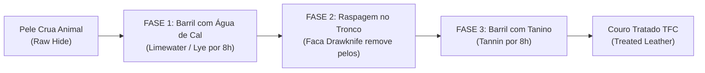

# 🔨 Guia Mestre: Processos Físicos, Forjas & Interações do Jogador

> *No TFC: Arcanum & Empires, os itens mais importantes do jogo não são montados instantaneamente em uma mesa de trabalho 3×3. Eles exigem **trabalho manual físico**: lascar rochas com os dedos, modelar argila, fundir ligas metálicas com controle térmico preciso, acertar o ritmo de marteladas na bigorna e curtir peles em barris.*

---

## 🗺️ Índice de Processos Físicos

| Processo | Ferramenta / Recipiente | Matéria-Prima | Resultado Obtido |
|---|---|---|---|
| **Knapping 5×5 (Lascamento)** | Mãos vazias / Pedras soltas | Rochas, Argila ou Couro cru | Pontas de ferramentas, cadinhos, moldes e selas |
| **Pit Kiln (Cova de Queima)** | Cova 1×1×1 + Palha e Toras | Cerâmicas secas e moldes crus | Cerâmicas vitrificadas, jarras e vasos resistentes |
| **Charcoal Forge (Forja)** | Forja + Fole (*Bellows*) | Carvão vegetal + Lingotes frios | Metais incandescentes em calor de trabalho |
| **Cadinho & Ligas Líquidas** | Cadinho refratário (*Crucible*) | Cobre, Estanho, Bismuto, Ouro | Bronze, Black Bronze, Ouro Rosa e Solda |
| **Minigame da Bigorna TFC** | Bigorna + Martelo + Fluxo | Lingotes e chapas incandescentes | Lâminas de espada, cabeças de picareta e chapas |
| **Curtume de Couro em 3 Fases** | Barris + Tronco + Drawknife | Peles cruas de animais abatidos | Couro tratado (*Treated Leather*) resistente |
| **Moagem no Quern** | Moedor de Pedra (*Quern*) | Grãos de cereal, calcário, minerais | Farinhas, pó de fluxo e pós alquímicos |
| **Sopro de Vidro** | Tubo de Sopro (*Blowpipe*) | Sílica fundida em cadinho de vidro | Garrafas, lentes de óculos e vidros de lâmpada |

---

## 1. Knapping 5×5 (Escultura Manual Primitiva)
*O primeiro método de fabricação da Idade da Pedra: esculpir fragmentos clicando em uma grade 5×5.*

```
Grade 5×5 de Lascamento (Exemplo: Cabeça de Machado de Pedra):
[ ] [X] [X] [X] [ ]   (Clique nos blocos marcados com [X]
[X] [X] [X] [X] [X]    para destacá-los e esculpir
[X] [X] [X] [X] [X]    a silhueta da ferramenta desejada)
[ ] [X] [X] [X] [ ]
[ ] [ ] [X] [ ] [ ]
```

### Tipos de Knapping:
1. **Lítico (Pedras Soltas):** Segure **2 pedras do mesmo tipo** (Ignea Intrusiva/Extrusiva, Metamórfica ou Sedimentar) e clique com o botão direito para abrir a grade 5×5. Remova as bordas para criar cabeças de machado, facas, pontas de lança, enxadas e pás.
2. **Argila (Clay Knapping):** Segure **5 bolas de argila** para esculpir vasos (*Vessels*), jarros de água (*Jugs*), potes de cozinha (*Pots*) e moldes de lingotes e ferramentas.
3. **Couro (Leather Knapping):** Use uma faca afiada sobre peles tratadas para cortar tiras de couro, selas de montaria e bainhas de espadas.

---

## 2. Pit Kiln (A Cova de Queima Cerâmica)
*Necessário para transformar cerâmicas frágeis não queimadas em recipientes refratários utilizáveis.*

1. **Escavação:** Cave um buraco de **1×1×1 bloco** na terra ou pedra.
2. **Posicionamento:** Coloque até **4 itens cerâmicos não queimados** no fundo da cova (Shift + Clique com o botão direito).
3. **Acamamento de Palha:** Segure **Palha (*Straw*)** e clique na cova 8 vezes consecutivas para cobrir completamente os itens.
4. **Camada de Troncos:** Segure **Toras de Madeira (*Logs*)** e clique na cova 8 vezes consecutivas para cobrir a palha com madeira densa.
5. **Ignição:** Acenda o topo da cova com uma tocha acesa ou acendedor. A cova entrará em combustão lenta a ~800 °C por aproximadamente **8 horas in-game**.
6. **Coleta:** Quando o fogo apagar e as cinzas sumirem, seus recipientes cerâmicos estarão perfeitamente vitrificados e prontos para uso!

---

## 3. Charcoal Forge & A Escala Térmica de Cores
*A forja a carvão vegetal eleva o metal a diferentes temperaturas de conformação mecânica.*

O TFC utiliza uma **escala visual de cores térmicas** que determina o que você pode fazer com o lingote:

| Cor Térmica | Temperatura Aprox. | Estado do Metal / Ação Possível |
|---|:---:|---|
| **Cold (Frio)** | < 100 °C | Metal rígido; quebra a bigorna se martelado |
| **Faint Red / Dark Red** | 400 °C – 600 °C | Início da maleabilidade; não suporta soldagem |
| **Bright Red** | 700 °C – 900 °C | **TEMPERATURA IDEAL DE FORJA:** Pode ser trabalhado na bigorna com menor desgaste |
| **Orange / Yellow** | 1000 °C – 1200 °C | **TEMPERATURA DE SOLDA (*WELDING*):** Permite unir lingotes com fluxo |
| **White** | 1300 °C – 1450 °C | Limite máximo; perigo de queimar o metal |
| **Brilliant White / Liquid** | > 1450 °C | **Fusão líquida:** O metal derrete e escorre caso não esteja em um cadinho |

> [!TIP]
> **Uso do Fole (Bellows):** Cada acionamento do fole injeta oxigênio na forja, elevando a temperatura em ~150 °C por alguns segundos. Mantenha o fole acionado para atingir a cor *Yellow* para soldas.

---

## 4. O Minigame da Bigorna TFC (Anvil Forging)
*Na bigorna do TFC, forjar é um minigame rítmico de precisão matemática e sequência de golpes.*

Ao colocar o metal quente na bigorna e selecionar o plano de trabalho (*Plan*), você verá duas agulhas:
- **Agulha Verde (Alvo):** A posição final que você precisa atingir.
- **Agulha Vermelha (Atual):** A sua posição de martelamento.

### Tabela Oficial de Valores dos Golpes:
Cada golpe empurra a agulha para a esquerda (negativo) ou para a direita (positivo):

| Golpe | Ícone do Botão | Deslocamento da Agulha | Descrição |
|---|:---:|:---:|---|
| **Heavy Hit** | Martelo Grande | **-15** | Pancada pesada de compressão |
| **Medium Hit** | Martelo Médio | **-9** | Golpe médio convencional |
| **Light Hit** | Martelo Pequeno | **-3** | Ajuste fino de precisão |
| **Draw** | Bigorna com Seta | **-6** | Estiramento do metal |
| **Punch** | Punção | **+2** | Perfuração suave |
| **Bend** | Curva | **+7** | Dobramento mecânico |
| **Upset** | Expansor | **+13** | Alargamento de extremidades |
| **Shrink** | Prensa | **+16** | Compressão de massa |

### As Duas Regras de Vitória Obrigatórias:
1. **Alinhamento Exato:** A agulha vermelha precisa terminar **perfeitamente sobreposta** à agulha verde.
2. **A Regra dos Três Últimos Golpes:** Os **3 últimos golpes** desferidos antes de a agulha alinhar precisam corresponder **exatamente** à sequência exigida pelo plano do item (por exemplo: `Hit`, `Bend`, `Punch`). Se a agulha alinhar mas o último golpe for errado, a peça não é forjada!

### Soldagem na Bigorna (*Welding*):
Para unir dois lingotes quentes e criar lingotes duplos (*Double Ingots*) ou chapas:
1. Aqueça ambos os metais até a cor **Yellow** ou **White**.
2. Coloque um lingote na bigorna e adicione **Pó de Fluxo (*Flux*)**.
3. Coloque o segundo lingote sobre a bigorna.
4. Com o martelo na mão, clique no botão **Weld** da interface da bigorna.

---

## 5. Curtume de Couro em 3 Fases (Tanning)
*Peles de animais abatidos apodrecem rapidamente se não passarem pelo processo químico do curtume:*



1. **Fase 1 (Limpeza Alcalina):** Encha um Barril com água doce e adicione pó de cal (*Lime Powder*) para criar **Água de Cal (*Limewater*)**. Coloque a pele crua e feche o barril por 8 horas in-game até ela virar uma *Pele Embebida (*Soaked Hide*)*.
2. **Fase 2 (Raspagem Mecânica):** Posicione um tronco de madeira na horizontal no chão. Coloque a pele embebida sobre o tronco. Com a **Faca de Raspagem (*Drawknife*)**, clique repetidamente até raspar todos os pelos e gordura, obtendo a *Pele Raspada (*Scraped Hide*)*.
3. **Fase 3 (Tingimento e Fixação):** Ferva cascas de árvore (*Tree Bark*) em um barril com água para extrair o **Tanino (*Tannin*)**. Coloque a pele raspada no barril de tanino e feche por mais 8 horas. Ao abrir, você obtém o verdadeiro **Couro Tratado (*Treated Leather*)**, imune a apodrecimento!
