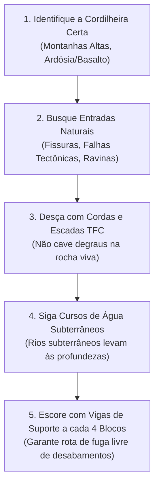

# ⚔️ Guia Mestre: Chefes Essenciais da História & Desafios Lendários

> *No universo de **TFC: Arcanum & Empires**, chefes e monstros lendários não são simples sacos de pancada: eles são os marcos que destravam Atos da Campanha, tecnologias metalúrgicas, eras mágicas e dimensões arcanas.*
>
> *Como o TerraFirmaCraft substitui a mineração tradicional por **geologia real, desabamentos sísmicos e física de cavernas**, encontrar e enfrentar esses titãs exige táticas de exploração orgânicas, preparação de expedições e cooperação em servidores.*

---

## 🗺️ Visão Geral: Mapa de Chefes por Atos da Campanha

| Chefe | Ato / Fase | Onde Encontrar (Bioma / Estrutura) | Nível de Aço Mínimo | Recompensa Principal & Desbloqueio |
|---|---|---|---|---|
| **Ferrous Wroughtnaut** | Ato I — Era dos Metais | Câmaras Subterrâneas de Pedra (`Y: 15 a 45`) | Cobre / Bronze | *Wrought Axe* (nunca quebra) e *Helm of the Steeler* |
| **Frostmaw** | Ato II — Frio & Alquimia | Picos Nevados & Geleiras (`Y > 130`) | Bronze / Ferro | *Ice Crystal* (sopro de gelo contínuo e resfriamento) |
| **Naga dos Penhascos** | Ato II — Montanhas | Desfiladeiros e Platôs Costeiros | Bronze / Ferro | *Naga Fang* (toxinas arcanas e adagas perfurantes) |
| **The Dead King** | Ato IV — Ápice Místico | Catacumbas Arcanas (Entrada em Florestas) | Ferro Forjado / Aço | *Blood Staff*, Mantos Arcanos e Magias Lendárias |
| **Forgotten Guardian** | Ato III — Undergarden | Catacumbas Esquecidas do Undergarden | Ferro Forjado | *Forgotten Ingot* (liga que ignora armaduras) |
| **Lord Pumpkinhead** | Ato IV — Terror Noturno | Altares de Floresta / Lua de Sangue | Ferro Forjado / Aço | Núcleos de *Dark Metal* e Gemas do Pesadelo |
| **O Warden** | Ato V — Profundezas Sísmicas | Cidades Ancestrais TFC (`Y: -40 a -60`) | **Aço (Steel)** | Aços Negro/Azul/Vermelho, *Echo Shards* e Gemas |
| **Ender Dragon** | Ato VI — Limiar Dimensional | Portal do The End de Aço Negro | Aço Negro | *Dragon Heart*, Elytra e Acesso ao Vazio Profundo |
| **The Chaos Guardian** | Ato VI — Clímax Cósmico | Ilha do Caos Primordial (X/Z: ~10.000) | **Aço Azul / Vermelho** | *Chaos Shard* ➔ **Pilão da Purificação Cósmica** |

---

## ⛏️ Manual de Sobrevivência: Como Encontrar Estruturas Subterrâneas no TFC Sem Cavar em Linha Reta

No Minecraft Vanilla, o jogador apenas cava reto para baixo até o fundo do mundo (*strip mining*). **No TFC, isso é morte certa:**
- Quebrar rocha sem escoramento causa **desabamentos em cadeia (*cave-ins*)** que soterram e matam o jogador instantaneamente.
- As tochas normais do TFC **apagam com o tempo** (~72 horas in-game) ou sob chuva.
- Não existe água infinita para escalar paredes de poços.

### Como Achar Câmaras e Cidades Subterrâneas com Segurança:

### O Kit de Expedição Obrigatório para Servidores e Jogadores Casuais:
1. **Iluminação Permanente:** Leve **Lamparinas de Azeite (Oil Lamps)** com azeite de oliva ou sebo animal. Elas não apagam com o tempo nem com vento, fornecendo luz eterna para a base subterrânea.
2. **Vigas de Suporte (Support Beams):** Leve pelo menos **2 a 3 pilhas (stacks)** de vigas de madeira do TFC. A cada 4 a 5 blocos abertos em um túnel, coloque dois pilares verticais e conecte uma viga horizontal no teto.
3. **Cordas do TFC (`tfc:rope`) & Escadas:** Quando encontrar uma fenda gigante ou ravina que despenca 50 blocos, amarre uma corda no topo e desça deslizando. É 100% seguro contra desabamento.
4. **Comida Não Perecível:** Alimentos crus apodrecem rápido no calor subterrâneo. Leve carnes salgadas com sal marinho do TFC ou armazene suas refeições dentro de **Potes Cerâmicos Selados (Sealed Ceramic Vessels)**, que multiplicam a durabilidade dos alimentos em mais de 10×.
5. **Água Doce:** Encha 3 a 4 **Jarros Cerâmicos (Ceramic Jugs)** em nascentes de água doce antes de descer. Cavernas profundas raramente têm água potável doce (muitas contêm água salgada ou ácida).

---

## 🛡️ Detalhamento dos Chefes por Atos & Estratégias

---

### 1. Ferrous Wroughtnaut (O Cavaleiro de Ferro Esquecido) — Ato I
*Uma colossal estátua mecânica forjada em ferro ancestral que patrulha sua câmara funerária há milênios.*

- **Biomas & Geologia:** Camadas rochosas intermediárias (`Y: 15 a 45`), geralmente sob florestas e planícies com rochas ígneas intrusivas (Granito, Diorito, Gabro).
- **Como Encontrar Sem Cavar às Cegas:**
  - Desça por cavernas naturais médias ou siga cursos de água subterrâneos.
  - Conforme você se aproxima, você ouvirá o som característico de engrenagens mecânicas e passos metálicos pesados ecoando pelas paredes da caverna.
  - A câmara do chefe é uma estrutura quadrada de tijolos de pedra cinzenta (*Stone Bricks*) com uma porta de 2 blocos de largura. O interior é uma arena aberta onde o teto já é reforçado e seguro.
- **Por que Enfrentar:**
  - Dropa o **Wrought Axe**, um machado de combate devastador com **durabilidade infinita** (nunca quebra na forja nem no combate).
  - Dropa o **Helm of the Steeler**, um elmo lendário que concede invulnerabilidade frontal absoluta contra projéteis e ataques leves.
- **Dicas Táticas (Solo & Servidor):**
  - **Frente Blindada:** A armadura frontal do Wroughtnaut é 100% impenetrável. Flechas, magias e golpes de espada pela frente não causam dano.
  - **O Truque do Golpe Vertical:** Mantenha distância média de 3 a 4 blocos. Quando ele erguer o machado acima da cabeça com as duas mãos, prepare-se para esquivar lateralmente. O golpe dele afunda o machado no chão de pedra, onde ele fica preso por cerca de 3 segundos.
  - **Ponto Fraco:** Corra rapidamente para as costas dele e golpeie a fenda exposta em sua carapaça.
  - **Em Servidores (Coop):** Um jogador serve de isca (*tank*) andando para trás com escudo, enquanto o segundo jogador fica posicionado atrás para desferir golpes críticos com lança de ferro forjado.

---

### 2. Frostmaw (A Besta Glacial Adormecida) — Ato II
*Um gigantesco titã de gelo ancestral que hiberna sob o frio extremo das montanhas mais altas do mundo.*

- **Biomas & Localização:** Picos nevados, tundras montanhosas e geleiras do TFC (`#c:is_snowy`, `#c:is_mountain`), sempre em elevações elevadas (`Y > 130`).
- **Como Localizar na Superfície:**
  - Durante o dia límpido, olhe para as cordilheiras mais altas no horizonte. O covil do Frostmaw é uma depressão circular em forma de tigela na neve, cercada por espigões de gelo e ossos gigantes espalhados.
  - **Atenção ao Inverno do TFC:** Nos meses frios in-game, as temperaturas nas montanhas caem para -15 °C. Se você subir sem botas de couro reforçadas e roupas forradas com lã (*Wool Cloth*), sofrerá hipotermia antes mesmo de avistar a fera.
- **Por que Enfrentar:**
  - Guarda o lendário **Ice Crystal**. Quando empunhado na mão principal ou secundária, você pode canalizar um jato contínuo de sopro glacial que congela inimigos, apaga incêndios e resfria lingotes incandescentes de forja instantaneamente sem precisar de água.
- **Dicas Táticas:**
  - O Frostmaw dorme profundamente no centro do covil. **Não ataque desajeitadamente pela frente!**
  - Ao ser acordado, ele salta rugindo e golpeia o solo com uma enorme clava congelada, arremessando qualquer um ao redor pelo ar.
  - Beba poções de calor ou acenda fogueiras nos arredores do covil para manter a temperatura corporal.
  - Use armadura de Bronze ou Ferro Forjado. Mantenha-se móvel, esquive-se do sopro de gelo correndo em círculos e desfira golpes nos calcanhares da criatura enquanto ele se recupera dos golpes de clava.

---

### 3. Naga dos Penhascos — Ato II
*Uma serpente alada predadora que domina as correntes de vento dos cânions e desfiladeiros.*

- **Biomas:** Penhascos íngremes, cânions rochosos e platôs montanhosos costeiros.
- **Como Encontrar:** Olhe para o céu ao caminhar perto de grandes desfiladeiros de pedra; você a verá planando em círculos abertos.
- **Por que Enfrentar:** Suas presas (*Naga Fangs*) são o componente central para forjar adagas de ataque ultraveloz e elixires alquímicos que neutralizam venenos e corrosão ácida.
- **Dica Tática:** Quando ela se preparar para um voo rasante em sua direção, erga um escudo de ferro forjado no momento do impacto. A colisão contra o escudo atordoa a serpente, que cai no chão sem poder voar por alguns segundos, abrindo janela para combos com espada e maça.

---

### 4. The Dead King (O Rei dos Mortos) — Ato IV (*Essencial para o Sistema Mágico*)
*O primeiro imperador que fundiu o conhecimento arcano e a nigromancia antes da Fratura Primordial.*

- **Onde Encontrar (Estruturas na Superfície):**
  - O Dead King reside em **Catacumbas Arcanas Subterrâneas**, mas a sua entrada gera **diretamente na superfície**!
  - Ao explorar florestas densas, bosques sombrios ou colinas antigas, procure por ruínas de mausoléus de pedra musgosa com pequenas lápides ao redor. No centro do mausoléu haverá uma escadaria de tijolos de ardósia descendo em espiral até o complexo funerário.
- **Por que é Essencial para a Progressão:**
  - **Ele é o portão de progressão mística do Iron's Spells.** Sem derrotá-lo, o jogador não consegue obter o lendário **Blood Staff** nem os componentes necessários para forjar pergaminhos e feitiços de **Tier Épico e Lendário**.
  - Dropa mantos arcanos ancestrais que multiplicam a sua regeneração de mana e ampliam o poder de todas as escolas de magia.
- **Estratégia de Duas Fases:**
  - **Fase 1 (O Corpo Físico):** O Rei conjura relâmpagos em área e esferas de fogo negro, invocando cavaleiros decrépitos como guarda-costas. Mantenha distância usando arcos compostos do TFC com flechas de ponta de ferro ou feitiços de luz/sagrado (*Holy*), que causam o dobro de dano em mortos-vivos.
  - **Fase 2 (A Alma Espectral):** Ao destruir o corpo, sua alma espectral se ergue dos ossos. Ele se move com o dobro de velocidade, atravessa colunas e seus ataques causam dano arcano penetrante que ignora armaduras físicas comuns. Beba poções de resistência arcana, use feitiços de proteção e concentre fogo concentrado para dissipar sua névoa de almas.

---

### 5. Forgotten Guardian & Masticator (The Undergarden) — Ato III
*Antigos titãs que guardam os segredos biológicos e minerais da dimensão corrosiva do Undergarden.*

- **Como Chegar ao Undergarden no TFC:**
  - Construa uma moldura de portal retangular (formato 4×5 estilo Nether) usando **Tijolos de Pedra do TFC** e ative o portal com o **Undergarden Catalyst** (obtido combinando esporos e pó alquímico na bancada).
- **Onde Encontrar nas Profundezas:**
  - O Forgotten Guardian habita as **Catacumbas Esquecidas** (*Forgotten Catacombs*), enormes labirintos subterrâneos de clogrume enterrados no Undergarden.
- **Por que Enfrentar:**
  - Dropa o **Forgotten Ingot**, um metal dimensional que ignora a resistência natural de armaduras de inimigos e nunca sofre corrosão por venenos.
- **Dicas de Sobrevivência no Undergarden:**
  - A atmosfera do Undergarden é escura e sufocante. Bússolas convencionais giram descontroladas.
  - Leve Lamparinas de Azeite e plante *Shard Torches* no solo a cada curva para nunca perder o caminho de volta para o portal dimensional.

---

### 6. O Warden (O Horror Acústico das Profundezas) — Ato V (*Desafio Sísmico Máximo*)
*Uma monstruosidade cega guiada exclusivamente por vibrações e sons, incubada nos leitos de ardósia e basalto negro mais profundos do planeta (`Y: -40 a -60`).*

- **Onde e Como Encontrar no TFC (Guia Sem Cavar):**
  - Cidades Ancestrais no TFC não geram aleatoriamente sob qualquer terreno plano. Elas geram sob **grandes cordilheiras montanhosas** que possuem camadas inferiores de **Ardósia (Slate)** ou **Basalto Negro**.
  - Procure por fendas montanhosas profundas e desça com cordas até avistar a bioluminescência azulada do Sculk sobre a rocha negra.

> [!CAUTION]
> ### ⚠️ Mecânica Especial do Modpack: O Terremoto Sísmico do Warden
> No nosso modpack, as vibrações sonoras do Warden são físicas e afetam o ambiente:
> - Toda vez que o Warden ruge ou ataca, ele dispara um **abalo acústico que desaba o teto da caverna** caso a área não esteja escorada!
> - Pedras caindo atordoam o jogador e causam dano por esmagamento.
> 
> **A Regra de Ouro:** Antes de iniciar qualquer combate ou exploração agressiva, instale **Vigas de Suporte (Support Beams)** do TFC nos corredores em intervalos de 4 a 5 blocos. Se o teto estiver escorado com vigas, as pedras NÃO caem!

> [!IMPORTANT]
> ### ⛏️ Sculk Fossilizado: Exige Ferramentas de Aço!
> O Sculk antigo petrificou com a pressão geológica. Se você tentar minerar ou quebrar blocos de Sculk com picaretas ou enxadas de cobre, bronze ou ferro comum, o bloco ricocheteia uma onda de choque que causa **Cegueira, Lentidão e dano direto ao jogador**.
> 
> **Utilize ferramentas de Aço (Steel), Aço Negro ou Ligas Nobres do TFC!**

- **Por que Vale a Pena Enfrentar / O que Guarda:**
  - As Cidades Ancestrais guardam os maiores tesouros de sobrevivência do jogo: baús com **barras prontas de Aço Negro, Aço Azul e Aço Vermelho**, *Echo Shards*, gemas lapidadas perfeitas e moldes raros de metalurgia que economizam dezenas de horas de forja.
- **Tática de Exploração em Servidores (O Jeito Inteligente):**
  - **Ande Agachado (Shift):** Seus passos não emitem vibrações sonoras enquanto você estiver agachado.
  - **Trilhas de Lã:** Leve blocos de lã. A lã absorve 100% das vibrações sonoras. Crie pontes e caminhos de lã entre os baús e cubra os *Sculk Shriekers* com 4 blocos de lã ao redor para que eles fiquem mudos e nunca convoquem o monstro.
  - **Se o Warden Despertar:** Não tente bater de frente no corpo a corpo sem poções defensivas. O ataque sônico (*Sonic Boom*) dele atravessa paredes e causa dano penetrante massivo. Se precisar enfrentá-lo, use arcos de longo alcance com flechas de ponta de aço e mantenha pelo menos 20 blocos de distância, esquivando-se lateralmente quando ele canalizar energia azul no tórax.

---

### 7. Ender Dragon (O Dragão do Limiar) — Ato VI
*A besta que ancora o tecido do Vazio e impede a expansão da fenda do Caos.*

- **Como Abrir o Portal do The End no Modpack:**
  - As molduras do portal do End **não** aparecem ativadas.
  - Para abrir a passagem para o Fim, os jogadores devem forjar as molduras combinando **Chapas e Blocos de Aço Negro do TFC**, o **Receptáculo de Almas** (Corail Tombstone) e o **Olho Ancestral Infundido** com Essência Arcana.
- **Por que Enfrentar:**
  - Concede o lendário **Coração do Dragão (Dragon Heart)**, além de liberar o acesso às Cidades do End, ao Elytra e ao Vazio Profundo.

---

### 8. The Chaos Guardian (O Chefe Final da Campanha) — Ato VI
*A entidade primordial de entropia pura que reside no Vazio Profundo do End e causou a Fratura dos Pilões e a maldição da Lua de Sangue.*

- **Onde Habita:**
  - Reside na **Ilha do Caos Primordial**, situada a **~10.000 blocos de distância** do centro da dimensão do The End (por exemplo, nas coordenadas X: 10.000 / Z: 0 ou X: 0 / Z: 10.000).
- **Como Chegar Vivo nas Coordenadas Cósmicas:**
  - Não tente caminhar por pontes de blocos — o Vazio é infinito.
  - Utilize **Poções de Voo Místico** ou um **Elytra reforçado com afixos lendários do Apotheosis** e foguetes de longo alcance.
- **A Batalha Final Passo a Passo:**
  1. **Fase da Imunidade (Os Cristais do Caos):** Ao se aproximar da ilha, o Chaos Guardian possui um escudo cinético de 100% de invulnerabilidade. Na órbita da ilha existem cristais de energia protegidos por gaiolas de ferro.
  2. Voe entre as torres, desvie das esferas de antimatéria teleguiadas e quebre as grades de ferro com picareta de Aço Azul para explodir cada um dos cristais do caos.
  3. **Fase do Combate Direto:** Sem os cristais, o escudo dele colapsa. Suas esferas de fogo cósmico causam dano que ignora proteções simples. Exige armadura completa de **Aço Vermelho (Red Steel)** ou **Aço Azul (Blue Steel)** refinada na bigorna e infusões de resistência mágica.
- **A Vitória e o Fechamento da História:**
  - Derrotar o Chaos Guardian concede o lendário **Chaos Shard (Fragmento do Caos)**.
  - Com o Chaos Shard, você forja o **Pilão da Purificação Cósmica (Ultimate Infusion Pylon)**. Ao ativar este pilão no coração do seu império, a maldição da Lua de Sangue é erradicada para sempre, restaurando o Selo Primordial e garantindo paz eterna para a sua civilização!
