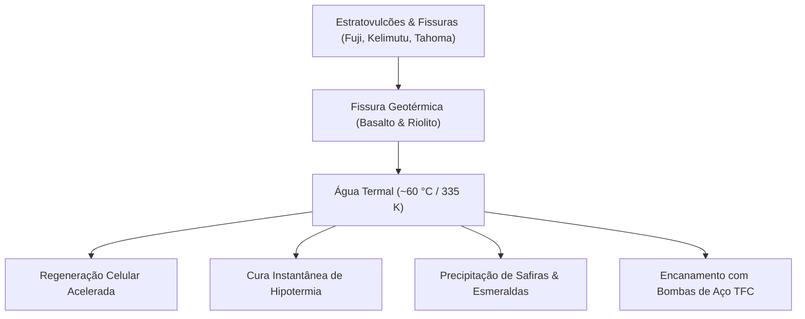
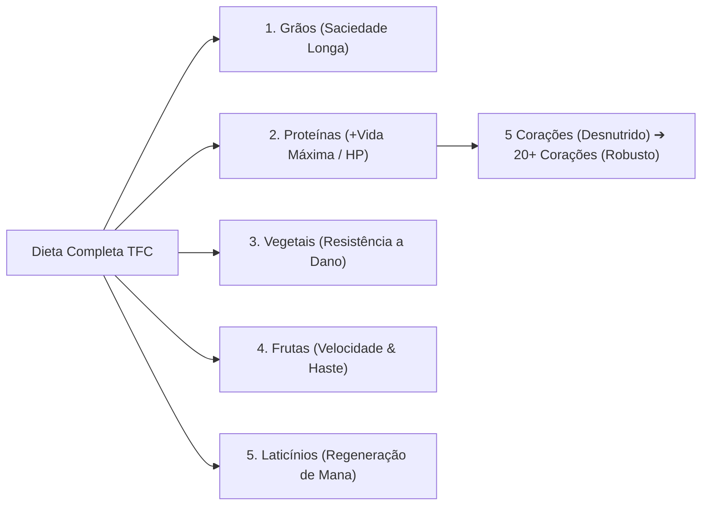
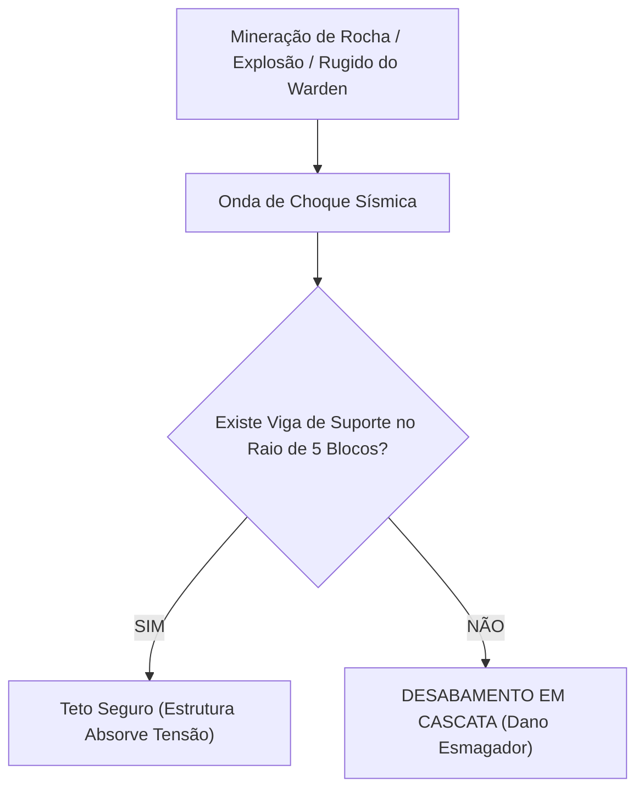

# ⚙️ Guia Mestre de Mecânicas, Físicas & Fisiologia

> **TerraFirmaCraft: Arcanum & Empires (NeoForge 1.21.1 — v1.3.0)**  
> **Escopo:** Fisiologia humana, águas termais geotérmicas, nutrição celular, termorregulação, colapso sísmico de cavernas, termodinâmica metalúrgica e eventos cósmicos.

---

## 🧭 Índice Temático das Mecânicas
1. [♨️ Águas Termais Vulcânicas & Geotermia](#1-️-águas-termais-vulcânicas--geotermia)
2. [🥗 Fisiologia Nutricional de 5 Grupos & Saúde Dinâmica](#2--fisiologia-nutricional-de-5-grupos--saúde-dinâmica)
3. [🥩 Mecânica de Apodrecimento (Decay) & Preservação Eterna](#3--mecânica-de-apodrecimento-decay--preservação-eterna)
4. [🌡️ Termorregulação Corporal (Hipotermia vs Hipertermia)](#4-️-termorregulação-corporal-hipotermia-vs-hipertermia)
5. [💧 Hidratação, Sede & Purificação de Fluidos](#5--hidratação-sede--purificação-de-fluidos)
6. [🪨 Física Sísmica, Desabamentos (Cave-ins) & Vigas](#6--física-sísmica-desabamentos-cave-ins--vigas)
7. [🔍 Prospecção Geológica & Triangulação Mineral](#7--prospecção-geológica--triangulação-mineral)
8. [🔥 Termodinâmica de Forjas & Escala de Cores Incandescentes](#8--termodinâmica-de-forjas--escala-de-cores-incandescentes)
9. [🔨 Metalurgia da Bigorna: A Regra dos Três Últimos Golpes](#9--metalurgia-da-bigorna-a-regra-dos-três-últimos-golpes)
10. [🌕 Ciclos Celestes: Luas de Sangue, Colheita e Azul](#10--ciclos-celestes-luas-de-sangue-colheita-e-azul)
11. [⚡ Mecânicas Arcanas de Servidor: Atenção do Dragão & Mana](#11--mecânicas-arcanas-de-servidor-atenção-do-dragão--mana)

---

## 1. ♨️ Águas Termais Vulcânicas & Geotermia

O TerraFirmaCraft simula a atividade hidrotermal da crosta terrestre através do fluido canônico **Água Termal (`tfc:spring_water`)**.



### 1.1 Localização & Geologia de Formação
* **Biomas & Estruturas:** As águas termais brotam nas encostas e caldeiras dos grandes estratovulcões do TFC (*Crater Lake, Kelimutu, Fuji e Tahoma*), fluindo por fissuras de rochas vulcânicas extrusivas (**Basalto**, **Riolito**, **Dacito** e **Andesito**).
* **Marcadores Visuais:** Produzem colunas ascendentes de bolhas de vapor borbulhante (`spring_water_bubble_column`) com partículas visíveis de calor.

### 1.2 Efeitos Fisiológicos no Jogador
1. **Regeneração e Cura Acelerada:** Estar submerso em água termal relaxa a musculatura, acelera a cicatrização de ferimentos graves e recupera corações de vida sem consumir a saturação de alimentos na velocidade convencional.
2. **Combate à Hipotermia:** O fluido possui temperatura constante de ~330 K a 345 K (~57 °C a ~72 °C). Mergulhar em uma piscina termal zera imediatamente o acúmulo de congelamento corporal, salvando exploradores apanhados por nevascas montanhosas.
3. **Alívio da Estamina:** Restaura a barra de vigor físico (*Stamina*), permitindo retomar corridas e minerações pesadas rapidamente.

### 1.3 Berço de Safiras e Esmeraldas
As fissuras geotérmicas de água termal atuam como aceleradores químicos da crosta. O fluido mineral superaquecido dissolve silicatos, precipitando veios raros de **Safiras Brutas (`tfc:ore/sapphire`)** e **Esmeraldas Brutas (`tfc:ore/emerald`)** diretamente encrustadas nas paredes das fendas térmicas.

### 1.4 Coleta, Banheiras e Saunas Residenciais
* **Coleta em Baldes:** Pode ser recolhida em Baldes de Metal TFC e transportada para a base residencial.
* **Encanamento Mecânico:** Pode ser canalizada horizontal e verticalmente usando **Bombas de Aço (`tfc:metal/steel_pump`)** e **Tubos de Aço (`tfc:metal/steel_pipe`)** para criar termas de recuperação em vilas e fortalezas de clãs.

---

## 2. 🥗 Fisiologia Nutricional de 5 Grupos & Saúde Dinâmica

No modpack, a barra de vida máxima do jogador não é um valor estático de 10 corações. A integridade física é regida pela **alimentação diversificada**:



| Grupo Nutricional | Fontes Comuns no TFC | Efeito Fisiológico Principal | Benefício Tático |
| :--- | :--- | :--- | :--- |
| 🌾 **Grãos (Carboidratos)** | Trigo, Cevada, Aveia, Centeio, Milho, Arroz | **Saciedade Prolongada** | Retarda a velocidade com que a barra de fome decai em caminhadas. |
| 🥩 **Proteínas** | Carne bovina, suína, carneiro, frango, caça, peixes | **Expansão de Vida Máxima (HP)** | Aumenta o número total de corações (de 5 até mais de 20 corações). |
| 🥕 **Vegetais** | Cenoura, batata, repolho, cebola, alho, pimentão | **Resistência Física** | Reduz o dano sofrido por golpes cortantes, flechas e concussão. |
| 🍎 **Frutas** | Maçã, pêssego, banana, bagas silvestres, laranja | **Agilidade & Pressa** | Concede maior velocidade de corrida e pressa de mineração (*Haste*). |
| 🧀 **Laticínios** | Leite ordenhado, queijos maturados em barril | **Poder & Reserva Arcana** | Amplia a resistência contra magias hostis e regenera Mana velozmente. |

> [!IMPORTANT]
> **A Regra de Ouro da Sobrevivência:** Um jogador alimentado apenas com carne terá muita vida máxima, mas sofrerá de lentidão e fome rápida por falta de grãos e frutas. Mantenha os 5 indicadores nutricionais equilibrados pressionando **[N]** para inspecionar seu gráfico de nutrição.

---

## 3. 🥩 Mecânica de Apodrecimento (*Decay*) & Preservação Eterna

Nenhum alimento orgânico é eterno no ecossistema do TFC. A carne crua apodrece em poucos dias, transformando-se em resíduo tóxico que causa náusea e envenenamento.

### 3.1 Variáveis que Aceleram o Apodrecimento
* **Temperatura do Bioma:** Carnes em desertos ou planícies tropicais apodrecem 3x mais rápido do que em tundras glaciais.
* **Exposição ao Ar Livre:** Deixar comida solta no inventário acelera a contaminação microbiana.

### 3.2 Métodos de Preservação Comprovados
1. **Salga Marinha (*Salt Curing*):**  
   Ferver água do mar em um **Pote Cerâmico** gera **Pó de Sal (`tfc:powder/salt`)**. Misturar sal com carnes e peixes na bancada estende a validade em **mais de 400%**.
2. **Potes Cerâmicos Herméticos (*Sealed Vessels*):**  
   Vasos cerâmicos queimados no Pit Kiln e selados reduzem a taxa de decomposição em **90%**, preservando queijos e grãos por anos in-game.
3. **Adegas Subterrâneas de Gelo (*Ice Houses*):**  
   Câmaras frias escavadas nas profundezas e abastecidas com blocos de Gelo Compacto reduzem a temperatura ambiente a 0 °C, congelando o decaimento.
4. **Vinagre & Conservas em Barril (*Pickling*):**  
   Mergulhar vegetais em barris selados com vinagre produz picles crocantes com validade quase infinita.

---

## 4. 🌡️ Termorregulação Corporal (Hipotermia vs Hipertermia)

O jogador possui temperatura interna constante que busca equilíbrio com o ambiente:

```
[ CONGELAMENTO / HIPOTERMIA ] <---- [ ZONA DE CONFORTO: 37 °C ] ----> [ INSOLAÇÃO / HIPERTERMIA ]
 Tremores, lentidão extrema,            Taxa basal normal de fome        Queima de sede em 300%,
 respiração ofegante, dano de gelo.         e hidratação.                náusea, dano por calor.
```

### 4.1 Sobrevivência no Frio Severo (Inverno & Picos Nevados)
* **Sintomas:** Bordas da tela congeladas, estamina travada e perda contínua de vida por congelamento.
* **Contramedidas:**
  - Vestir armaduras com forro de lã ou peles tratadas.
  - Portar tochas acesas na mão secundária (*off-hand*).
  - Descansar ao lado de fogueiras acesas ou mergulhar em **Águas Termais**.

### 4.2 Sobrevivência no Calor Extremo (Verão & Desertos Vulcânicos)
* **Sintomas:** Visão turva, queima de água 3x mais rápida e dano térmico contínuo.
* **Contramedidas:**
  - Vestir roupas leves de linho e estopa.
  - Evitar operar fornos e bigornas ao meio-dia sob sol pleno.
  - Buscar a sombra de copas de árvores densas ou cavernas ventiladas.
  - Banhos em rios correntes de água doce.

---

## 5. 💧 Hidratação, Sede & Purificação de Fluidos

A barra de sede decai continuamente com o esforço físico (correr, pular, minerar e forjar metais).

* **Água Potável Segura:** Água doce de rios com correnteza rápida ou lagos montanhosos.
* **Água Contaminada / Salgada:** Beber água do mar ou poças paradas de pântano causa desidratação imediata e efeito de náusea.
* **Purificação Canônica:**
  - Encha garrafas de vidro ou potes cerâmicos com água bruta e ferva sobre a fogueira.
  - Para viagens longas, utilize a **Chaleira de Cobre (*Copper Kettle*)** para criar chás que eliminam a fadiga e saciam a sede por longos períodos.

---

## 6. 🪨 Física Sísmica, Desabamentos (*Cave-ins*) & Vigas

Ao contrário do Minecraft convencional, o teto das cavernas do TerraFirmaCraft obedece à gravidade real:



### 6.1 Estabilidade dos Tipos de Rocha
* **Ígneas Intrusivas (Granito, Diorito, Gabro):** As mais seguras. Suportam grandes vãos sem desabar espontaneamente.
* **Metamórficas (Mármore, Gneisse, Quartzito):** Estabilidade intermediária.
* **Sedimentares (Calcário, Arenito, Argilito):** Altamente instáveis. Qualquer bloco quebrado pode derrubar dezenas de toneladas de cascalho e pedra sobre o minerador.

### 6.2 Instalação de Vigas de Suporte (*Support Beams*)
* As vigas são fabricadas com toras de madeira e serradas na carpintaria.
* **Regra de Cobertura:** Cada pilar vertical de viga protege um teto horizontal de até **5 blocos de raio**.
* Nunca escave minérios no subsolo profundo sem antes cravar vigas verticais e travessas horizontais de madeira.

### 6.3 O Colapso Acústico do Warden
Nas Cidades Ancestrais subterrâneas, o rugido sônico (*Sonic Boom*) do Warden produz uma onda sísmica de alta potência. Se a sala da batalha não estiver reforçada com vigas de suporte, o impacto sônico provoca desabamentos massivos de ardósia, esmagando o jogador e soterrando baús de relíquias.

---

## 7. 🔍 Prospecção Geológica & Triangulação Mineral

No TFC, os minérios não se distribuem em blocos isolados no teto de cavernas. Eles se concentram em **megaveios tridimensionais** invisíveis da superfície.

### 7.1 Indicadores Naturais de Superfície
Caminhe olhando atentamente para o solo: **seixos de minério soltos (Pebbles)** no capim indicam que existe um veio mineral diretamente abaixo ou na rocha matriz adjacente (ex: seixos de Malaquita indicam cobre profundo; seixos de Hematita indicam ferro rico).

### 7.2 O Martelo de Prospecção (*Propick*)
* Clique com o botão direito na rocha para escanear um volume cônico em profundidade.
* **Respostas do Martelo:**
  1. *Nothing:* Nenhum traço mineral no cone de leitura.
  2. *Very Low / Low:* Margem periférica do depósito.
  3. *Medium:* Proximidade do corpo mineral.
  4. *High:* Núcleo denso do depósito.
* **Método da Cruz (Triangulação):** Ao obter uma leitura *Low*, escave 10 blocos ao Norte, Sul, Leste e Oeste. As leituras que subirem para *Medium* e *High* indicarão o vetor exato do coração do veio.

---

## 8. 🔥 Termodinâmica de Forjas & Escala de Cores Incandescentes

Metais não passam de sólido para líquido em um segundo. Eles seguem a curva termodinâmica real de aquecimento:

```
[ TEMPERATURA ] --------> COR VISÍVEL ---------> ESTADO FÍSICO / MECÂNICO
   ~600 °C                Faint Red               Frio demais (quebra se forjado)
   ~750 °C                Dark Red                Início da maleabilidade
   ~900 °C                Bright Red              Maleável (Workable)
   ~1050 °C               Orange                  Forjamento ideal na Bigorna
   ~1200 °C               Yellow                  Soldável (Weldable - exige Fluxo)
   >1350 °C               White                   Risco de queima / perda de material
   >1500 °C               Brilliant White         Ponto de Fusão Líquido (Cadinho)
```

* **Manuseio com Pinça:** Nunca retire metais incandescentes com a mão desprotegida; utilize pinças de ferreiro (*Tongs*).
* **Foles (*Bellows*):** Forjas a carvão vegetal atingem cerca de 1000 °C por conta própria. Para alcançar o calor amarelo e branco de solda e fusão do aço, foles manuais ou acionados por torque do *Create* devem bombear ar contínuo na boca de fogo.

---

## 9. 🔨 Metalurgia da Bigorna: A Regra dos Três Últimos Golpes

Forjar uma espada, armadura ou chapa na Bigorna TFC é um enigma mecânico de alta precisão.

### 9.1 A Interface da Bigorna
* **Ponteiro Vermelho:** Posição atual do metal.
* **Ponteiro Verde:** Alvo final exigido pela receita.
* O objetivo é fazer o ponteiro vermelho coincidir perfeitamente sobre o ponteiro verde.

### 9.2 As Técnicas de Martelo & Valores Numéricos
| Técnica | Ícone | Variação no Ponteiro |
| :--- | :---: | :---: |
| **Light Hit** (Golpe Leve) | Martelo Pequeno | `+3` |
| **Medium Hit** (Golpe Médio) | Martelo Médio | `+6` |
| **Heavy Hit** (Golpe Pesado) | Martelo Pesado | `+9` |
| **Draw** (Estiramento) | Cunha Lateral | `-15` |
| **Punch** (Punção) | Cinzel Central | `+2` |
| **Bend** (Dobra) | Curvatura | `+7` |
| **Upset** (Recalque) | Bigorna Superior | `+13` |
| **Shrink** (Encolhimento) | Prensa Lateral | `-16` |

### 9.3 A Regra dos 3 Últimos Golpes
Além de alinhar os ponteiros no zero, **os 3 últimos golpes aplicados devem ser exatamente os mesmos descritos no plano de forjamento** (ex: *Hit, Bend, Punch*). Se os ponteiros estiverem perfeitamente alinhados, mas o último golpe for incorreto, a peça é arruinada.

---

## 10. 🌕 Ciclos Celestes: Luas de Sangue, Colheita e Azul

O modpack implementa eventos astrológicos periódicos através do *Enhanced Celestials*:

### 10.1 Lua de Sangue (*Blood Moon*)
* O céu se tinge de vermelho escuro e uma névoa densa cobre o horizonte.
* **Física Hostil:**
  - Mobs agressivos brotam em velocidade tripla, ignorando completamente o nível de luz emitido por tochas e fogueiras.
  - Monstros rompem portas de madeira e escalam defesas rústicas.
  - Dormir em camas é estritamente bloqueado.
* **Estratégia:** Recuar para o interior de vilas protegidas por Pilões de Expulsão, acionar guardas do Millager e defender o perímetro com arcos e lanças.

### 10.2 Lua da Colheita (*Harvest Moon*)
* O céu noturno assume um brilho dourado aconchegante.
* **Bênçãos:** Plantações agrícolas crescem a velocidades quádruplas e animais domesticados geram ninhadas duplas com menor tempo de maturação.

### 10.3 Lua Azul (*Blue Moon*)
* O éter cósmico transborda energia pura.
* **Bênçãos:** A regeneração passiva de Mana do *Ars Nouveau* e *Iron's Spells* é acelerada em 50%, e a probabilidade de infusão bem-sucedida de joias e encantamentos é maximizada.

---

## 11. ⚡ Mecânicas Arcanas de Servidor: Atenção do Dragão & Mana

Para equilibrar comandos utilitários com a sobrevivência canônica, ações mágicas possuem custos e salvaguardas:

### 11.1 Teleporte com Consumo de Mana Real
* Os comandos `/home`, `/tpa` e `/back` consomem **50 pontos de Mana real** do jogador.
* Se as reservas mágicas do personagem estiverem vazias, o teleporte é cancelado com notificação de exaustão mística.

### 11.2 Consagração de Vilas & Atenção do Dragão
* Os comandos `/consagrar` e `/proteger_vila` custam **100 de Mana** (ou 4 frascos de XP) e erguem um santuário protetor com Waystone aos pés do jogador.
* **Mecânica Anti-Abuso (Atenção do Dragão):**
  - **Usos 1 a 3 (Seguro):** Notificação serena informando a estabilidade do éter.
  - **Uso 4+ em menos de 5 minutos (Ira do Dragão):** O jogador rompe o tecido místico.
    - Efeito de **Brilho Místico (Glowing)** forçado por 3 minutos.
    - Efeito de **Mau Presságio (Bad Omen)** por 5 minutos.
    - Todos os monstros em um raio de **35 blocos** entram em fúria imediata e caçam o infrator.
    - Invocação imediata de uma vanguarda sombria (*Dread Hounds* e *Nightmare Stalkers*).
