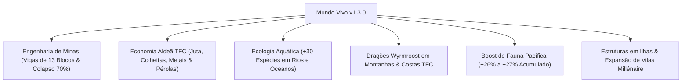

# 🌍 Geração de Mundo, Engenharia de Vigas & Economia de Trocas

> **TerraFirmaCraft: Arcanum & Empires (NeoForge 1.21.1 — v1.3.0)**  
> **Status:** Balanceamento Ativo no Servidor & Cliente  
> **Base de Configuração:** `docs/balanceamento_e_ajustes.md`, `config/tfc-server.toml` e KubeJS Data Modifiers.

---

## 🧭 Visão Geral das Alterações
Para transformar o Overworld em um ambiente geologicamente crível, economicamente integrado e ecologicamente vibrante, a atualização **v1.3.0** implementou três grandes pilares de rebalanceamento:

1. **Engenharia de Minas Realista:** Fim dos blocos flutuantes feios em cavernas; a física de desmoronamentos agora propaga em cadeia contínua e as **Vigas de Suporte** foram aprimoradas para cobrir vãos muito mais amplos.
2. **Economia de Trocas dos Aldeões (VillagerTradingPlus):** Erradicação de trocas genéricas vanilla. Aldeões agora compram colheitas sazonais, aniagem de juta e metais TFC, vendendo ferramentas de prospecção, pergaminhos arcanos e armaduras legítimas.
3. **Ecologia Aquática dos Biomas:** Rios, pântanos, lagos montanhosos e mares foram repovoados com mais de 30 espécies ativas de peixes, mamíferos marinhos e aves aquáticas.



---

## 1. 🪨 Engenharia de Minas: Desmoronamentos & Alcance das Vigas

O sistema de sustentação de cavernas e túneis foi completamente calibrado para punir a mineração descuidada e premiar obras de engenharia subterrânea bem escoradas.

### 1.1 Nova Física de Colapso Sísmico
Anteriormente, minerar pedras cruas gerava buracos pontuais ou deixava blocos soltos "flutuando no ar", quebrando o realismo. Com os novos parâmetros:
* **Gatilho de Colapso (`collapseTriggerChance`):** Elevado de 10% para **30%**. Minerar rocha crua sem escoras agora traz risco real e iminente.
* **Propagação em Cadeia (`collapsePropagateChance`):** Elevada de 55% para **70%**. Quando um teto cede, ele desce por completo em efeito dominó, soterrando a câmara e limpando artefatos flutuantes.
* **Sensibilidade a Explosões:** Elevada de 30% para **50%**. Detonações de pólvora sem reforço estrutural derrubam tetos inteiros.

| Parâmetro no `config/tfc-server.toml` | Padrão TFC | Valor Ajustado v1.3.0 | Impacto Prático na Gameplay |
| :--- | :---: | :---: | :--- |
| `collapseTriggerChance` | 10% | **30%** | Maior perigo ao escavar sem suporte prévio. |
| `collapseFakeTriggerChance` | 35% | **40%** | Mais avisos de estalos sonoros e poeira antes do desastre. |
| `collapsePropagateChance` | 55% | **70%** | Desabamentos descem em bloco uniforme, sem sobras flutuantes. |
| `collapseExplosionPropagateChance` | 30% | **50%** | Explosões subterrâneas exigem túneis fortificados. |
| `collapseMinRadius` | 3 blocos | **4 blocos** | Raio mínimo de desmoronamento mais natural e dramático. |
| `collapseRadiusVariance` | 16 blocos | **18 blocos** | Grandes cavernas sofrem abalos tectônicos amplos. |

---

### 1.2 O Novo Alcance Aprimorado das Vigas de Suporte
Para compensar o perigo aumentado de colapso, o alcance estrutural das **Vigas Horizontais de Madeira (`horizontal_support_beam`)** foi substancialmente ampliado:

```
[ PILAR DE VIGA A ] <------- VÃO LIVRE DE ATÉ 13 BLOCOS PROTEGIDOS -------> [ PILAR DE VIGA B ]
                             (6 blocos à esq. + 1 centro + 6 blocos à dir.)
```

* **Alcance Horizontal (`support_horizontal`):** Expandido de 4 para **6 blocos em cada direção**.
  - **Na Prática:** Dois pilares verticais de vigas agora sustentam um vão livre contínuo de **até 13 blocos de largura** (antes apenas 9). Isso permite criar galerias espaçosas para trilhos de carrinho e máquinas do Create sem encher o túnel de madeira a cada passo!
* **Sustentação Vertical Superior (`support_up`):** Aumentada de 2 para **3 blocos** acima da viga. O teto pode ter até 3 camadas de rocha sobreposta com segurança absoluta.
* **Sustentação Vertical Inferior (`support_down`):** Aumentada de 2 para **3 blocos** abaixo, garantindo estabilidade ao cavar poços e galerias escalonadas.

---

## 2. 🪙 Economia de Aldeões Reformulada (VillagerTradingPlus)

O comércio com aldeões vanilla foi despojado de receitas vazias e reconfigurado para integrar-se ao ciclo de colheita, metalurgia e tecelagem do TerraFirmaCraft:

| Profissão | Nível | O que o Aldeão Compra (Entrada) | O que o Aldeão Vende (Recompensa) | Utilidade no Modpack |
| :--- | :---: | :--- | :--- | :--- |
| **Bibliotecário** | Novato | 12x Tecido de Aniagem (`tfc:burlap_cloth`) ou 24x Papel | 1x Esmeralda / 1x Estante | Recompensa a fiação e tecelagem de juta TFC. |
| **Bibliotecário** | Mestre | 8x Esmeraldas | 2x Pergaminho de Feitiço (*Ars Nouveau*) | Acesso a magias avançadas com sábios locais. |
| **Fazendeiro** | Novato | 20x Trigo TFC, 24x Batata TFC ou 22x Cenoura TFC | 6x Pão Tradicional | Escoamento de safras e silos agrícolas. |
| **Fazendeiro** | Jornaleiro | 16x Alho TFC ou 16x Cebola TFC | 1x Esmeralda | Incentiva cultivo de temperos e hortaliças medicinais. |
| **Flecheiro** | Novato | 8x Feixes de Gravetos (`tfc:stick_bundle`) ou 32x Gravetos | 16x Flechas | Converte poda florestal de galhos em munição. |
| **Flecheiro** | Mestre | 6x Esmeraldas | 1x Corda de Arco Encantada (*Simply Bows*) | Acesso direto a materiais de arcaria nobre. |
| **Armeiro** | Novato | 4x Chapa de Cobre TFC ou 2x Chapa de Bronze TFC | 1x Elmo de Bronze Bismuto TFC | Escoamento de chapas de metal da forja. |
| **Armeiro** | Mestre | 16x Esmeraldas | 1x Peitoral de Ferro Forjado TFC | Equipamento militar de ponta para expedições. |
| **Armeiro de Armas** | Novato | 15x Carvão Mineral ou Vegetal TFC | 1x Espada de Bronze Bismuto TFC | Defesa imediata contra predadores noturnos. |
| **Armeiro de Armas** | Mestre | 12x Esmeraldas | 1x Espada de Ferro Forjado TFC | Lâmina balanceada forjada por mestres da forja. |
| **Ferreiro de Ferramentas** | Novato | 15x Carvão TFC | 1x Picareta / Machado de Bronze Bismuto | Transição rápida da pedra para a metalurgia. |
| **Ferreiro de Ferramentas** | Mestre | 10x Esmeraldas | 1x Picareta de Prospecção (`propick`) Ferro | Essencial para localização de megaveios minerais. |
| **Clérigo** | Especialista | 1x Ametista Lapidada TFC | 1x Pérola do Ender | Obtenção de pérolas sem caçar Endermans no escuro. |
| **Pescador** | Novato | 6x Smallmouth Bass ou 8x Bluegill (*Aquaculture*) | 1x Fogueira de Acampamento | Incentiva pesca esportiva e subsistência ribeirinha. |
| **Pescador** | Mestre | 8x Esmeraldas | 1x Vara de Pesca de Ferro (*Aquaculture*) | Equipamento reforçado para pescarias marítimas. |
| **Pedreiro / Canteiro** | Novato | 10x Tijolos Refratários (`tfc:brick/fire_clay`) | 16x Argamassa TFC (`tfc:mortar`) | Agiliza construção civil e altos-fornos. |
| **Coureiro** | Novato | 2x Couro Cru Médio TFC | 1x Botas de Couro | Aproveitamento de caça antes de curtumes complexos. |
| **Coureiro** | Mestre | 6x Esmeraldas | 1x Sela / Armadura de Couro para Cavalo | Montaria rápida para cavalaria de expedição. |
| **Açougueiro** | Novato | 14x Carne Crua TFC (Boi, Porco ou Carneiro) | 8x Frango Cozido | Troca de proteínas antes do apodrecimento (*decay*). |
| **Pastor** | Mestre | 3x Esmeraldas | 4x Tecido de Lã TFC (`tfc:wool_cloth`) | Matéria-prima para velas náuticas e forro térmico. |
| **Cartógrafo** | Novato | 12x Tecido de Aniagem ou 24x Papel | 1x Mapa em Branco | Estímulo à exploração e cartografia de relevos. |

---

## 3. 🐟 Ecologia Aquática: Repovoamento de Rios, Lagos & Mares

Através de Biome Modifiers dedicados no NeoForge, os biomas hídricos do TFC deixaram de ser silenciosos e vazios, recebendo cardumes nativos e fauna dinâmica:

### 3.1 Rios, Lagos Montanhosos, Pântanos & Cenotes
* **Lambaris (*Minnow*) & Bluegills:** Cardumes abundantes para pescaria rápida de iniciantes.
* **Smallmouth Bass & Trutas Marrons:** Predadores esportivos de águas frias e rios correntes.
* **Carpas Koi & Carpas Comuns:** Peixes de fundo abundantes em lagos profundos e jardins.
* **Lontras (*Otters*):** Pequenos mamíferos aquáticos carismáticos que nadam e mergulham à caça de peixes.
* **Tartarugas Fluviais & Patos Selvagens:** Dão vida e movimento às margens e restingas.

### 3.2 Oceanos Profundos & Zonas Costeiras
* **Bacalhau do Atlântico & Grandes Cardumes de Arenque:** A base da cadeia alimentar oceânica.
* **Polvo Dumbo (*Dumbo Octopus*) & Lesmas-do-Mar (*Sea Bunnies*):** Criaturas pacíficas que decoram recifes de coral e cânions submarinos.
* **Golfinhos:** Guiam velejadores e concedem graça marinha a exploradores em alto-mar.
* **Tubarões-Brancos & Baleias:** O topo da cadeia alimentar dos mares abertos, tornando o mergulho em alto-mar um desafio emocionante.

---

## 4. 🏹 Arcaria de Elite & Runas de Gemas TFC (*Simply Bows*)

As IDs internas do *Simply Bows* foram retificadas para alinhamento com os metais e gemas do TerraFirmaCraft, introduzindo **Runas de Encantamento Físico**:

| Runa / Componente | Receita de Bancada TFC | Efeito no Arco |
| :--- | :--- | :--- |
| **Runa da Dor (`rune_etching_pain`)** | Redstone + **Rubi Lapidado TFC** | Aumento maciço de dano perfurante e sangramento. |
| **Runa da Graça (`rune_etching_grace`)** | Pena + **Esmeralda Lapidada TFC** | Redução extrema do tempo de puxada da corda (*Draw Speed*). |
| **Runa da Fartura (`rune_etching_bounty`)** | Pepita de Ouro + **Topázio Lapidado TFC** | Chance de recuperar flechas disparadas intactas. |
| **Runa do Caos (`rune_etching_chaos`)** | Pérola do Ender + **Ametista Lapidada TFC** | Flechas com teletransporte e explosão cinética. |
| **Armação Reforçada (`reinforced_bow_frame`)** | Chapas de Bronze TFC + Toras de Madeira | Tensão elástica robusta para disparo de longo alcance. |
| **Corda Encantada (`enchanted_bow_string`)** | Linho/Seda TFC + Redstone + Ametista | Condução mística para tiros elementais. |


---

## 5. 🐉 Dragões do Wyrmroost & Predadores Alados nos Biomas TFC

Para restaurar o perigo aéreo e a mística dos dragões selvagens, geradores dedicados do NeoForge foram configurados para os dragões do *Wyrmroost* nos relevos acidentados do TerraFirmaCraft:

### 5.1. Dragões de Montanha, Picos Frios & Vulcões
* **Alpine Dragon (Peso 35, Bando 1–3):** Habita os cumes nevados e picos glaciais do TFC (`#c:is_mountain`).
* **Royal Red Dragon (Peso 22, Bando 1–2):** Predador lendário de escamas escarlates que nidifica ao redor de caldeiras de estratovulcões TFC, expelindo sopros de fogo devastadores.
* **Overworld Drake (Peso 30, Bando 1–3):** Dragão terrestre ágil e territorial que patrulha as terras altas (*Highlands*) e platôs rochosos.

### 5.2. Dragões Costeiros, Florestais & Planícies
* **Silver Glider (Peso 36, Bando 2–4):** Dragão planar prateado que sobrevoa praias, restingas e falésias marítimas caçando peixes em voos rasantes.
* **Roost Stalker (Peso 30, Bando 2–5):** Pequenos répteis alados carnívoros que caçam em matilhas ágeis em florestas temperadas e colinas onduladas (*Rolling Hills*).
* **Dragon Fruit Drake (Peso 28, Bando 2–4):** Drake dócil frugívoro que habita copas densas em biomas de clima quente.
* **Butterfly Leviathan (Peso 24, Bando 1–2):** Criatura monumental de asas colossais que flutua suavemente pelas correntes de ar sobre os continentes do TFC.

---

## 6. 🌿 Registro de Boost Acumulado da Fauna Pacífica (+15% Adicional)

Para balancear a alta exigência nutricional do TFC com a caça e pecuária, todos os animais passivos e pássaros receberam um novo incremento de **+15%**, totalizando ganhos acumulados de mais de 26% em relação à v1.2:

| Categoria de Fauna | Mod de Origem | Peso Base Inicial | Peso Ajustado v1.3.0 | Ganho Total Acumulado | Impacto na Sobrevivência |
| :--- | :--- | :---: | :---: | :---: | :--- |
| **Aves Silvestres TFC** (Codorna, Faisão, Pato) | *TerraFirmaCraft* | 44 – 50 | **55 – 63** | **+26%** | Abundância de ovos e penas para flechas. |
| **Pássaros & Insetos Canoros** | *Naturalist* | 44 – 60 | **55 – 76** | **+27%** | Ambientes florestais vivos e sonoros. |
| **Fauna de Floresta** (Cervos, Javalis, Ursos) | *Naturalist* | 18 – 55 | **23 – 70** | **+27%** | Fontes consistentes de couro e carne nobre. |
| **Fauna de Savana & Planícies** (Zebras, Girafas) | *Naturalist* | 25 – 50 | **32 – 63** | **+26%** | Vida nas grandes estepes e cânions. |
| **Pequenos Companheiros** (Lontras, Furões) | *Critters & Companions* | 35 – 50 | **45 – 63** | **+26%** | Domesticação e companhia de expedição. |
| **Vida Fluvial e Lacustre** (Trutas, Carpas) | *Aquaculture 2* | 20 – 50 | **25 – 60** | **+20%** | Pesca produtiva em qualquer corpo de água doce. |
| **Fauna Marinha de Ápice** (Tubarão-Branco, Baleia) | *Naturalist / Aquaculture* | 12 – 14 | **30 – 38** | **+150%** | Exploração oceânica recompensadora e desafiadora. |

---

## 7. 🏛️ Estruturas em Ilhas Oceânicas & Expansão de Vilas Millénaire

### 7.1 Geração em Ilhas e Atóis
* **Inclusão em Tags Globais:** Os biomas insulares do TFC (`guano_island`, `volcanic_island`, `volcanic_mountain_islands`, `ocean_atolls`) agora pertencem às tags `#c:is_plains` e `#c:is_mountain`.
* **Resultado:** Ilhas oceânicas remotas deixaram de ser montes de terra vazios; agora geram postos avançados de saqueadores (*Pillager Outposts*), vilarejos de bandidos e torres de vigia do *Dungeons Arise*.

### 7.2 Dispersão Territorial de Vilas do Millénaire
* O suporte de biomas para fundação de vilas de todas as 7 culturas (*Normandos, Bizantinos, Japoneses, Maias, Inuit, Indianos e Seljúcidas*) foi estendido para `lowlands`, `hills`, `plains` e `dolines`.
* Isso resolve o problema de vilas raras demais, permitindo encontrar civilizações em praticamente qualquer planície ou vale fértil dos continentes do TFC.

### 7.3 Coexistência Harmoniosa: Água Salgada TFC & Estruturas NBT
> [!NOTE]
> Os oceanos do TerraFirmaCraft geram nativamente com **Água Salgada** (`tfc:salt_water`), enquanto estruturas importadas de masmorras (como a Acrópole do *Cataclysm* e navios naufragados) utilizam **Água Vanilla** (`minecraft:water`). Ambas compartilham a mesma tag fluida unificada (`#minecraft:water`), garantindo 100% de compatibilidade na navegação por barco, respiração aquática e natação de monstros marinhos sem falhas de física!
