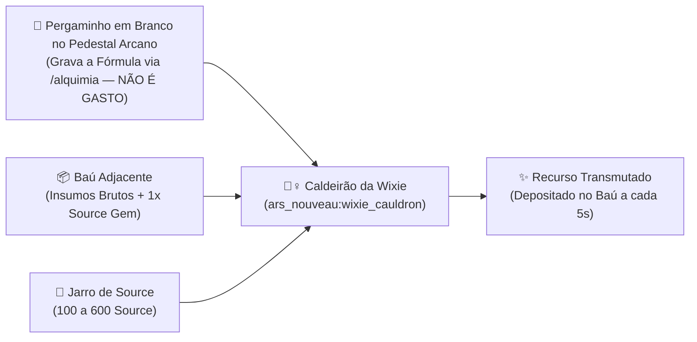

> *"Na natureza nada se cria, nada se perde, tudo se transforma."* — **Lei da Equivalência Alquímica de Lavoisier Arcano**

No **TFC: Arcanum & Empires**, a convergência entre a geologia realista do *TerraFirmaCraft* e as artes místicas do *Ars Nouveau* permite sintetizar recursos geológicos, minérios, gemas, sementes e reagentes através de dois sistemas complementares de automação mágica:
1. **Alquimia da Wixie via Pergaminho Gravado no Pedestal Arcano** (`58 Fórmulas de Transmutação`).
2. **Drusa Geológica do Golem de Ametista** (Cristalização de minérios do TFC baseada na rocha-mãe).

---

## 📜 1. Como Funciona a Alquimia da Wixie (Pergaminho no Pedestal)

Diferente da criação convencional, você **não precisa possuir uma amostra prévia do item raro** (como *Kaolin Clay*, *Grafite* ou *Criolita*) para ordenar que sua Wixie o produza!

### Passo a Passo de Montagem:
1. **Posicione o Caldeirão e o Pedestal:** Coloque um **Caldeirão da Wixie (`ars_nouveau:wixie_cauldron`)** e, a até 3 blocos dele, um **Pedestal Arcano (`ars_nouveau:arcane_pedestal`)**.
2. **Coloque o Pergaminho em Branco:** Ponha **1x Pergaminho em Branco (`ars_nouveau:blank_parchment`)** sobre o Pedestal Arcano. **O pergaminho jamais será consumido!**
3. **Grave a Fórmula Alquímica:**
   - Digite **`/alquimia`** no chat (ou clique com **Shift + Botão Direito** de mão vazia no Pedestal) para abrir o **Grimório Interativo de Fórmulas** e clique em `[Gravar]` na receita desejada; **OU**
   - Clique no Pedestal usando qualquer item que possua fórmula para gravá-la instantaneamente.
4. **Abasteça o Baú e o Source Jar:** Coloque um Baú a até 4 blocos do Caldeirão contendo os **Insumos Brutos + 1x Gema da Fonte (`ars_nouveau:source_gem`)** por operação, e mantenha um **Jarro de Source (`ars_nouveau:source_jar`)** próximo abastecido.
5. **Consulta no JEI / EMI:** Todas as 58 receitas também estão registradas no JEI/EMI! Basta pressionar **[U]** sobre o `ars_nouveau:blank_parchment` ou `ars_nouveau:source_gem` (ou **[R]** sobre qualquer minério/item do TFC).

---

## 📊 2. Tabela Mestra de Conversão Alquímica da Wixie (58 Fórmulas)

> [!TIP]
> Em **todas** as fórmulas abaixo:
> - **Catalisador Consumido:** `1x ars_nouveau:source_gem` (retirado do baú).
> - **Foco no Pedestal (Não Consumido):** `1x ars_nouveau:blank_parchment` (permanece eternamente no pedestal).

### Categoria I — Geologia Rara, Refratários & Pós Químicos (12 Fórmulas)

| ID (`/alquimia_gravar`) | Produto Transmutado | Insumos Exigidos no Baú (+ `1x Source Gem`) | Custo de Source | Aplicação Principal |
| :--- | :--- | :--- | :---: | :--- |
| `kaolin_clay` | **4x Kaolin Clay** (`tfc:kaolin_clay`) | `4x Argila` + `1x Fluxo` + `1x Farinha de Osso` | `200` | Cadinhos e Tijolos Refratários |
| `graphite` | **2x Grafite** (`tfc:ore/graphite`) | `4x Pó de Carvão Vegetal` + `1x Sílex (Flint)` | `250` | Argila Refratária e Aço |
| `fire_clay` | **2x Fire Clay** (`tfc:fire_clay`) | `2x Argila` + `2x Pó de Carvão` + `1x Fluxo` | `250` | Síntese refratária direta |
| `cryolite` | **1x Criolita** (`tfc:ore/cryolite`) | `1x Quartzo` + `2x Sal` + `1x Fluxo` | `400` | Fundição de Redstone Alloy |
| `sulfur` | **4x Pó de Enxofre** (`tfc:powder/sulfur`) | `2x Pó de Carvão` + `1x Carne Podre` | `150` | Pólvora, Ácidos e Vulcanização |
| `saltpeter` | **4x Salitre** (`tfc:powder/saltpeter`) | `2x Farinha de Osso` + `2x Areia` | `150` | Pólvora e Fertilizantes |
| `flux` | **8x Fluxo Metalúrgico** (`tfc:powder/flux`) | `4x Pedregulho` + `1x Farinha de Osso` | `100` | Solda na Bigorna, Alto-Forno e Couro |
| `salt` | **6x Sal Marinho** (`tfc:powder/salt`) | `2x Areia` + `1x Alga (Kelp)` | `100` | Salga e Preservação de Carnes |
| `redstone` | **6x Redstone** (`minecraft:redstone`) | `2x Enxofre` + `1x Fluxo` + `1x Lingote de Cobre` | `200` | Automação Create e Circuitos |
| `borax` | **2x Bórax** (`tfc:ore/borax`) | `2x Sal` + `2x Fluxo` | `200` | Fluxo Nobre e Vidraçaria |
| `gypsum` | **4x Gipsita** (`tfc:ore/gypsum`) | `2x Fluxo` + `2x Argila` | `150` | Alabastro e Gesso Arquitetônico |
| `mortar` | **16x Argamassa** (`tfc:mortar`) | `4x Areia` + `2x Fluxo` | `100` | Alvenaria e Tijolos TFC |

---

### Categoria II — Minérios & Metalurgia TFC (11 Fórmulas)

| ID (`/alquimia_gravar`) | Produto Transmutado | Insumos Exigidos no Baú (+ `1x Source Gem`) | Custo de Source | Metal / Liga Resultante |
| :--- | :--- | :--- | :---: | :--- |
| `native_copper` | **2x Cobre Nativo Normal** (`tfc:ore/normal_native_copper`) | `3x Pepitas de Cobre` + `1x Fluxo` | `200` | Cobre Base (50 mB) |
| `cassiterite` | **2x Cassiterita Normal** (`tfc:ore/normal_cassiterite`) | `2x Cobre Normal` + `1x Farinha de Osso` + `1x Fluxo` | `250` | Estanho / Bronze Padrão |
| `sphalerite` | **2x Esfalerita Normal** (`tfc:ore/normal_sphalerite`) | `2x Cobre Normal` + `1x Enxofre` | `250` | Zinco / Latão (*Brass* do Create) |
| `bismuthinite` | **2x Bismutinita Normal** (`tfc:ore/normal_bismuthinite`) | `2x Cobre Normal` + `1x Argila` + `1x Fluxo` | `250` | Bismuto / Bronze de Bismuto |
| `hematite` | **2x Hematita Normal** (`tfc:ore/normal_hematite`) | `2x Cobre Normal` + `1x Redstone` + `1x Pó de Carvão` | `300` | Ferro Forjado e Aço |
| `magnetite` | **2x Magnetita Normal** (`tfc:ore/normal_magnetite`) | `2x Hematita Normal` + `1x Redstone` | `300` | Ferro Magnético |
| `limonite` | **2x Limonita Normal** (`tfc:ore/normal_limonite`) | `2x Hematita Normal` + `1x Argila` | `300` | Ferro Sedimentar |
| `garnierite` | **2x Garnierita Normal** (`tfc:ore/normal_garnierite`) | `2x Hematita Normal` + `1x Fluxo` + `1x Slime` | `400` | Níquel / Aço Negro (*Black Steel*) |
| `native_silver` | **2x Prata Nativa Normal** (`tfc:ore/normal_native_silver`) | `2x Esfalerita Normal` + `1x Quartzo` + `1x Sal` | `400` | Prata / Sterling Silver / Blue Steel |
| `native_gold` | **2x Ouro Nativo Normal** (`tfc:ore/normal_native_gold`) | `2x Cobre Normal` + `2x Enxofre` + `1x Glowstone` | `450` | Ouro / Rose Gold / Red Steel |
| `bituminous_coal` | **4x Carvão Betuminoso** (`tfc:ore/bituminous_coal`) | `4x Carvão Vegetal` + `1x Enxofre` + `1x Pedregulho` | `200` | Combustível de Forja e Coque |

---

### Categoria III — Gemas, Cristais & Essências Arcanas (15 Fórmulas)

| ID (`/alquimia_gravar`) | Produto Transmutado | Insumos Exigidos no Baú (+ `1x Source Gem`) | Custo de Source |
| :--- | :--- | :--- | :---: |
| `gem_amethyst` | **2x Ametista TFC** (`tfc:gem/amethyst`) | `2x Quartzo` + `1x Redstone` | `200` |
| `gem_opal` | **2x Opala TFC** (`tfc:gem/opal`) | `2x Quartzo` + `1x Argila` | `250` |
| `gem_pyrite` | **2x Pirita TFC** (`tfc:gem/pyrite`) | `1x Hematita Normal` + `2x Enxofre` | `200` |
| `gem_lapis` | **4x Lápis-Lazúli TFC** (`tfc:gem/lapis_lazuli`) | `2x Fluxo` + `1x Quartzo` + `1x Sal` | `250` |
| `gem_topaz` | **1x Topázio TFC** (`tfc:gem/topaz`) | `2x Pirita TFC` + `1x Fluxo` | `350` |
| `gem_ruby` | **1x Rubi TFC** (`tfc:gem/ruby`) | `1x Ametista TFC` + `2x Redstone` + `1x Fluxo` | `400` |
| `gem_sapphire` | **1x Safira TFC** (`tfc:gem/sapphire`) | `1x Ametista TFC` + `2x Lápis-Lazúli TFC` + `1x Fluxo` | `400` |
| `gem_emerald` | **1x Esmeralda TFC** (`tfc:gem/emerald`) | `1x Opala TFC` + `2x Slime` + `1x Fluxo` | `450` |
| `gem_diamond` | **1x Diamante TFC** (`tfc:gem/diamond`) | `4x Grafite` + `2x Fluxo` + `1x Pó de Blaze` | `600` |
| `quartz` | **4x Quartzo** (`minecraft:quartz`) | `4x Areia` + `1x Fluxo` | `150` |
| `source_gem_mult` | **3x Gema da Fonte** (`ars_nouveau:source_gem`) | `2x Fragmento de Ametista` + `2x Quartzo` | `300` |
| `fire_essence` | **1x Essência do Fogo** (`ars_nouveau:fire_essence`) | `1x Enxofre` + `1x Carvão Vegetal` + `1x Sílex` | `200` |
| `water_essence` | **1x Essência da Água** (`ars_nouveau:water_essence`) | `1x Alga (Kelp)` + `1x Sal` + `1x Argila` | `200` |
| `earth_essence` | **1x Essência da Terra** (`ars_nouveau:earth_essence`) | `2x Terra` + `1x Farinha de Osso` + `1x Sílex` | `200` |
| `air_essence` | **1x Essência do Ar** (`ars_nouveau:air_essence`) | `1x Pena` + `2x Palha TFC` | `200` |

---

### Categoria IV — Rochas, Argilas & Construção (8 Fórmulas)

| ID (`/alquimia_gravar`) | Produto Transmutado | Insumos Exigidos no Baú (+ `1x Source Gem`) | Custo de Source |
| :--- | :--- | :--- | :---: |
| `clay_ball` | **8x Argila Comum** (`minecraft:clay_ball`) | `2x Terra` + `2x Areia` | `100` |
| `sand` | **8x Areia Sílica** (`minecraft:sand`) | `4x Cascalho` + `1x Fluxo` | `100` |
| `gravel` | **8x Cascalho** (`minecraft:gravel`) | `4x Pedregulho` + `1x Sílex` | `100` |
| `granite_raw` | **4x Granito Bruto TFC** (`tfc:rock/raw/granite`) | `4x Pedregulho` + `1x Quartzo` | `100` |
| `basalt_raw` | **4x Basalto Bruto TFC** (`tfc:rock/raw/basalt`) | `4x Pedregulho` + `1x Pó de Carvão` | `100` |
| `limestone_raw` | **4x Calcário Bruto TFC** (`tfc:rock/raw/limestone`) | `4x Pedregulho` + `1x Fluxo` | `100` |
| `marble_raw` | **4x Mármore Bruto TFC** (`tfc:rock/raw/marble`) | `4x Calcário Bruto` + `1x Farinha de Osso` | `150` |
| `obsidian` | **2x Obsidiana** (`minecraft:obsidian`) | `4x Basalto Bruto` + `1x Pó de Blaze` | `300` |

---

### Categoria V — Botânica, Fibras, Madeiras & Sementes TFC (16 Fórmulas)

| ID (`/alquimia_gravar`) | Produto Transmutado | Insumos Exigidos no Baú (+ `1x Source Gem`) | Custo de Source |
| :--- | :--- | :--- | :---: |
| `jute_fiber` | **4x Fibra de Juta** (`tfc:jute_fiber`) | `4x Palha` + `1x Linha` + `1x Farinha de Osso` | `100` |
| `wool_yarn` | **4x Fio de Lã** (`tfc:wool_yarn`) | `4x Linha` + `1x Palha` | `100` |
| `burlap_cloth` | **2x Estopa** (`tfc:burlap_cloth`) | `4x Fibra de Juta` + `1x Fluxo` | `150` |
| `silk_cloth` | **2x Tecido de Seda** (`tfc:silk_cloth`) | `4x Linha` + `1x Sal` | `150` |
| `hickory_log` | **4x Tora de Nogueira** (`tfc:wood/log/hickory`) | `4x Tora de Carvalho` + `1x Farinha de Osso` + `1x Pó de Carvão` | `150` |
| `kapok_log` | **4x Tora de Sumaúma** (`tfc:wood/log/kapok`) | `4x Tora de Carvalho` + `2x Palha` + `1x Farinha de Osso` | `150` |
| `rosewood_log` | **4x Tora de Pau-Rosa** (`tfc:wood/log/rosewood`) | `4x Tora de Bétula` + `1x Redstone` + `1x Farinha de Osso` | `150` |
| `blackwood_log` | **4x Tora de Madeira Negra** (`tfc:wood/log/blackwood`) | `4x Tora de Pinheiro` + `1x Pó de Carvão` + `1x Farinha de Osso` | `150` |
| `seeds_wheat` | **2x Sementes de Trigo** (`tfc:seeds/wheat`) | `2x Palha` + `1x Farinha de Osso` | `150` |
| `seeds_rice` | **2x Sementes de Arroz** (`tfc:seeds/rice`) | `2x Palha` + `1x Alga (Kelp)` + `1x Farinha de Osso` | `150` |
| `seeds_maize` | **2x Sementes de Milho** (`tfc:seeds/maize`) | `2x Palha` + `1x Enxofre` + `1x Farinha de Osso` | `150` |
| `seeds_potato` | **2x Sementes de Batata** (`tfc:seeds/potato`) | `2x Palha` + `1x Terra` + `1x Farinha de Osso` | `150` |
| `seeds_cabbage` | **2x Sementes de Repolho** (`tfc:seeds/cabbage`) | `2x Palha` + `1x Argila` + `1x Farinha de Osso` | `150` |
| `seeds_soybean` | **2x Sementes de Soja** (`tfc:seeds/soybean`) | `2x Palha` + `1x Fluxo` + `1x Farinha de Osso` | `150` |
| `seeds_jute` | **2x Sementes de Juta** (`tfc:seeds/jute`) | `2x Palha` + `1x Linha` | `150` |
| `seeds_sugarcane` | **2x Sementes de Cana** (`tfc:seeds/sugarcane`) | `2x Palha` + `1x Areia` + `1x Farinha de Osso` | `150` |

---

### Categoria VI — Fauna, Couro & Reagentes de Criaturas (12 Fórmulas)

| ID (`/alquimia_gravar`) | Produto Transmutado | Insumos Exigidos no Baú (+ `1x Source Gem`) | Custo de Source |
| :--- | :--- | :--- | :---: |
| `prepared_hide` | **1x Pele Grande Preparada** (`tfc:large_prepared_hide`) | `2x Carne Podre` + `2x Fluxo` + `1x Sal` | `200` |
| `leather` | **3x Couro Curtido** (`minecraft:leather`) | `1x Pele Grande Preparada` + `1x Fluxo` | `150` |
| `slime_ball` | **4x Bola de Slime** (`minecraft:slime_ball`) | `2x Argila` + `1x Alga (Kelp)` + `1x Fluxo` | `150` |
| `string` | **6x Linha / Fio** (`minecraft:string`) | `4x Palha` + `1x Farinha de Osso` | `100` |
| `feather` | **4x Penas** (`minecraft:feather`) | `2x Linha` + `1x Palha` | `100` |
| `bone` | **4x Ossos** (`minecraft:bone`) | `2x Carne Podre` + `2x Fluxo` | `150` |
| `gunpowder` | **6x Pólvora Negra** (`minecraft:gunpowder`) | `2x Salitre` + `1x Enxofre` + `1x Pó de Carvão` | `150` |
| `blaze_powder` | **2x Pó de Blaze** (`minecraft:blaze_powder`) | `2x Enxofre` + `1x Redstone` + `1x Pó de Carvão` | `300` |
| `glowstone_dust` | **4x Pó de Glowstone** (`minecraft:glowstone_dust`) | `2x Redstone` + `1x Enxofre` + `1x Quartzo` | `200` |
| `ender_pearl` | **1x Pérola do Fim** (`minecraft:ender_pearl`) | `2x Fragmento de Ametista` + `1x Lápis-Lazúli` + `1x Carne Podre` | `400` |
| `honeycomb` | **3x Favo de Mel** (`minecraft:honeycomb`) | `2x Palha` + `1x Farinha de Osso` + `1x Argila` | `150` |
| `prismarine_shard` | **4x Prismarinho** (`minecraft:prismarine_shard`) | `2x Quartzo` + `2x Sal` + `1x Alga (Kelp)` | `200` |

---

## 💎 3. Drusa Geológica do Golem de Ametista

O **Golem de Ametista (`ars_nouveau:amethyst_golem`)** atua como um cristalizador geológico vivo quando trabalha próximo a um bloco de **Drusa de Ametista (`minecraft:budding_amethyst`)** apoiado sobre uma **Rocha Bruta do TFC (`tfc:rock/raw/*`)** e abastecido por um **Jarro de Source** (`250 Source` por cristalização):

| Família Geológica (Rocha Bruta Adjacente à Drusa) | Rochas do TFC Compatíveis | Minérios & Cristais Gerados (Pesos) |
| :--- | :--- | :--- |
| **Félsica / Ígnea Ácida** | `granite`, `rhyolite`, `diorite`, `dacite` | **Cassiterita Normal** (`40%`), **Hematita Normal** (`30%`), **Grafite** (`20%`), **Topázio** (`10%`) |
| **Máfica / Ígnea Básica** | `basalt`, `gabbro`, `andesite` | **Cobre Nativo Normal** (`40%`), **Garnierita / Níquel** (`30%`), **Ouro Nativo Normal** (`20%`), **Rubi** (`10%`) |
| **Sedimentar** | `limestone`, `dolomite`, `chalk`, `chert`, `shale`, `claystone`, `conglomerate` | **Limonita Normal** (`35%`), **Fluxo** (`30%`), **Kaolin Clay** (`20%`), **Carvão Betuminoso** (`15%`) |
| **Metamórfica** | `marble`, `gneiss`, `schist`, `phyllite`, `slate`, `quartzite` | **Esfalerita / Zinco** (`35%`), **Prata Nativa Normal** (`25%`), **Grafite** (`25%`), **Safira** (`15%`) |
