> [!IMPORTANT]
> **A Engenharia do Calor e da Matéria no TFC:**
> No **TerraFirmaCraft: Arcanum & Empires**, as tradicionais fornalhas de bloco único do Minecraft Vanilla foram completamente removidas para garantir máxima imersão física. O processamento térmico de alimentos, cerâmica, vidros e metais depende de **estruturas de queima realistas**, **construções multibloco dinâmicas** e **minigames rítmicos de forja e lasqueamento** controlados diretamente pelo jogador.

---

## 📑 Índice do Guia de Processos

1. [🔥 Fornalhas & Tratamento Térmico (Pit Kiln, Fogueira, Forja & Quern)](#1-fornalhas--tratamento-térmico)
2. [🏗️ Estruturas Multibloco (Pilha de Carvão, Bloomery, Blast Furnace & Pylons)](#2-estruturas-multibloco)
3. [🔨 Crafts Compostos & Interação do Jogador (Bigorna, Knapping & Curtume)](#3-crafts-compostos--interação-do-jogador)

---

## 1. Fornalhas & Tratamento Térmico

### A. Pit Kiln (Cova de Queima Primitiva)
*O primeiro método de vitrificação de cerâmica antes da metalurgia.*

- **O que processa:** Todos os moldes cerâmicos não-cozidos, vasos, potes, jarras, cadinhos de fundição, tijolos refratários e o **Vaso Arcano** (kubejs:arcane_vessel).
- **Como Construir e Operar:**
  1. Escave um buraco de 1 bloco no chão (`1x1x1`).
  2. Com a cerâmica crua na mão, agache e clique com o botão direito (**Shift + Botão Direito**) no fundo da cova (comporta até 4 peças pequenas ou 1 vaso grande).
  3. Adicione **8 unidades de Palha Seca (*Straw*)** segurando Shift + Botão Direito.
  4. Adicione **8 unidades de Toras de Madeira (*Logs*)** ou gravetos segurando Shift + Botão Direito até cobrir a cova completamente.
  5. Acenda o topo com um **Acendedor de Graveto (*Firestarter*)** ou Tocha.
- **Duração & Temperatura:** A queima é lenta e contínua (~8 a 10 horas in-game, cerca de 8 minutos reais), atingindo **~800°C**. Ao final, recolha os itens cozidos e resistentes.

---

### B. Fogueira do TFC (Firepit) & Cozimento Avançado
*A base da alimentação, hidratação e primeiras ligas de cobre.*

- **Montagem:** Jogue 1 tora de madeira + 3 gravetos + 1 palha no mesmo bloco e use o *Firestarter* no chão.
- **Temperatura Máxima:** Cerca de **~600°C** (alimentada com gravetos, lenha ou turfa).
- **Módulos de Expansão Interativos:**
  1. **Grelha de Ferro Forjado (*Wrought Iron Grill*):** Agache e clique na fogueira com a grelha. Permite posicionar até 5 bifes, carnes ou peixes simultaneamente. Grelhar carnes eleva seu valor nutricional e prolonga o prazo antes do apodrecimento.
  2. **Pote de Cerâmica Cozido (*Ceramic Pot*):** Posicionado sobre a fogueira com água doce ou salgada. Ferve água do mar para extrair sal marinho e cozinha sopas ricas com até 5 vegetais/carnes combinados.
  3. **Vaso de Cerâmica Cozido (*Small Vessel*):** Suporta até **40 pepitas ou pedaços de minério de cobre, bronze, ouro ou bismuto**. Como a fogueira atinge a temperatura de fusão do cobre (~1080°C no pico com bom combustível), o vaso funciona como o **primeiro cadinho da Idade do Cobre**, permitindo despejar metal líquido em moldes de ferramentas!

---

### C. Forja a Carvão (Charcoal Forge)
*O coração da ferraria para aquecer metais ao ponto forjável e soldável.*

- **Montagem:**
  1. Escave 1 bloco no chão rodeado por 4 blocos de pedra ou tijolo refratário.
  2. Adicione **7x Carvão Vegetal (*Charcoal*)** na cavidade.
  3. Acenda com um Firestarter.
  4. Posicione um **Fole (*Bellows*)** imediatamente ao lado da forja, com o bocal apontado para o fogo.
- **Mecânica do Fole:** Clicar com o botão direito no fole bombeia rajadas de ar, elevando a temperatura de 600°C até mais de **1450°C**!
- **Escala de Temperatura Visual dos Metais:**
  - `Faint Red` / `Dark Red` (~600°C - 800°C): Aquecimento inicial.
  - `Bright Red` (~900°C): Ponto inicial onde a peça torna-se **Trabalhável (*Workable*)** na bigorna.
  - `Orange` / `Yellow` (~1100°C - 1250°C): Ponto em que a peça torna-se **Soldável (*Weldable*)**.
  - `Brilliant White` / `Danger of Melting!` (>1400°C): Se passar desse ponto, o lingote derrete e é perdido!

---

### D. Cadinho de Metalurgia & Mistura de Ligas (Crucible)
*Permite fundir grandes volumes e criar ligas metálicas com proporções perfeitas.*

- Posicionado diretamente sobre a Charcoal Forge aquecida.
- Suporta até **3.000 mB de metal líquido**.
- **Receitas de Ligas Fundidas no Cadinho:**
  - **Bronze Comum:** `88% a 92% Cobre` + `8% a 12% Estanho`.
  - **Latão (Brass):** `50% a 60% Cobre` + `40% a 50% Zinco`.
  - **Bronze Bismuto:** `50% a 65% Cobre` + `20% a 30% Zinco` + `10% a 20% Bismuto`.
  - **Bronze Negro:** `50% a 70% Cobre` + `10% a 25% Prata` + `10% a 25% Ouro`.
  - **Aço Negro (*Black Steel*):** `50% a 70% Aço` + `15% a 25% Bronze Negro` + `15% a 25% Ouro Rosa`.
- Use a **Concha de Cerâmica** ou verta diretamente nos moldes posicionados ao lado.

---

### E. Moenda Manual de Pedra (Quern)
*Moinho mecânico de rotação manual para grãos e minerais.*

- **Construção:** Base de Moenda de Pedra (*Quern Base*) + Pedra Superior com Alavanca (*Handstone*).
- **Operação:** Coloque o cereal ou mineral no topo e **segure o clique direito na alavanca** para girar a pedra.
- **Multiplicador de Rendimento:** Enquanto a moagem rústica com martelo na bancada rende apenas 1x farinha, o Quern extrai **3x a 4x de farinha por grão**, além de triturar Enxofre, Carvão e Minérios em pós puros.

---

## 2. Estruturas Multibloco

```mermaid
flowchart TD
    subgraph Carvao ["Pilha de Carvão (Charcoal Pit)"]
        A1["Toras Empilhadas (1x1 a 9x9)"] --> A2["Vedação 100% com Terra/Pedra"]
        A2 --> A3["Fogueira no Topo & Fechamento"]
        A3 --> A4["Queima Lenta (18-24h) ➔ Centenas de Carvões"]
    end

    subgraph FornoReducao ["Bloomery (Ferro Forjado)"]
        B1["Base de Bloomery + Tubeira + Fole"] --> B2["Chaminé 2x2 de Tijolos Refratários"]
        B2 --> B3["Carga Alternada: 24x Minério + 24x Carvão"]
        B3 --> B4["Esponja de Ferro Bruta (Raw Iron Bloom)"]
        B4 --> B5["Bigorna: Bater e Expelir Escória ➔ Ferro Forjado"]
    end

    subgraph AltoForno ["Alto-Forno (Blast Furnace - Aço)"]
        C1["Blast Furnace + Cadinho + Tubeira de Aço"] --> C2["Tubo Cilíndrico com Chapas de Ferro"]
        C2 --> C3["Minério/Ferro + Carvão + Fundente (Flux)"]
        C3 --> C4["Temperatura > 1500°C ➔ Ferro Gusa (Cast Iron)"]
        C4 --> C5["Descarbonetação na Bigorna ➔ Lingotes de Aço"]
    end
```



---

### A. Pilha de Carvão (Charcoal Pit)
- **Estrutura:** Pilhas cúbicas de toras de madeira cortadas (desde `1x1x1` até `9x9x9` blocos de volume).
- **Vedação Obrigatória:** Nenhum bloco de madeira pode ter contato direto com o ar ambiente. Cubra todos os lados e o fundo com terra, argila ou pedra.
- **Ignição:** Remova 1 bloco do topo central, acenda as toras com uma tocha ou fogueira, e recoloque imediatamente o bloco de terra para selar o oxigênio.
- **Resultado:** Fumaça cinzenta sairá pelos blocos. Quando a fumaça parar (após 1 dia in-game), escave a área para coletar pilhas massivas de carvão vegetal puro.

---

### B. Bloomery (Forno de Redução de Ferro)
*O único método para extrair ferro metálico antes da revolução do aço.*

- **Componentes do Multibloco:**
  1. **Bloco de Bloomery:** Posicionado no solo como base frontal.
  2. **Tubeira (*Tuyere*):** Encaixada na lateral da base do Bloomery.
  3. **Fole (*Bellows*):** Conectado à Tubeira para injetar oxigênio forçado.
  4. **Chaminé Vertical:** Estrutura oca de `2x2` blocos de largura externa e `2 a 3 blocos de altura` construída com **Tijolos Refratários (*Fire Bricks*)** ou pedra talhada.
- **Carregamento:** Suba no topo da chaminé e jogue alternadamente:
  - 1x Minério de Ferro Rico/Normal (`Hematite`, `Magnetite` ou `Limonite`).
  - 1x Carvão Vegetal (*Charcoal*).
  - *Capacidade Máxima:* 24 minérios + 24 carvões.
- **Operação:** Acenda a base e acione o fole ritmicamente. A queima derrete a rocha e aglutina o ferro.
- **Colheita & Refino:** Quebre a tampa frontal de tijolos para retirar a **Esponja de Ferro Bruta (*Raw Iron Bloom*)**. A esponja ainda incandescente deve ser colocada na bigorna e golpeada com martelo para expulsar as escórias de sílica, gerando os **Lingotes de Ferro Forjado (*Wrought Iron*)**.

---

### C. Alto-Forno Industrial (Blast Furnace)
*A usina pirometalúrgica necessária para fabricar Aço (Steel) e ligas supremas.*

- **Componentes do Multibloco:**
  1. **Bloco Central de Blast Furnace:** Com um **Cadinho (*Crucible*)** posicionado logo abaixo para capturar o metal fundido.
  2. **Tubo de Tijolos Refratários Reforçados:** Coluna vertical oca cilíndrica revestida com **Chapas de Ferro Forjado (*Wrought Iron Sheets*)**.
  3. **Tubeira de Alta Resistência (*Tuyere de Ferro/Aço*):** Ligada a um sistema de foles motorizados ou manuais.
- **Carga de Fusão Contínua:**
  - Minério de Ferro / Lingotes de Ferro Forjado.
  - Carvão mineral ou vegetal como redutor de carbono.
  - **Fundente Alquímico (*Flux*):** Pó de calcário, dolomita ou mármore que se liga aos óxidos indesejados.
- **Temperatura:** Ultrapassa **1500°C**. O ferro funde completamente e escorre para o cadinho inferior como **Ferro Gusa (*Cast Iron*)**. Ao ser trabalhado na bigorna com fluxo, o ferro gusa perde o excesso de carbono e transforma-se em **Aço (*Steel*)**!

---

### D. Pilão Protetor de Aldeia (Ward Pylon) & Santuários
*Multibloco sagrado de proteção contra incursões e eventos de Lua de Sangue.*

- **Construção:**
  - Base de 3x3 blocos de Cobre ou Aço TFC.
  - No centro, o **Núcleo de Pilão Arcano** (Lodestone/Beacon consagrado).
  - Cercado por 4 condutores de Essência Arcana e coroado por uma **Waystone**.
- **Efeito:** Impede totalmente o surgimento de monstros da superfície em um raio de até **64 blocos** ao redor da estrutura, criando refúgios seguros para bases e cidades de jogadores.

---

## 3. Crafts Compostos & Interação do Jogador

### A. O Minigame de Ferraria na Bigorna (Anvil Forging)
*A arte milenar de bater o metal quente até a forma perfeita.*

Toda ferramenta, arma ou armadura forjada na bigorna do TFC exige que o jogador alinhe dois marcadores na interface gráfica da bigorna:
- 🟢 **Marcador Verde (Alvo):** A posição exata onde o produto final é moldado.
- 🔴 **Marcador Vermelho (Atual):** A posição atual do metal sob os golpes do martelo.

#### Tabela de Golpes de Ferraria:
| Tipo de Golpe | Nome da Ação | Efeito no Marcador Vermelho | Uso Estratégico |
|:---:|---|:---:|---|
| **Leve** | `Light Hit` | Move `-3` pontos | Ajuste fino de precisão |
| **Médio** | `Medium Hit` | Move `-6` pontos | Avanço moderado |
| **Pesado** | `Heavy Hit` | Move `-9` pontos | Grande salto para a esquerda |
| **Esticar** | `Draw` | Move `-15` pontos | O maior movimento redutor |
| **Furar / Encolher** | `Punch` | Move `+2` pontos | Pequeno avanço positivo |
| **Dobrar** | `Bend` | Move `+7` pontos | Salto médio positivo |
| **Recalcar** | `Upset` | Move `+13` pontos | Grande salto para a direita |
| **Encolher Rápido** | `Shrink` | Move `+16` pontos | Maior movimento positivo |

> [!WARNING]
> **A Regra dos Três Últimos Golpes:**
> Para que o craft seja aceito, os **últimos 3 golpes aplicados pelo jogador devem corresponder com exatidão à receita do plano da bigorna** (exemplo: para forjar uma Espada de Ferro, os últimos golpes devem ser rigorosamente `Bend` ➔ `Bend` ➔ `Hit`), e o marcador vermelho deve terminar perfeitamente alinhado com o marcador verde!

#### Soldagem de Metais (Welding):
1. Aqueça 2 lingotes ou 2 chapas do mesmo metal até a temperatura **Soldável (*Weldable - Amarelo Brilhante*)**.
2. Coloque ambas as peças nos slots da bigorna.
3. Adicione **1x Pó de Fluxo (*Flux*)**.
4. Pressione o botão do martelo: as duas peças se fundem em um **Lingote Duplo (*Double Ingot*)** ou **Chapa Dupla (*Double Sheet*)**, indispensáveis para armas pesadas e armaduras de placas.

---

### B. Knapping Manual 5×5 (Lasqueamento Interativo)
*A tecnologia do primeiro dia: pedra lascada, cerâmica e couro.*

```
Grade de Knapping (5x5)
[ 1 ][ 2 ][ 3 ][ 4 ][ 5 ]
[ 6 ][ 7 ][ 8 ][ 9 ][10 ]
[11 ][12 ][13 ][14 ][15 ]
[16 ][17 ][18 ][19 ][20 ]
[21 ][22 ][23 ][24 ][25 ]
```

- **Rock Knapping (Pedras Lascadas):** Segure 2 pedras soltas (`#tfc:rock_knapping`) nas mãos e clique com o botão direito. A interface 5x5 se abre: clique nas células para remover lascas de pedra até sobrar a silhueta da ferramenta (machado, faca, pá, martelo ou dardo).
- **Clay Knapping (Moldagem de Cerâmica):** Segure 5 argilas na mão e clique com o botão direito. Remova pedaços de barro para formar potes, vasos de armazenagem, cadinhos ou o **Vaso Arcano**.
- **Leather Knapping (Recorte de Couro):** Com uma faca na mão principal e couro preparado na mão secundária, abra a interface de recorte para criar botas leves, cintos de ferramentas e tiras de couro.

---

### C. Curtume em Três Fases: Do Animal ao Couro Nobre
*O processo tradicional e mais eficiente de obtenção de peles e couros.*

```mermaid
flowchart LR
    PeleBruta["Pele Bruta (Raw Hide)"] -->|Barril com Água de Cal (Lye)| PeleLavada["Pele Lavada (Soaked Hide)"]
    PeleLavada -->|Tronco + Faca Drawknife| PelePreparada["Pele Preparada (Scraped Hide)"]
    PelePreparada -->|Barril com Tanino (Tannin)| CouroFinal["Couro Nobre (Prepared Leather)"]
```

1. **Fase 1: Banho de Cal (*Limewater*):**
   - Encha um barril de madeira com Água Doce e adicione Cinzas de Madeira (*Wood Ash*).
   - Coloque a Pele Bruta no barril e **sele a tampa por 8 horas in-game**.
   - A pele perde a gordura externa e torna-se uma **Pele Lavada (*Soaked Hide*)**.
2. **Fase 2: Raspagem Manual no Tronco (*Scraping*):**
   - Posicione um tronco de madeira (*Log*) horizontalmente no chão.
   - Agache e coloque a Pele Lavada sobre o tronco.
   - Com uma **Faca de Raspagem (*Drawknife*)** em mãos, clique repetidamente com o botão direito para raspar os pelos e camadas sebáceas da pele até que ela se torne uma **Pele Preparada (*Scraped Hide*)**.
3. **Fase 3: Curtimento em Tanino (*Tannin*):**
   - Encha um barril com Água Doce e adicione Casca de Árvore (*Tree Bark* de carvalho, castanheira, etc.) para criar o líquido avermelhado de Tanino.
   - Coloque as Peles Preparadas no barril, tranque a tampa e aguarde o curtimento.
   - O produto final é o **Couro Nobre Preparado (*Prepared Leather*)**, o material mais resistente para armaduras, mochilas e selas!
