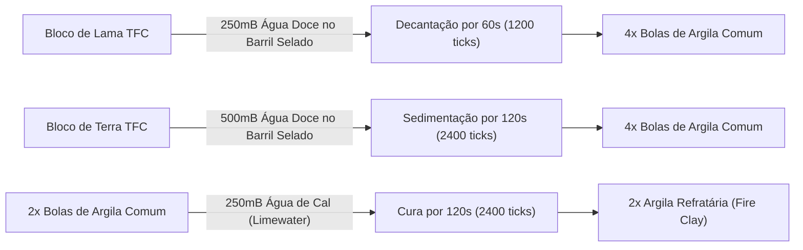
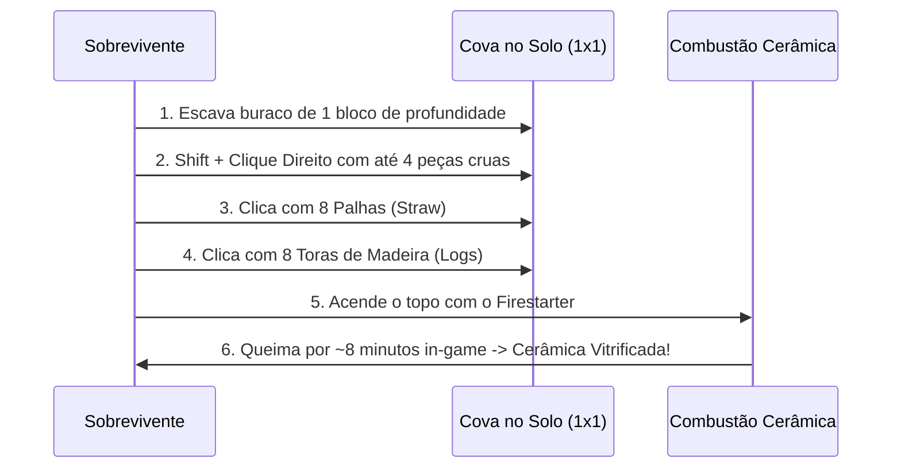

import { Tabs, TabItem } from '@astrojs/starlight/components';

# 🏺 Argila, Alquimia Primitiva & Cerâmica Refratária

No ecossistema do **TerraFirmaCraft**, a argila é a pedra angular da tecnologia humana: sem ela, é impossível fabricar cadinhos, vasos de estocagem, jarras de água, formas de fundição de cobre e tijolos para altos-fornos.

> [!IMPORTANT]
> **Fim do Travamento em Biomas Secos:**  
> No TFC clássico, nascer em regiões com pluviosidade anual inferior a 150-200mm impedia a formação natural de depósitos de argila na superfície, condenando o sobrevivente a vagar por milhares de blocos. O modpack implementou **5 rotas balanceadas de obtenção física, orgânica e arcana** para garantir que qualquer jogador consiga argila e progrida sem depender da sorte climática!

---

## 🧭 1. Encontrando Argila no Mundo Selvagem

Se você estiver em um bioma com chuva regular (> 200mm de precipitação anual):
* **Flores Indicadoras:** Plantas silvestres como **Goldenrod**, **Canna** e **Cattails** crescem preferencialmente sobre jazidas de argila úmida.
* **Escavação:** Use uma **Pá de Pedra** para coletar bolas de argila (`tfc:clay_ball`) rapidamente.
* **Margens Fluviais e Pântanos:** Quebrar blocos de **Lama TFC (`tfc:mud/*`)** no mundo agora garante **2 bolas de argila diretamente**! Além disso, escavar terra ou areia em blocos banhados por água fresca oferece **30% de chance** de recuperar argila aluvial.

---

## 🪵 2. Alquimia Rústica (Inventário 2×2 ou Bancada)

Aproveita resíduos da combustão de lenha e solos locais sem exigir forjas ou máquinas avançadas:

| Receita | Insumos Exigidos | Grade | Rendimento | Observações |
| :--- | :--- | :---: | :---: | :--- |
| **Terra + Cinzas + Água** | `1x Terra TFC` (`#tfc:dirt`) + `1x Cinzas de Madeira` + `100mB Água` | 2×2 | **4x Bolas de Argila** | Consome 100mB da Jarra Cerâmica e devolve a jarra intacta |
| **Lama + Cinzas de Fogueira** | `1x Lama TFC` (`#tfc:mud`) + `1x Cinzas de Madeira` (`tfc:powder/wood_ash`) | 2×2 | **4x Bolas de Argila** | **Dispensa água extra** (a lama já é hidratada) |
| **Terra + Areia + Água** | `1x Terra TFC` + `1x Areia TFC` (`#c:sands`) + `100mB Água` | 2×2 | **3x Bolas de Argila** | Alternativa para quando o jogador ainda não fez fogo |
| **Lama + Areia Fluvial** | `1x Lama TFC` + `1x Areia TFC` | 2×2 | **3x Bolas de Argila** | Sedimento lamacento rústico imediato |

---

## 🛢️ 3. Decantação Natural em Barril Selado (TFC Barrel)

Simula o processo geológico onde as partículas pesadas afundam e o silte fino vira argila pura por decantação hídrica:

* **Decantação Rápida de Lama:** 1 Bloco de Lama + 250mB Água Doce $\rightarrow$ **4x Bolas de Argila** em 60 segundos.
* **Sedimentação de Terra:** 1 Bloco de Terra + 500mB Água Doce $\rightarrow$ **4x Bolas de Argila** em 120 segundos.
* **Cura de Argila Refratária:** 2 Bolas de Argila + 250mB Água de Cal (*Limewater*) $\rightarrow$ **2x Argila Refratária (*Fire Clay*)** em 120 segundos.

---

## 🧱 4. Rota Química da Fire Clay & Kaolin (Sem Grafite)

> [!NOTE]
> No TerraFirmaCraft clássico, a *Fire Clay* exige encontrar minas raras de grafite (*Graphite*). Agora você pode produzir quimicamente na oficina misturando carvão moído e pedras de fluxo:

* **Síntese de Fire Clay na Bancada:**
  $$\text{2x Argila Comum} + \text{1x Pó de Carvão Vegetal} + \text{1x Pó de Fluxo} \longrightarrow \mathbf{2x\text{ Fire Clay}}$$
* **A partir de Lama Fluvial:**
  $$\text{1x Lama TFC} + \text{1x Pó de Carvão} + \text{1x Pó de Fluxo} \longrightarrow \mathbf{2x\text{ Fire Clay}}$$
* **Argila Caulinita Rústica (*Kaolin Clay*):**
  $$\text{2x Argila Comum} + \text{1x Pó de Fluxo} + \text{1x Farinha de Osso} \longrightarrow \mathbf{2x\text{ Kaolin Clay}}$$

---

## 🔮 5. Alquimia Mística com Ars Nouveau (Early-Game)

Canaliza a energia mística da Fonte para transmutar solo comum em argilas purificadas de alto rendimento:

| Transmutação | Insumo Místico | Insumos Físicos | Rendimento | Aplicação |
| :--- | :--- | :--- | :---: | :--- |
| **Fragmento da Fonte** | `1x Fragmento de Gema` | `1x Terra TFC` + `1x Areia TFC` | **4x Bolas de Argila** | Início rápido de feitiçaria |
| **Gema da Fonte em Massa** | `1x Gema da Fonte` | `4x Terra TFC` + `4x Areia TFC` | **16x Bolas de Argila** | Produção em massa de telhas e tijolos |
| **Bloco Maciço de Argila** | `1x Gema da Fonte` | `2x Terra TFC` + `2x Areia TFC` | **1x Bloco de Argila** | Cerâmica arquitetônica e construção |
| **Argila Caulinita Nobre** | `1x Gema da Fonte` | `1x Terra` + `1x Fluxo` + `1x Farinha de Osso` | **4x Kaolin Clay** | Porcelanas finas e tijolos brancos |
| **Fire Clay Mística Dupla** | `1x Gema da Fonte` | `2x Argila` + `1x Pó de Carvão` + `1x Fluxo` | **4x Fire Clay** | **Dobro de rendimento** para forjar cadinhos |

---

## 🔥 6. Montagem do Forno de Fosso (Pit Kiln)

As peças esculpidas no **Clay Knapping 5×5** (vasos, jarras, moldes e panelas) saem como cerâmica crua (*unfired*) e precisam ser vitrificadas no fogo para adquirirem rigidez estrutural.

### Passo a Passo Detalhado:
1. Cave **1 buraco de 1 bloco de profundidade** no solo.
2. Agache (`Shift`) e clique com o **Botão Direito** segurando a peça cerâmica crua para depositá-la no fundo da cova (cabem até **4 peças pequenas** ou **1 vaso grande**).
3. Clique na cova com **8 Palhas (*Straw*)**.
4. Clique na cova com **8 Toras de Madeira (*Logs*)**.
5. Acenda o topo segurando o **Acendedor de Gravetos (*Firestarter*)** com o Botão Direito até iniciar as chamas.
6. A combustão dura cerca de 8 minutos in-game. Não jogue água! Ao terminar, as toras viram cinzas e as peças tornam-se cerâmicas vitrificadas prontas para uso.

---

## 🏺 7. Utilitários Cerâmicos Vitrificados

* **Jarra de Cerâmica (*Ceramic Jug*):** Seu cantil primário! Segure o botão direito na água doce corrente para encher e beba durante longas viagens.
* **Vaso de Cerâmica (*Ceramic Vessel*):** Funciona como uma mochila portátil de **4 slots** que reduz a taxa de decomposição de alimentos em 90% quando selado. Pode ser guardado na mochila ou colocado no chão com `Shift + Botão Direito`.
* **Moldes de Fundição (*Molds*):** Moldes de picareta, machado, faca, serra e lingote usados para despejar metais líquidos (cobre, bronze e ouro) diretamente do cadinho ou do vaso de fundição.
* **Panela de Cozimento (*Cooking Pot*):** Utilizada sobre a grelha da fogueira para ferver sopas nutritivas que combinam grãos, carnes e vegetais.
