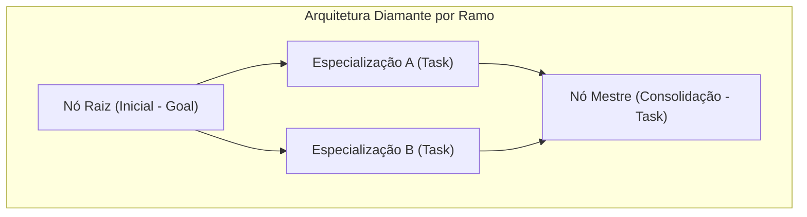
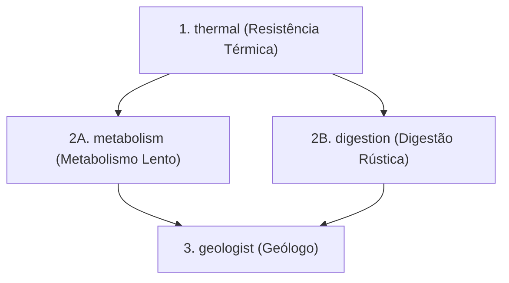
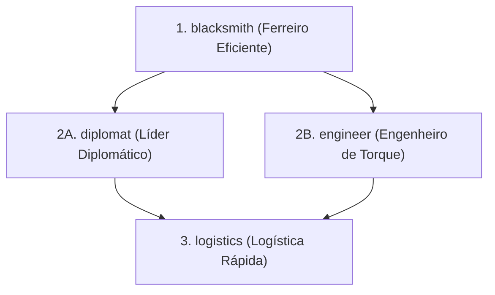
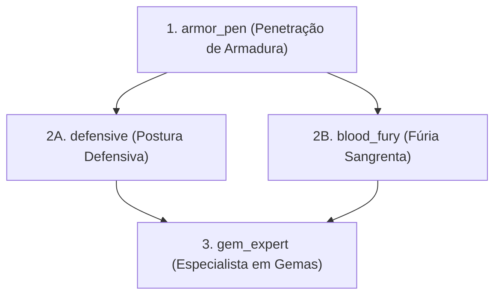
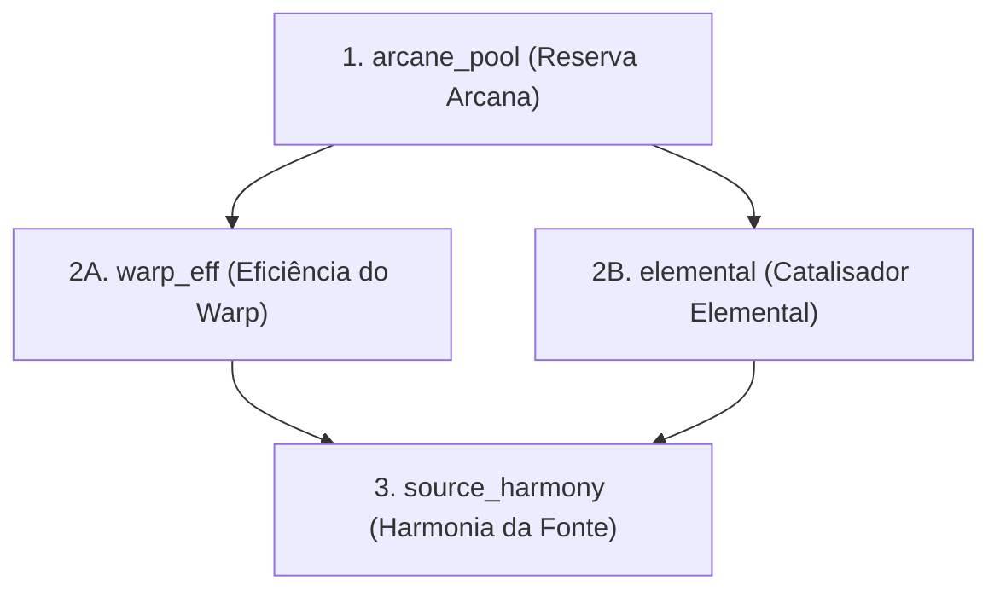

> **TerraFirmaCraft: Arcanum & Empires (NeoForge 1.21.1 — v1.3.0)**  
> **Sistema Core:** Puffish Skills (`puffish_skills`) & Puffish Attributes (`puffish_attributes`)  
> **Atalho no Teclado:** Pressione **[K]** para abrir a Árvore de Habilidades a qualquer momento.

---

## 📊 Visão Geral & Arquitetura do Sistema
O sistema de progressão de habilidades é estruturado em **4 árvores de especialização temáticas**, desenhadas no formato de diamante simétrico:  
**Nó Raiz (Inicial)** ➔ **2 Especializações Intermediárias** ➔ **Nó Mestre (Consolidação)**.

- **Pontos Iniciais Concedidos**: 1 Ponto de Habilidade imediato em cada categoria ao criar o personagem / entrar no mundo.
- **Mecânica de Evolução (XP)**:
  - **Fórmula de Ganho**: $XP = \text{dropped\_xp} \times 2 + 5$ (obtido ao abater criaturas e chefes).
  - **Custo por Nível**: $\min(\text{level} \times 25 + 25, 1000)$.
- **Total de Habilidades Implementadas**: 16 nós distribuídos igualmente entre 4 categorias.

---

## 1. 🌿 Ramo: Sobrevivência (`survival`)
* **Propósito**: Mitigar as dificuldades naturais do TerraFirmaCraft (temperatura corporal, fome, recuperação de vida e extração mineral).
* **Identidade Visual**: Ícone `tfc:ceramic/jug` | Fundo de Granito Bruto TFC.

| ID da Skill | Título em Jogo | Tipo | Ícone | Pré-requisito | Atributo Modificado | Operação | Magnitude | Descrição Oficial |
| :--- | :--- | :---: | :--- | :--- | :--- | :---: | :---: | :--- |
| `thermal` | **Resistência Térmica** | Raiz (`goal`) | `minecraft:campfire` | *Nenhum* | `minecraft:generic.max_health` | `addition` | `+2.0` | Reduz o impacto do frio e calor do TFC (+2 Vida Máxima) |
| `metabolism` | **Metabolismo Lento** | Comum (`task`) | `tfc:ceramic/vessel` | `thermal` | `puffish_attributes:stamina` | `multiply_base` | `+15%` | Maior vigor físico e resistência (+15% Stamina) |
| `digestion` | **Digestão Rústica** | Comum (`task`) | `minecraft:apple` | `thermal` | `puffish_attributes:healing` | `multiply_base` | `+15%` | Amplia a regeneração natural e cura recebida (+15%) |
| `geologist` | **Geólogo** | Mestre (`task`) | `minecraft:iron_pickaxe` | `metabolism` ou `digestion` | `puffish_attributes:pickaxe_speed` | `multiply_base` | `+15%` | Vel. de mineração com picareta e prospecção (+15% e +1 Sorte) |

---

## 2. 🏛️ Ramo: Humana / Império (`human`)
* **Propósito**: Focado em desenvolvimento técnico, engenharia mecânica com Create, comércio com Millénaire/Vanilla e transporte de cargas.
* **Identidade Visual**: Ícone `create:brass_hand` | Fundo de Tábuas de Carvalho TFC.

| ID da Skill | Título em Jogo | Tipo | Ícone | Pré-requisito | Atributo Modificado | Operação | Magnitude | Descrição Oficial |
| :--- | :--- | :---: | :--- | :--- | :--- | :---: | :---: | :--- |
| `blacksmith` | **Ferreiro Eficiente** | Raiz (`goal`) | `minecraft:anvil` | *Nenhum* | `puffish_attributes:repair_cost` | `multiply_base` | `-25%` | Menor custo de reparo e maior precisão na forja (-25% Custo) |
| `diplomat` | **Líder Diplomático** | Comum (`task`) | `minecraft:emerald` | `blacksmith` | `minecraft:generic.luck` | `addition` | `+1.0` | Sorte e carisma em negociações com aldeões (+1 Sorte) |
| `engineer` | **Engenheiro de Torque** | Comum (`task`) | `create:cogwheel` | `blacksmith` | `puffish_attributes:axe_speed` | `multiply_base` | `+15%` | Velocidade de corte e construção com machado/pá (+15%) |
| `logistics` | **Logística Rápida** | Mestre (`task`) | `minecraft:chest` | `diplomat` ou `engineer` | `minecraft:generic.movement_speed` | `multiply_base` | `+10%` | Velocidade de deslocamento com cargas (+10% Velocidade) |

---

## 3. ⚔️ Ramo: Combate (`combat`)
* **Propósito**: Sobrevivência contra chefes (*L. Cataclysm, Born in Chaos, Mowzie's Mobs, Graveyard*) e monstros reforçados pelo Apotheosis.
* **Identidade Visual**: Ícone `minecraft:iron_sword` | Fundo de Tijolos de Basalto TFC.

| ID da Skill | Título em Jogo | Tipo | Ícone | Pré-requisito | Atributo Modificado | Operação | Magnitude | Descrição Oficial |
| :--- | :--- | :---: | :--- | :--- | :--- | :---: | :---: | :--- |
| `armor_pen` | **Penetração de Armadura** | Raiz (`goal`) | `minecraft:iron_sword` | *Nenhum* | `puffish_attributes:melee_damage` | `multiply_base` | `+10%` | +10% Dano Corpo-a-Corpo com armas do TFC |
| `defensive` | **Postura Defensiva** | Comum (`task`) | `minecraft:shield` | `armor_pen` | `minecraft:generic.armor` | `addition` | `+2.0` | +2 Armadura e resistência contra elites do Apotheosis |
| `blood_fury` | **Fúria Sangrenta** | Comum (`task`) | `minecraft:redstone` | `armor_pen` | `minecraft:generic.attack_speed` | `multiply_base` | `+10%` | +10% Velocidade de Ataque e Roubo de Vida na Blood Moon |
| `gem_expert` | **Especialista em Gemas** | Mestre (`task`) | `minecraft:diamond` | `defensive` ou `blood_fury` | `puffish_attributes:magic_resistance` | `multiply_base` | `+15%` | +15% Resistência Mágica e sinergia com gemas |

---

## 4. 🔮 Ramo: Mágica (`magic`)
* **Propósito**: Potencializar feitiços do Ars Nouveau e Iron's Spells 'n Spellbooks, mitigar custos de teleporte e amplificar dano elemental.
* **Identidade Visual**: Ícone `ars_nouveau:novice_spell_book` | Fundo de Mármore Polido TFC.

| ID da Skill | Título em Jogo | Tipo | Ícone | Pré-requisito | Atributo Modificado | Operação | Magnitude | Descrição Oficial |
| :--- | :--- | :---: | :--- | :--- | :--- | :---: | :---: | :--- |
| `arcane_pool` | **Reserva Arcana** | Raiz (`goal`) | `ars_nouveau:novice_spell_book` | *Nenhum* | `puffish_attributes:magic_damage` | `multiply_base` | `+10%` | Amplia o poder arcano e fluxo de mana (+10% Dano Mágico) |
| `warp_eff` | **Eficiência do Warp** | Comum (`task`) | `waystones:warp_stone` | `arcane_pool` | `puffish_attributes:magic_resistance` | `multiply_base` | `+10%` | Reduz fadiga dimensional e aumenta resistência mágica (+10%) |
| `elemental` | **Catalisador Elemental** | Comum (`task`) | `tfc_arcanum:fired_arcane_catalyst` | `arcane_pool` | `puffish_attributes:magic_damage` | `multiply_base` | `+12%` | Amplia a potência elemental de Fogo, Gelo e Raio (+12%) |
| `source_harmony` | **Harmonia da Fonte** | Mestre (`task`) | `pylons:expulsion_pylon` | `warp_eff` ou `elemental` | `puffish_attributes:healing` | `multiply_base` | `+15%` | Sinergia com Source e Pilões (+15% Cura e Regeneração) |

---

## 💡 Dicas de Sobrevivência & Multijogador
1. **Sinergia com Nutrição do TFC**:
   - A vida concedida por `thermal` soma-se à vida máxima calculada pelos 5 grupos alimentares do TFC. Manter uma boa dieta combinada a essa skill garante mais de 15 corações totais no early game.
2. **Especialização de Papéis**:
   - Em servidores cooperativos, designe um jogador para trilhar **Humana (Engenharia & Forja)** para economizar metal e acelerar obras com Create, um para **Combate** como linha de frente contra elites de masmorra, um para **Magia** focado em curar a guarnição e manter os pilões acesos, e exploradores focados em **Sobrevivência**.
