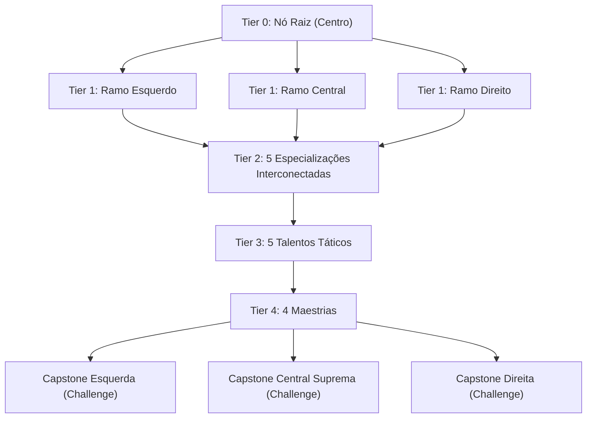

> **TerraFirmaCraft: Arcanum & Empires (NeoForge 1.21.1 — v1.4.0)**  
> **Sistema Core:** Puffish Skills (`puffish_skills`), Puffish Attributes, Apothic Attributes & Ars Nouveau Perks  
> **Atalho no Teclado:** Pressione **[K]** para abrir a Árvore de Habilidades a qualquer momento.

---

## 📊 Visão Geral & Arquitetura Constelação (Estilo Craftoria)

O sistema de progressão de habilidades foi expandido para uma **arquitetura de Constelação Compacta estilo Craftoria**, com **21 nós interconectados em cada uma das 4 categorias temáticas (84 Talentos no total)** distribuídos em 5 Tiers progressivos:
- **Tier 0 (Raiz):** 1 Nó Inicial (`goal`)
- **Tier 1:** 3 Nós Fundamentais (`task`)
- **Tier 2:** 5 Nós de Especialização (`task` / `goal`)
- **Tier 3:** 5 Nós Avançados com conexões cruzadas (`task`)
- **Tier 4:** 4 Nós de Maestria (`task` / `goal`)
- **Tier 5 (Capstones):** 3 Nós Supremos de Fim de Jogo (`challenge`)

> [!IMPORTANT]
> **100% Estável com a Sede e Nutrição do TFC:**
> - Nenhum talento modifica `puffish_attributes:stamina`, garantindo **estabilidade absoluta da barra de sede do TerraFirmaCraft**.
> - Todos os bônus de Vida Máxima (`minecraft:generic.max_health`) somam-se às **Relíquias (Relics)** e **Afixos do Apotheosis**, escalando em até **5.0x** com a Nutrição do TFC (`nutritionMaximumHealthModifier = 5.0`).

---

## 1. 🌿 Ramo: Sobrevivência (`survival` — 21 Nós)
* **Propósito:** Vitalidade, adaptação climática ao TFC, prospecção geológica, velocidade de mineração/escavação e mobilidade em montanhas.

| Tier | ID da Skill | Título em Jogo | Atributos Modificados | Descrição |
| :---: | :--- | :--- | :--- | :--- |
| **0** | `thermal` | **Resistência Térmica** | `+2.0 Vida Máxima` | Adaptação ao frio e calor extremos do TFC |
| **1** | `metabolism` | **Vigor Rústico** | `+8% Resistência Geral` | Maior resiliência física contra intempéries |
| **1** | `digestion` | **Digestão Nutritiva** | `+15% Cura` | Amplia a regeneração natural e cura |
| **1** | `geologist` | **Mestre Geólogo** | `+15% Vel. Picareta` | Eficiência superior com picaretas em rochas do TFC |
| **2** | `thick_skin` | **Pele Calejada** | `+2.0 Armadura` | Endurece a pele contra espinhos e predadores |
| **2** | `herbal_remedy` | **Fitoterapia TFC** | `+15% Cura Recebida` | Chás, cataplasmas e alimentos curam mais |
| **2** | `hearty_constitution` | **Constituição Robusta** | `+4.0 Vida Máxima` | Expande a vitalidade base em sinergia com a Nutrição TFC |
| **2** | `stone_breaker` | **Quebrador de Veios** | `+12% Mining Speed` | Acelera a escavação global de minérios e rochas |
| **2** | `sure_footed` | **Passo Firme nas Montanhas** | `-2.5 Dano de Queda` | Reduz o dano de queda em escarpas e cavernas |
| **3** | `mountain_stride` | **Andarilho Alpino** | `+0.5 Altura de Passo` | Sobe blocos inteiros sem precisar pular |
| **3** | `nomad_sprinter` | **Passo do Nômade** | `+10% Vel. Corrida` | Maior velocidade em corridas e travessias |
| **3** | `deep_miner` | **Escavador Profundo** | `+0.5 Alcance de Bloco` | Alcance adicional para minerar tetos de cavernas |
| **3** | `prospector_luck` | **Olho do Prospector** | `+1.0 Sorte` | Maior sorte ao garimpar pepitas, gemas e drusas |
| **3** | `agile_leaper` | **Salto Selvagem** | `+12% Impulso de Salto` | Impulso aprimorado para transpor rios e ravinas |
| **4** | `iron_lungs` | **Fôlego de Titã** | `+4.0 Vida, +15% Antirrecuo` | Aumenta a vitalidade e resistência a empurrões |
| **4** | `vital_overflow` | **Vitalidade Transbordante** | `+10% Overheal` | Converte excesso de regeneração em absorção |
| **4** | `excavator_mastery` | **Mestre da Escavação** | `+25% Vel. Pá` | Domínio total sobre pás, cascalhos e argilas |
| **4** | `tectonic_precision` | **Precisão Tectônica** | `+2.0 Eficiência de Mineração` | Eficiência bruta ao quebrar rochas ígneas e metamórficas |
| **5** | `avatar_of_gaia` | **Avatar da Natureza TFC** | `+8.0 Vida, +20% Cura Recebida` | Capstone: Simbiose perfeita com o mundo |
| **5** | `immortal_survivor` | **Sobrevivente Imortal** | `+10.0 Vida, +4 Armadura, +12% Resist.` | Capstone Suprema: Ápice da sobrevivência TFC |
| **5** | `lord_of_the_depths` | **Senhor das Profundezas** | `+30% Picareta, +1.5 Sorte, +1 Alcance` | Capstone: Mestre absoluto da geologia |

---

## 2. 🏛️ Ramo: Humana & Impérios (`human` — 21 Nós)
* **Propósito:** Metalurgia na bigorna TFC, engenharia mecânica com *Create*, comércio com *Millénaire*, ganho de XP e alcance de construção.

| Tier | ID da Skill | Título em Jogo | Atributos Modificados | Descrição |
| :---: | :--- | :--- | :--- | :--- |
| **0** | `blacksmith` | **Ferreiro Eficiente** | `-25% Custo de Reparo` | Menor custo de reparo na bigorna e maior precisão |
| **1** | `diplomat` | **Líder Diplomático** | `+1.0 Sorte` | Sorte e carisma em negociações com vilas Millénaire |
| **1** | `engineer` | **Engenheiro de Torque** | `+20% Vel. Machado` | Velocidade de corte de madeiras e montagem Create |
| **1** | `logistics` | **Mestre da Logística** | `+10% Vel. Movimento` | Deslocamento ágil entre fábricas e entrepostos |
| **2** | `metallurgist` | **Mestre Metalúrgico** | `+2.0 Tenacidade de Armadura` | Forja armaduras mais densas e resistentes |
| **2** | `scholar` | **Erudito Imperial** | `+20% XP Ganho` | Compreensão acelerada de ofícios e pergaminhos |
| **2** | `master_builder` | **Arquiteto de Impérios** | `+1.0 Alcance de Bloco` | Alcance ampliado para construir muralhas e pontes |
| **2** | `lumberjack` | **Lenhador Industrial** | `+25% Vel. Machado` | Derruba florestas e processa toras rapidamente |
| **2** | `road_runner` | **Mensageiro Real** | `+12% Vel. Corrida` | Velocidade de corrida sustentada em estradas |
| **3** | `tempered_platings` | **Chapas Temperadas** | `+3.0 Armadura` | Reforço estrutural nos equipamentos |
| **3** | `merchant_prince` | **Príncipe Mercador** | `+1.5 Sorte, +15% XP Ganho` | Atrai tesouros raros e melhores trocas |
| **3** | `kinetic_artisan` | **Artesão Cinético** | `+12% Vel. Ação/Ataque` | Mãos rápidas para operar máquinas e ferramentas |
| **3** | `earth_mover` | **Terraplanador** | `+25% Vel. Pá` | Abre canais, estradas e fundações com facilidade |
| **3** | `civic_vigor` | **Vigor Cívico** | `+4.0 Vida Máxima` | Bem-estar proporcionado pela civilização |
| **4** | `master_anvil` | **Segredo do Aço Colorido** | `-35% Reparo, +2.0 Tenacidade` | Reduz drasticamente o desgaste e custo de reparo |
| **4** | `guild_grandmaster` | **Grão-Mestre da Guilda** | `+30% XP Ganho` | Sabedoria suprema em todas as profissões |
| **4** | `quarry_director` | **Diretor de Pedreira** | `+20% Mining Speed` | Eficiência combinada de mineração e extração |
| **4** | `imperial_crane` | **Engenharia de Guindaste** | `+1.5 Alcance de Bloco` | Alcance de construção estendido |
| **5** | `vulcan_heir` | **Herdeiro de Vulcano** | `+6 Armadura, +4 Tenacidade, +6 Vida` | Capstone: Mestre da Forja TFC |
| **5** | `emperor_of_industry` | **Imperador da Indústria** | `+50% XP, +2.0 Sorte, +15% Movimento` | Capstone Suprema: Ápice da Engenharia e Impérios |
| **5** | `architect_of_wonders` | **Arquiteto de Maravilhas** | `+2.0 Alcance, +35% Machado/Picareta` | Capstone: Alcance e eficiência de obra lendários |

---

## 3. ⚔️ Ramo: Combate & Guerra (`combat` — 21 Nós)
* **Propósito:** Combate contra Bosses (*Cataclysm, Ice and Fire, Born in Chaos*), penetração de armadura, crítico, roubo de vida e arquearia.

| Tier | ID da Skill | Título em Jogo | Atributos Modificados | Descrição |
| :---: | :--- | :--- | :--- | :--- |
| **0** | `armor_pen` | **Arte da Guerra TFC** | `+10% Dano Melee` | Domínio de armas de corte, impacto e perfuração |
| **1** | `defensive` | **Postura de Falange** | `+2.0 Armadura` | Defesa sólida contra enxames e elites |
| **1** | `blood_fury` | **Frenezi de Batalha** | `+10% Vel. Ataque` | Golpes mais velozes em combate intenso |
| **1** | `gem_expert` | **Precisão Letal** | `+15% Dano Crítico` | Explora pontos vitais do inimigo |
| **2** | `shield_wall` | **Muralha Inabalável** | `+25% Antirrecuo` | Reduz o recuo de golpes pesados de Bosses |
| **2** | `sunder_armor` | **Quebra-Couraças** | `+4.0 Armor Pierce` | Seus ataques ignoram parte da armadura inimiga |
| **2** | `vampiric_strike` | **Sede de Sangue** | `+5% Roubo de Vida (Life Steal)` | Drena a vitalidade dos inimigos a cada golpe |
| **2** | `critical_eye` | **Olho do Predador** | `+8% Chance Crítica` | Aumenta a chance de desferir golpes críticos |
| **2** | `ranger_training` | **Mestre Arqueiro & Javelin** | `+15% Dano à Distância` | Maior potência com arcos, bestas e dardos TFC |
| **3** | `juggernaut_vitality` | **Sangue de Guerreiro** | `+6.0 Vida Máxima` | Aumenta a reserva de vida para duelos prolongados |
| **3** | `armor_shredder` | **Estilhaçador de Placas** | `+15% Armor Shred` | Destrói um percentual da armadura do alvo |
| **3** | `long_reach` | **Estocada Longa** | `+0.5 Alcance de Combate` | Aumenta a distância de alcance dos seus ataques |
| **3** | `evasive_footwork` | **Esquiva Acrobática** | `+8% Esquiva (Dodge)` | Chance de evitar completamente um ataque recebido |
| **3** | `rapid_draw` | **Tensão Veloz** | `+20% Draw Speed, +15% Vel. Flecha` | Puxa cordas de arco e recarrega armas mais rápido |
| **4** | `bastion_of_steel` | **Bastião de Aço Negro** | `+4 Armadura, +3 Tenacidade` | Defesa de elite contra ataques físicos |
| **4** | `executioner` | **Verdugo Implacável** | `+15% Dano Melee, +6 Armor Pierce` | Golpes devastadores corpo-a-corpo |
| **4** | `crimson_reaper` | **Ceifador Carmesim** | `+6% Life Steal, +12% Vel. Ataque` | Sinergia letal entre velocidade e drenagem |
| **4** | `sniper_precision` | **Disparo Perfurante** | `+10% Crit Chance, +20% Arrow Dmg` | Críticos e projéteis letais |
| **5** | `immortal_colossus` | **Colosso Imortal** | `+12 Vida, +6 Armadura, +15% Resist.` | Capstone: Tanque supremo contra Bosses |
| **5** | `warlord_of_arcanum` | **Senhor da Guerra Arcanum** | `+25% Melee, +10% Life Steal, +0.75 Alcance` | Capstone Suprema: Ápice marcial |
| **5** | `phantom_deadeye` | **Atirador Fantasma** | `+35% Crit Dmg, +25% Ranged, +10% Esquiva` | Capstone: Mestre de Críticos e Distância |

---

## 4. 🔮 Ramo: Magia & Alquimia (`magic` — 21 Nós)
* **Propósito:** Mana Máxima e Regeneração (*Ars Nouveau*), Dano de Feitiços, Barreira Arcana (*Warding*), Dano Elemental e Alquimia da Wixie.

| Tier | ID da Skill | Título em Jogo | Atributos Modificados | Descrição |
| :---: | :--- | :--- | :--- | :--- |
| **0** | `arcane_pool` | **Reserva Arcana** | `+10% Dano Mágico, +40 Mana Máx.` | Amplia o poder arcano e a reserva de mana |
| **1** | `warp_eff` | **Égide Dimensional** | `+12% Resist. Mágica, +2 Warding` | Reduz danos mágicos e maldições |
| **1** | `elemental` | **Catalisador Elemental** | `+12% Dano Mágico, +2 Spell Damage` | Amplia a potência de feitiços e glifos |
| **1** | `source_harmony` | **Harmonia da Fonte** | `+2.0 Regen de Mana, +15% Cura` | Acelera a regeneração de mana e vitalidade |
| **2** | `arcane_warding` | **Manto de Abjuração** | `+3.0 Warding, +4.0 Vida Máxima` | Barreira arcana contra ataques de Bosses |
| **2** | `pyromancer` | **Chama Primordial** | `+3.0 Dano de Fogo, +10% Dano Mágico` | Infusão ígnea nos ataques e magias |
| **2** | `mana_wellspring` | **Fonte Interior** | `+80 Mana Máxima, +2.5 Regen Mana` | Expande profundamente sua capacidade de Mana |
| **2** | `cryomancer` | **Zero Absoluto** | `+3.0 Dano de Gelo, +10% Dano Mágico` | Infusão glacial nos ataques e feitiços |
| **2** | `wixie_alchemist` | **Mestre da Alquimia Wixie** | `+2.0 Bônus Wixie, +20% XP Ganho` | Potencializa familiares, poções e síntese arcana |
| **3** | `spell_piercing` | **Ruptura de Proteção** | `+4.0 Protection Pierce` | Suas magias atravessam resistências mágicas |
| **3** | `archmage_focus` | **Foco do Arquimago** | `+4.0 Spell Damage` | Amplia o dano base de todos os glifos do Ars Nouveau |
| **3** | `astral_conduit` | **Conduíte Astral** | `+3.5 Regen de Mana` | Fluxo contínuo de mana em combate |
| **3** | `feather_step` | **Gravidade Arcana** | `+0.20 Feather, +10% Vel. Movimento` | Passo leve dos ventos |
| **3** | `druse_resonator` | **Ressonância Cristalina** | `+1.5 Sorte, +60 Mana Máxima` | Sintonia com gemas e drusas de ametista |
| **4** | `sanctuary_aura` | **Aura de Santuário** | `+20% Resist. Mágica, +4 Warding, +6 Vida` | Proteção mística avançada |
| **4** | `cataclysmic_caster` | **Conjurador Cataclísmico** | `+20% Dano Mágico, +5.0 Spell Damage` | Dano mágico devastador |
| **4** | `soul_siphon` | **Sifão de Almas & Mana** | `+6% Life Steal, +10% Overheal` | Seus ataques e feitiços absorvem essência vital |
| **4** | `philosopher_sage` | **Sábio da Pedra Filosofal** | `+100 Mana, +4 Regen, +25% Cura Recebida` | Maestria alquímica |
| **5** | `immortal_archmage` | **Arquimago Imortal** | `+150 Mana, +8 Warding, +10 Vida` | Capstone: Defesa arcana impenetrável |
| **5** | `avatar_of_source` | **Avatar da Fonte (Source)** | `+35% Dano Mágico, +8 Spell Dmg, +8 Regen` | Capstone Suprema: Poder mágico absoluto |
| **5** | `grand_alchemist` | **Grão-Alquimista de Lavoisier** | `+200 Mana, +5 Wixie, +40% XP, +2 Sorte` | Capstone: Síntese perfeita da Alquimia Wixie |
