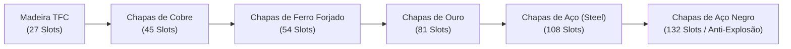
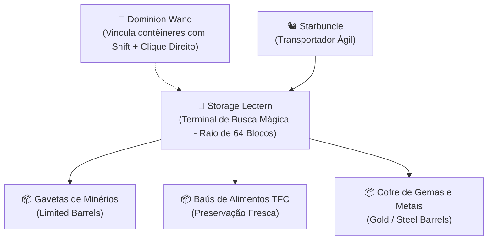

import { Tabs, TabItem } from '@astrojs/starlight/components';

# 📦 Armazenamento, Gestão de Loot & Logística Arcana

No **TerraFirmaCraft**, o inventário e o armazenamento obedecem a regras estritas de peso, volume e física material. Para evitar o acúmulo desordenado de rochas, toras e minérios, o modpack integra a infraestrutura de armazéns massivos do **Sophisticated Storage** à magia logística inteligente do **Ars Nouveau**, totalmente conectadas às ligas forjadas do TFC.

---

## 🪵 1. Armazenamento Primitivo (Idade da Pedra)

Antes de forjar as primeiras serras e tábuas de madeira:

1. **Empilhamento Físico no Chão:**
   - **Lingotes e Chapas:** Segure o metal na mão, agache (`Shift`) e clique com o **Botão Direito** no chão para criar pilhas de até **64 lingotes** no mesmo bloco.
   - **Lenha e Toras:** Crie pilhas organizadas de toras (`tfc:firepit_logs`) com até **16 toras** por cova para alimentar fogueiras e forjas.
2. **Vasos de Cerâmica Vitrificada (*Ceramic Vessels*):**
   - Cada vaso armazena **4 slots** de pequenos itens, sementes ou minérios.
   - Podem ser guardados na mochila ou apoiados no chão em grupos de até 4 vasos por bloco (`Shift + Botão Direito`).

---

## 🏛️ 2. Sophisticated Storage Integrado às Madeiras e Metais TFC

Elimina completamente o lag gerado por excesso de entidades soltas e baús comuns através de contêineres inteligentes e **gavetas compactas (*Limited Barrels*)**:

| Contêiner | ID do Item | Insumos Requeridos | Capacidade | Utilidade Principal |
| :--- | :--- | :--- | :---: | :--- |
| **Barril Básico** | `sophisticatedstorage:barrel` | `1x #tfc:barrels` + `2x #tfc:lumber` | **27 slots** + 1 upgrade | Armazenamento de bancada e oficina |
| **Baú Básico** | `sophisticatedstorage:chest` | `1x #tfc:chests` + `2x #tfc:lumber` | **27 slots** + 1 upgrade | Baú padrão de expedicionário |
| **Gaveta Simples (1 Slot)** | `sophisticatedstorage:limited_barrel_1` | 1x Barril Sophisticated + `1x #tfc:lumber` | **32x Stacks** (1 único item) | Rochedos, carvão vegetal e gravetos |
| **Gaveta Dupla (2 Slots)** | `sophisticatedstorage:limited_barrel_2` | 1x Barril Sophisticated + `2x #tfc:lumber` | **16x Stacks** por slot (2 itens) | Cobre e minérios associados |
| **Gaveta Quádrupla (4 Slots)** | `sophisticatedstorage:limited_barrel_4` | 1x Barril Sophisticated + `4x #tfc:lumber` | **8x Stacks** por slot (4 itens) | Grãos, farinhas e sementes |

---

## ⚒️ 3. Progressão de Tiers Metálicos TFC

Para expandir o número de slots e desbloquear slots extras de upgrades funcionais (filtros, compactadores e empilhamento massivo):

| Tier Metálico | ID Base | Chapa Exigida | Slots | Upgrades | Características |
| :--- | :--- | :--- | :---: | :---: | :--- |
| **Cobre** | `sophisticatedstorage:copper_barrel` | 4x Chapa de Cobre TFC | **45** | 1 slot | Imune a goteiras e umidade |
| **Ferro Forjado** | `sophisticatedstorage:iron_barrel` | 4x Chapa de Ferro Forjado TFC | **54** | 2 slots | Resistência mecânica superior |
| **Ouro** | `sophisticatedstorage:gold_barrel` | 4x Chapa de Ouro TFC | **81** | 3 slots | Ideal para gemas e reagentes arcanos |
| **Aço (Steel)** | `sophisticatedstorage:diamond_barrel` | 4x Chapa de Aço TFC | **108** | 4 slots | Alta densidade de estocagem |
| **Aço Negro (Black Steel)** | `sophisticatedstorage:netherite_barrel` | 4x Chapa de Aço Negro TFC | **132** | 5 slots | **Totalmente à prova de explosões** |

---

## 📈 4. Upgrades de Empilhamento Massivo (Stack Upgrades)

Multiplicam exponencialmente a capacidade por slot dos contêineres e gavetas sem causar sobrecarga de desempenho no servidor:

| Upgrade | ID do Item | Multiplicador | Capacidade por Slot | Material TFC |
| :--- | :--- | :---: | :---: | :--- |
| **Base de Upgrade** | `sophisticatedstorage:upgrade_base` | — | Base neutra | 4x Tábuas TFC + 4x Palha + Fio de Linho |
| **Stack Tier 1** | `sophisticatedstorage:stack_upgrade_tier_1` | **2x** | **128 itens** / slot | Base + 4x Chapas de Cobre TFC |
| **Stack Tier 2** | `sophisticatedstorage:stack_upgrade_tier_2` | **4x** | **256 itens** / slot | Tier 1 + 4x Chapas de Ferro Forjado |
| **Stack Tier 3** | `sophisticatedstorage:stack_upgrade_tier_3` | **8x** | **512 itens** / slot | Tier 2 + 4x Chapas de Ouro TFC |
| **Stack Tier 4** | `sophisticatedstorage:stack_upgrade_tier_4` | **16x** | **1.024 itens** / slot | Tier 3 + 4x Chapas de Aço TFC |

---

## 🎒 5. Despejo Instantâneo de Dungeons (Deposit Upgrade)

> [!TIP]
> **Descarregamento com 1 Clique:**  
> Ao retornar de masmorras ou expedições com sua mochila cheia, instale o **Deposit Upgrade** no slot de melhoria da sua mochila (*Sophisticated Backpacks*):
> - Segure `Shift` e clique com o **botão direito da mochila diretamente sobre qualquer baú, barril ou lectern da sua base**.
> - Todo o loot compatível é descarregado instantaneamente para os estoques corretos em menos de 1 segundo!

---

## 🔮 6. Armazém Místico Centralizado (Ars Nouveau)

O sistema de armazenamento mágico do Ars Nouveau atua como uma rede inteligente medieval sem necessidade de cabos ou energia RF:

| Aparelho / Entidade | ID do Item | Receita Acessível (Early Game) | Função no Armazém |
| :--- | :--- | :--- | :--- |
| **Storage Lectern** | `ars_nouveau:storage_lectern` | `1x Atril TFC` + `1x Gema da Fonte` + `2x Baús TFC` | Painel unificado com busca de texto que indexa todos os baús num raio de **64 blocos** |
| **Crafting Lectern** | `ars_nouveau:crafting_lectern` | `1x Storage Lectern` + `1x Bancada de Trabalho` | Permite fabricar itens puxando materiais diretamente dos baús conectados |
| **Dominion Wand** | `ars_nouveau:dominion_wand` | `1x Graveto` + `1x Gema da Fonte` + `1x Pepita` | Varinha mágica usada para vincular baús e gavetas ao Lectern |
| **Bookwyrm Charm** | `ars_nouveau:bookwyrm_charm` | `1x Livro` + `1x Gema da Fonte` + `2x Papel` + `2x Penas` | Dragão bibliotecário que organiza estoques e busca itens fisicamente |
| **Starbuncle Charm** | `ars_nouveau:starbuncle_charm` | `1x Pepita Ouro` + `1x Vegetal TFC` + `1x Gema` + `1x Fio` | Pequeno transportador veloz que move itens automaticamente entre forjas e baús |

---

## ♻️ 7. Reciclagem e Purga de Loot de Dungeons

Para manter os depósitos desobstruídos de armas e itens repetidos trazidos de masmorras:

1. **Desmanche de Ferramentas e Armaduras na Bancada:**
   - Armas, ferramentas e armaduras de ferro de masmorra + **Martelo do TFC** (`#tfc:hammers`) $\rightarrow$ Gera **2 a 4x Pepitas de Ferro Forjado** (`tfc:metal/nugget/wrought_iron`).
   - Equipamentos dourados + Martelo do TFC $\rightarrow$ Gera **2 a 4x Pepitas de Ouro** (`tfc:metal/nugget/gold`).
2. **Desmanche de Pergaminhos Místicos Duplicados:**
   - Pergaminhos de feitiço do *Iron's Spells* + Faca TFC ou Jarra d'Água $\rightarrow$ Reverte o pergaminho em **Papel puro (`minecraft:paper`)** para confeccionar novos grimórios.

---

## 🪨 8. Física de Desabamentos Sísmicos (*Cave-ins*) & Vigas de Suporte

Ao escavar montanhas e cavernas, a rocha sólida do TFC é regida por tensão geológica real:

* **Gatilhos de Desabamento:** Minerar blocos de rocha sem suporte, detonações de creepers ou o rugido do Warden provocam ondas de choque sísmicas.
* **Vigas de Suporte de Madeira (*Support Beams*):**
  - Confeccionadas serrando toras de madeira com uma serra TFC.
  - Devem ser erguidas em pares verticais com uma viga horizontal conectando o topo.
  - Sustentam com segurança o teto rochoso em um raio horizontal de **até 4 a 5 blocos** (e até 13 blocos estruturais em configurações com alvenaria de argamassa).
* **Aviso Auditivo de Colapso:** Se você escutar estalos secos ou poeira caindo do teto, **corra imediatamente para trás da linha de vigas**! O desmoronamento em cascata esmaga e soterra jogadores sem armadura reforçada.
