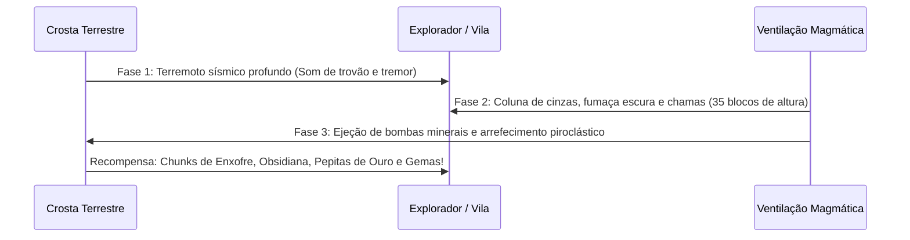

import { Tabs, TabItem } from '@astrojs/starlight/components';

# 🌋 Imersão Acústica, Clima Térmico & Dinâmica Vulcânica

A sobrevivência em **TFC: Arcanum & Empires** foi enriquecida com uma camada profunda de **imersão sensorial**, pensada para fazer o mundo parecer vivo e cinematográfico sem cair no erro de mecânicas hardcore punitivas ou frustrantes.

---

## 🎧 1. Revolução Acústica 3D (Áudio Imersivo)

O modpack implementa um quarteto de sistemas de áudio espacial que transformam a percepção do mundo:

| Mod | Função & Experiência no Jogo | Lado |
| :--- | :--- | :--- |
| **Sound Physics Remastered** | Simula atenuação, reflexão, oclusão e reverberação de som baseando-se na geometria dos blocos ao redor. Cavernas profundas ressoam com eco realista; portas fechadas abafam ruídos de monstros. | Ambos / Client |
| **AmbientSounds 6** | Adiciona paisagens sonoras vivas específicas de biomas e altitudes: farfalhar de folhas, pássaros cantando pela manhã, grilos ao crepúsculo e vento uivante nas cordilheiras. Requer **CreativeCore**. | Ambos / Client |
| **Drip Sounds** | Transforma o gotejamento de água e estalactites em cavernas úmidas em um efeito sonoro tridimensional dinâmico. | Client-Side |
| **Presence Footsteps** | Substitui os passos genéricos do Minecraft por ressonância biomecânica precisa para cada superfície (madeira, terra solta, cascalho, pedregulho, neve, ferro). | Client-Side |

> [!NOTE]
> Todos os arquivos `.jar` dessas modificações ficam no diretório `/mods/` do servidor dedicado para distribuição automatizada via **AutoModpack**, garantindo que todos os jogadores recebam a experiência sonora idêntica sem esforço manual.

---

## 🧥 2. Vestimentas de Conforto Térmico (Sob a Armadura)

Para se proteger do rigor climático das regiões mais extremas do planeta TFC, você pode usar **vestimentas de conforto térmico** equipadas nos slots do **Curios API** (`curios:body` e `curios:head`). 

Elas são vestidas **por baixo de qualquer elmo ou peitoral metálico**, garantindo proteção climática e leves bônus passivos sem ocupar os espaços da sua armadura pesada!

### Catálogo de Vestimentas & Benefícios

| Vestimenta | Slot Curios | Matéria-Prima TFC | Benefício Térmico | Bônus Adicional |
| :--- | :--- | :--- | :--- | :--- |
| **Gibão Acolchoado**<br>`(Gambeson)` | `curios:body` (Corpo) | Tecido de Lã (`tfc:wool_cloth`) + Burlap / Fios | Isola o tronco contra ventos gélidos e nevascas. | **+1 de Armadura** e sensação de aconchego (+Resistência I). |
| **Túnica Leve do Deserto** | `curios:body` (Corpo) | Burlap (`tfc:burlap_cloth`) ou Seda (`tfc:silk_cloth`) + Fios | Tecido respirável que dissipa calor e previne exaustão solar. | **+5% de Velocidade** de caminhada sob o calor. |
| **Coifa Acolchoada de Lã**<br>`(Padded Coif)` | `curios:head` (Cabeça) | Tecido de Lã (`tfc:wool_cloth`) + Fios | Protege o crânio e a nuca em picos nevados e montanhas altas. | Elimina torpor nos dedos e na cabeça no frio. |
| **Chapéu de Palha TFC** | `curios:head` (Cabeça) | Palha TFC (`tfc:straw`) + Fios | Aba circular larga que projeta sombra refrescante sobre o rosto. | Reduz a velocidade de drenagem de água ao sol do meio-dia. |

---

### Receitas de Confecção (Bancada de Trabalho)

<Tabs>
  <TabItem label="Gibão Acolchoado (Gambeson)">
    ```text
    Padrão na Bancada (3x3):
    [Tecido de Lã]  [             ]  [Tecido de Lã]
    [Tecido de Lã]  [Burlap / Fio ]  [Tecido de Lã]
    [Tecido de Lã]  [Burlap / Fio ]  [Tecido de Lã]
    ```
    *Também pode ser confeccionado substituindo o Burlap central por Linhas de Costura.*
  </TabItem>
  <TabItem label="Túnica Leve do Deserto">
    ```text
    Padrão na Bancada (3x3):
    [Burlap / Seda]  [            ]  [Burlap / Seda]
    [Burlap / Seda]  [Linha / Fio ]  [Burlap / Seda]
    [Burlap / Seda]  [            ]  [Burlap / Seda]
    ```
    *Excelente para cruzar desertos, dunas e chapadas áridas.*
  </TabItem>
  <TabItem label="Coifa Acolchoada de Lã">
    ```text
    Padrão na Bancada (3x3):
    [Tecido de Lã]  [Tecido de Lã]  [Tecido de Lã]
    [Tecido de Lã]  [            ]  [Tecido de Lã]
    [            ]  [Linha / Fio ]  [            ]
    ```
  </TabItem>
  <TabItem label="Chapéu de Palha TFC">
    ```text
    Padrão na Bancada (3x3):
    [          ]  [Palha TFC]  [          ]
    [Palha TFC ]  [Palha TFC]  [Palha TFC ]
    [Linha/Fio ]  [         ]  [Linha/Fio ]
    ```
    *Pode ser feito no início do jogo colhendo grama alta com uma faca primitiva.*
  </TabItem>
</Tabs>

---

## ❄️ 3. Mecânica Suave de Clima (Não-Punitiva)

O sistema climático foi balanceado para servir como um **aviso sensorial imersivo**, sem mecânicas punitivas como morte instantânea ou hipotermia fatal:

### Frio Intenso (Geadas & Cordilheiras Nevadas)
- **Quando ocorre:** Em biomas como `frozen`, `ice`, `snow`, `peaks`, `glacier`, `alpine` ou em florestas boreais acima da camada `Y=100`.
- **Como anular o frio:**
  1. Ficar a até 4 blocos de uma fonte de calor (Fogueira TFC, Tocha acesa, Forja, Forno de Fosso, Balde de Lava).
  2. Permanecer abrigado dentro de casa.
  3. Equipar o **Gibão Acolchoado** ou a **Coifa Acolchoada** no Curios.
- **Efeito se desprotegido:** Um aviso suave surge na barra de ação (*"❄ O vento gélido entorpece seus dedos..."*) acompanhado de lentidão leve de movimento (*Slowness I*) por 4 segundos.

### Calor Solar Escaldante (Deserto & Sol do Meio-Dia)
- **Quando ocorre:** Em desertos, savanas, ermos (`badlands`) e cumes vulcânicos entre os horários de pico solar (3000 a 9500 ticks do dia), a céu aberto.
- **Como anular o calor:**
  1. Ficar sob a sombra de árvores, tetos ou cavernas.
  2. Mergulhar em água doce.
  3. Equipar o **Chapéu de Palha** ou a **Túnica Leve do Deserto** no Curios.
- **Efeito se desprotegido:** Um aviso suave surge na barra de ação (*"☀ O sol escaldante castiga sua pele..."*) acompanhado de ligeiro aumento na sede/fome (*Hunger I*) por 4 segundos.

---

## 🌋 4. Erupções Vulcânicas Cinematográficas

Em regiões vulcânicas do planeta (onde predominam rochas extrusivas como **Basalto**, **Dacito**, **Riolito** ou **Andesita**, e em cumes acima da altitude `Y=80`), a pressão subterrânea de magma pode entrar em erupção:



### Características Principais
1. **Segurança Anti-Griefing:** A erupção **não destrói blocos**, não quebra estruturas feitas pelos jogadores e não afeta construções das Vilas Millénaire. Trata-se de um evento ambiental cinematográfico e enriquecedor.
2. **Recompensas Telúricas:** Quando a coluna de fumaça arrefece, o vulcão cospe fragmentos preciosos nas encostas:
   - **Enxofre** (`tfc:powder/sulfur`) — essencial para pólvora, alquimia e fertilizantes.
   - **Obsidiana Pura** (`minecraft:obsidian`).
   - **Pepitas de Ouro Nativo** (`minecraft:gold_nugget`).
   - **Rochas Soltas TFC** (Basalto, Dacito, Riolito) — excelentes para o minigame de knapping.
   - **Gemas Raras** (Diamantes brutos, Rubis e Safiras lapidados pela colossal pressão magmática).

### Comandos de Sismologia
- `/vulcao_status` — Permite que qualquer jogador consulte o sismógrafo local para verificar a estabilidade da crosta no bioma atual.
- `/vulcao_erupcao` — Comando administrativo para disparar a erupção cinematográfica na posição atual (útil para testes ou rituais de clã).
