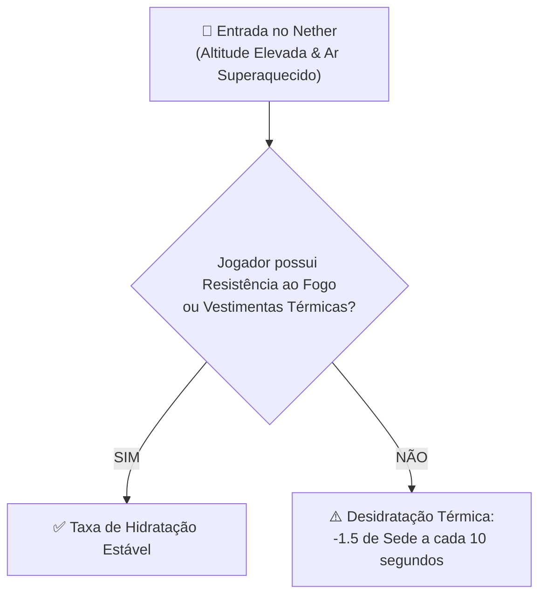
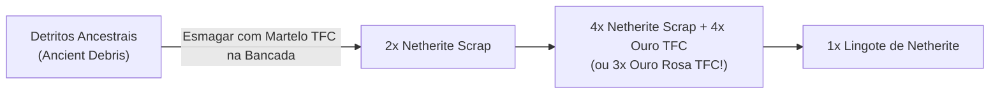

import { Tabs, TabItem } from '@astrojs/starlight/components';

# 🔥 O Nether, The End & Metalurgia Dimensional

Em **TFC: Arcanum & Empires**, as dimensões do **Nether (*The Beneath*)** e do **The End** foram completamente reestruturadas para se integrarem com a geologia e as ligas metálicas do *TerraFirmaCraft*, respeitando a progressão canônica dos **Seis Atos**.

---

## 🌋 1. O Nether Ampliado (*Amplified Nether*) & Sobrevivência Térmica

O Nether utiliza a geração vertical colossal do **Amplified Nether**, com desfiladeiros de lava de mais de 256 blocos de altura, florestas distorcidas imponentes e cavernas colossais de *Cursecoal*.

### Regras de Sobrevivência no Ar Infernal:
1. **Calor Infernal e Sede Contínua:**  
   O ar do Nether drena **1.5 pontos de Sede a cada 10 segundos** caso o jogador não esteja sob efeito de **Resistência ao Fogo (*Fire Resistance*)** ou vestindo vestimentas térmicas respiráveis (*Túnica do Deserto* no Curios).
2. **Combustível Vulcânico (*Cursecoal*):**  
   Minério vegetal fóssil nativo do Nether (`beneath:cursecoal`) que queima com calor extremo e azulado. É o combustível primordial para forjar peças de Aço Negro e moldes arcanos.

---

## 🐷 2. Piglin Barter & Pacificação com Ouro TFC

No Minecraft convencional, os Piglins só reconheciam o ouro Vanilla. O modpack unificou todas as ligas e armaduras de ouro do TFC ao ecossistema dos Piglins:

### A. Pacificação dos Piglins (Uso de Armaduras de Ouro)
Você pode andar com segurança entre os Piglins vestindo qualquer peça de ouro forjada no TFC:
* **Armaduras de Ouro TFC:** Elmo, Peitoral, Grevas, Botas ou Escudo de Ouro (`tfc:metal/*_gold`).
* **Armaduras de Ouro Rosa TFC (*Rose Gold*):** Também pacificam os Piglins, oferecendo proteção mecânica superior!

### B. Moedas Comerciais para Barter (Trocas)
Piglins realizam trocas comerciais imediatas quando você joga qualquer um dos seguintes insumos aos seus pés:
* **Lingote de Ouro TFC** (`tfc:metal/ingot/gold`).
* **Lingote de Ouro Rosa TFC** (`tfc:metal/ingot/rose_gold`).
* **Cursecoal do Nether** (`beneath:cursecoal`) — os Piglins são fascinados pelo calor abrasador desse carvão ancestral!

---

## 🖤 3. Metalurgia do Netherite Integrada ao TFC

A obtenção de Netherite foi integrada à metalurgia pesada da Idade do Aço Negro:

### A. Esmagamento de Detritos Ancestrais com Martelo TFC
Não é necessário fundição convencional de fornalha:
* Coloque **1x Detrito Ancestral (`minecraft:ancient_debris`)** na bancada de trabalho junto com qualquer **Martelo do TFC** (`#c:tools/hammer`).
* O martelo absorve o impacto e fragmenta a rocha, rendendo **2x Sucata de Netherite (*Netherite Scrap*)** imediatamente!

### B. Liga de Netherite com Ouro e Ouro Rosa TFC
* **Receita Padrão:** 4x Sucata de Netherite + **4x Lingotes de Ouro TFC** $\rightarrow$ **1x Lingote de Netherite**.
* **Rota Nobre (Ouro Rosa TFC):** Como o Ouro Rosa é uma liga nobre de ouro e cobre, exige menos ouro puro:  
  **4x Sucata de Netherite + 3x Lingotes de Ouro Rosa TFC** $\rightarrow$ **1x Lingote de Netherite**!

### C. Forjando o Molde de Ferraria (*Netherite Upgrade Template*)
Para não depender da sorte de encontrar baús de bastião saqueados em servidores multiplayer, você pode forjar o molde de aprimoramento na bancada:

| Ingrediente | Quantidade | Posição na Grade 3×3 |
| :--- | :---: | :--- |
| **Chapa de Aço Negro TFC** | 2 | Topo Esquerda e Topo Direita |
| **Cursecoal do Nether** | 1 | Topo Centro |
| **Diamante Lapidado** | 2 | Centro Esquerda e Centro Direita |
| **Netherrack** | 4 | Centro Meio e Linha Inferior Completa |

* **Resultado:** `1x Molde de Ferraria de Netherite` (`minecraft:netherite_upgrade_smithing_template`).

---

## 🌌 4. The End: Fruta do Coro Sagrada & Shulker Boxes

No **Ato VI (Endgame Supremo)**, o acesso à dimensão do Vazio introduz relíquias biológicas e logísticas cruciais:

### A. A Bênção Purificadora da Fruta do Coro (*Chorus Fruit*)
No modpack, a **Fruta do Coro** (`minecraft:chorus_fruit` ou assada) é um fruto sagrado que atua como remédio cósmico para os guerreiros:

1. **Purificação do Vazio & do Warden:** Remove instantaneamente os efeitos de **Escuridão (*Darkness*)** e **Cegueira (*Blindness*)** causados por criaturas do Sculk e chefes titânicos!
2. **Hidratação Instantânea TFC:** Fornece **+12 pontos de Sede** ao jogador na hora da ingestão.
3. **Recarga Arcana:** Canaliza o éter dimensional restaurando **+50 pontos de Mana** no *Ars Nouveau*.

### B. Shulker Boxes Forjadas com Aço Colorido TFC
Como no TerraFirmaCraft o inventário físico é sagrado, as caixas de Shulker exigem ligas de aço cromado de alta resistência:

* **Shulker Box de Aço Azul:**  
  $$\text{2x Casca de Shulker} + \text{2x Chapas de Aço Azul TFC} + \text{1x Baú TFC} \longrightarrow \mathbf{1x\text{ Shulker Box}}$$
* **Shulker Box de Aço Vermelho:**  
  $$\text{2x Casca de Shulker} + \text{2x Chapas de Aço Vermelho TFC} + \text{1x Baú TFC} \longrightarrow \mathbf{1x\text{ Shulker Box}}$$
